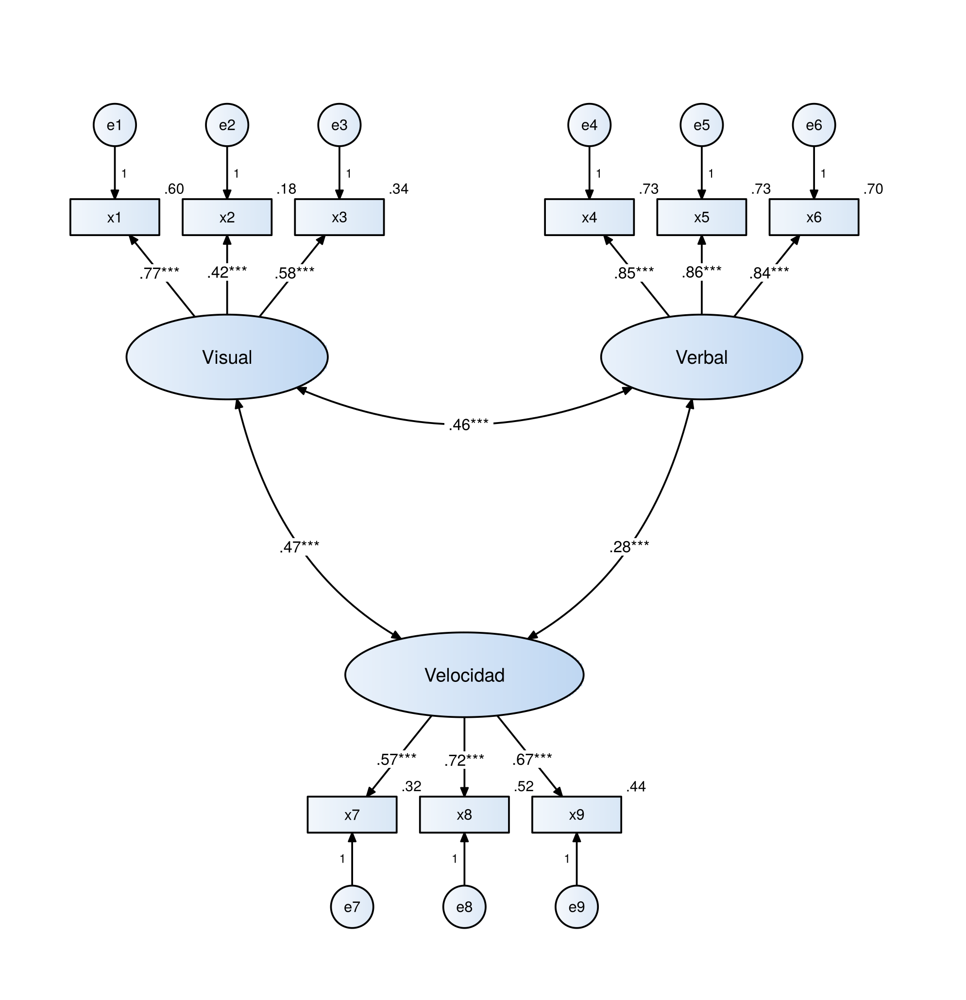
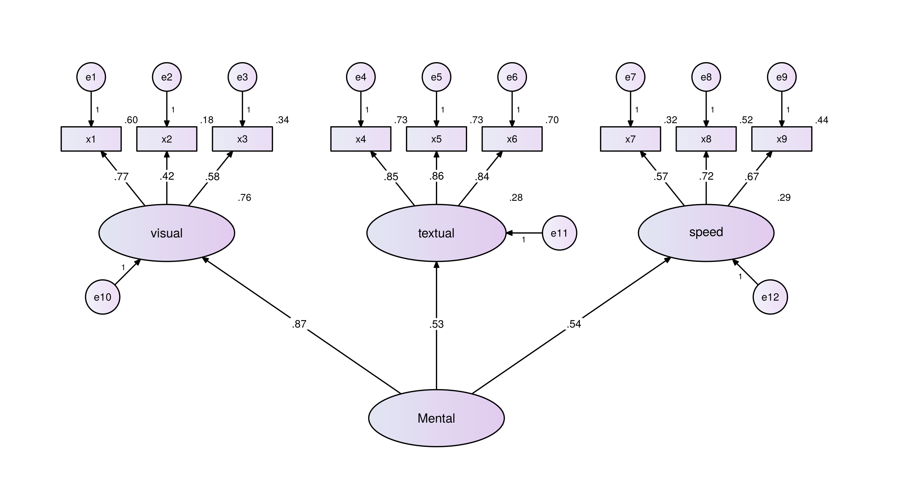
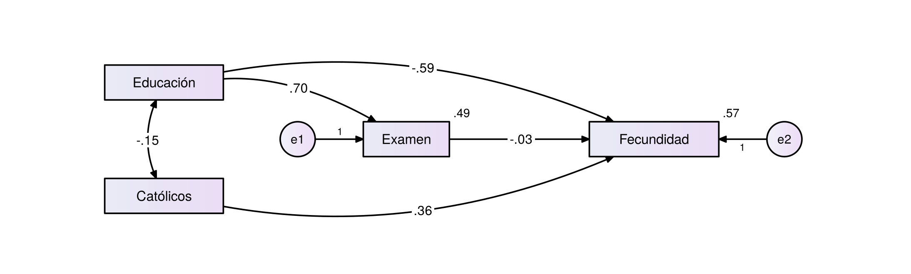
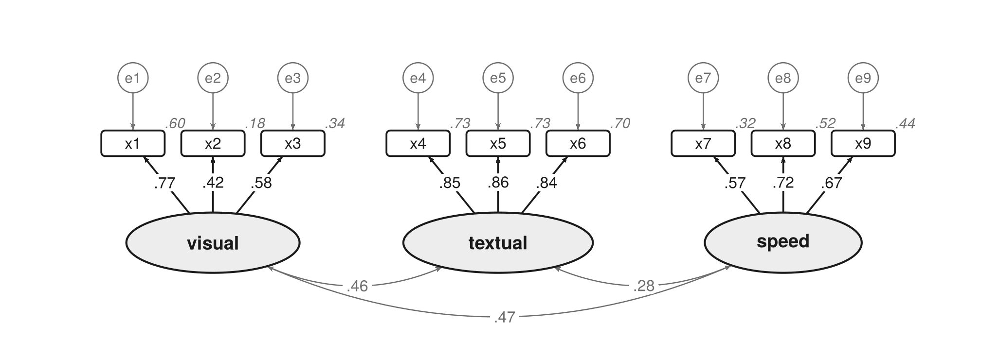
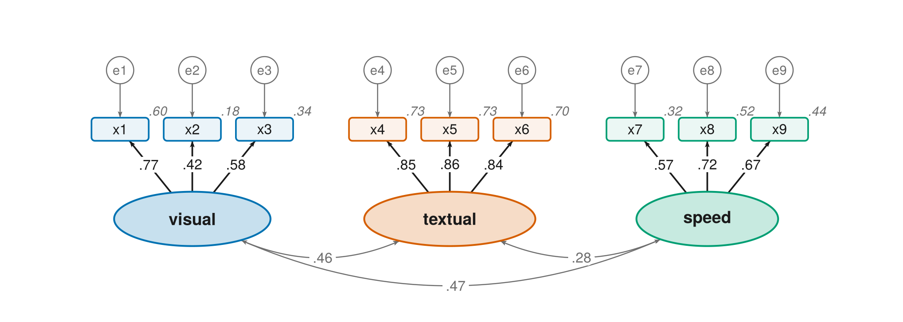
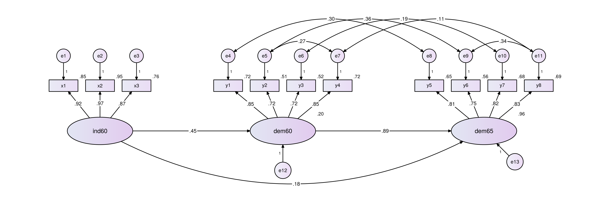

# diagramaSEM

[](LICENSE)

**Diagramas y tablas APA para tus análisis factoriales, de trayectorias, SEM, moderación y MANOVA, con una sola línea de código.**

- **Diagramas** con el estilo clásico de los programas de SEM: rectángulos para los
  ítems, óvalos para los factores, círculos de error (`e1`, `e2`, …), cargas sobre las
  flechas y R² junto a cada variable. El paquete reconoce el tipo de modelo y acomoda
  todo solo.
- **Tres estilos**: el clásico de AMOS y dos listos para publicar (`"revista"` en
  grises y `"color"`), que cumplen lo que piden APA y las principales revistas.
- **Tablas en formato APA**, listas para Word: descriptivos y supuestos,
  factorabilidad, cargas, confiabilidad, validez y HTMT, índices bifactor, ajuste,
  comparación de modelos, invarianza de medición, efectos indirectos, hipótesis,
  moderación y mediación moderada, MANOVA y hasta el párrafo de método con sus
  referencias.
- **En español o en inglés**, para tareas, tesis y artículos.

Funciona con análisis **exploratorios** (`psych::fa()`, `lavaan::efa()`),
**confirmatorios** (`cfa()`), de **trayectorias** y **SEM** (`sem()`); las tablas de
moderación y MANOVA trabajan directamente con tus datos.

<p align="center"> </p>

---

## Paso 0. Si nunca has usado R

1. **Instala R** desde [cran.r-project.org](https://cran.r-project.org): elige tu
   sistema (Windows, Mac o Linux) y descarga la versión más reciente.
2. **Instala RStudio Desktop** (gratis) desde
   [posit.co/download/rstudio-desktop](https://posit.co/download/rstudio-desktop/).
   RStudio es el programa en el que vas a trabajar; R funciona por debajo.
3. **Abre RStudio.** Verás la *consola* (abajo a la izquierda), donde se escriben las
   instrucciones, y el panel de gráficos y archivos (abajo a la derecha).
4. **Abre un script**: menú *File → New File → R Script*. Es un archivo de texto donde
   guardas tus instrucciones para repetirlas después. Para ejecutar una línea, pon el
   cursor en ella y presiona **Ctrl + Enter** (en Mac, **Cmd + Enter**).
5. **Elige tu carpeta de trabajo**: menú *Session → Set Working Directory → Choose
   Directory…* y selecciona la carpeta donde están tus datos. Ahí se guardarán los
   diagramas y las tablas.

Tres reglas que evitan la mayoría de los errores: R distingue mayúsculas de minúsculas
(`Item1` no es `item1`), los textos van entre comillas (`"mis_datos.xlsx"`) y cada
paréntesis que abres se tiene que cerrar.

## Paso 1. Instalar (solo la primera vez)

Abre R o RStudio, copia estas líneas, pégalas en la consola y presiona Enter:

```r
install.packages("remotes")
remotes::install_github("jeshuamv/diagramaSEM")
```

- Necesitas conexión a internet.
- Si R pregunta si quieres actualizar otros paquetes, **presiona Enter** sin escribir
  nada para continuar.
- Si no aparecen errores en rojo, quedó instalado.

**¿Vas a hacer análisis exploratorios con `psych`?** Instala también:

```r
install.packages(c("psych", "GPArotation"))
```

## Paso 2. Leer y revisar tus datos

R no solo lee archivos `.csv`. Con `leer_datos()` puedes abrir **Excel** (`.xlsx`,
`.xls`), **SPSS** (`.sav`), **CSV** (con coma o con punto y coma), **Stata** (`.dta`),
**SAS** y texto (`.txt`). Sin nada entre los paréntesis se abre una ventana para elegir
el archivo:

```r
library(lavaan)
library(diagramaSEM)

datos <- leer_datos()                          # se abre una ventana
datos <- leer_datos("mis_datos.xlsx")          # o con el nombre del archivo
datos <- leer_datos("encuesta.sav", perdidos = c(99, 999))   # códigos de dato perdido
```

`leer_datos()` detecta solo el formato, quita las etiquetas de SPSS y, si un nombre de
columna tiene espacios o acentos (`Ítem 1`), lo cambia a uno que funciona en R
(`Item_1`) y te avisa. También puedes usar el menú *File → Import Dataset* de RStudio.

Antes de estimar, revisa los datos y el modelo:

```r
revisar_datos(datos, modelo)
```

```
✖ Estas variables del modelo no están en los datos: 'item_2' (¿quisiste decir 'Item_2'?).
✔ No hay datos perdidos.
⚠ Las variables parecen ordinales (escala tipo Likert de hasta 5 puntos). Con 5 o más
    categorías suele aceptarse tratarlas como continuas con estimator = "MLR".
✔ Tamaño de la muestra: N = 312. Adecuada para la mayoría de los modelos.
```

Revisa errores de escritura en el modelo, columnas con texto, valores constantes,
códigos como 99 que parecen datos perdidos, el porcentaje de perdidos, si los ítems son
tipo Likert (y qué estimador conviene) y el tamaño de la muestra.

## La forma más fácil: una plantilla

`plantilla()` crea un script con **todo el análisis**, paso por paso y explicado:
leer los datos, revisarlos, estimar, revisar supuestos, dibujar el diagrama, hacer las
tablas y guardarlas en Word. Solo cambias lo marcado con `>>> CAMBIA AQUÍ <<<`.

```r
plantilla("afc")            # análisis factorial confirmatorio
plantilla("afe")            # exploratorio
plantilla("trayectorias")   # path
plantilla("sem")            # medición + estructural
plantilla("moderacion")     # moderación y mediación moderada
plantilla("manova")
```

El script se guarda en tu carpeta de trabajo (`analisis_afc.R`, …) y se abre en RStudio.
Cada plantilla trae datos de ejemplo para probarla antes de usar los tuyos.

## Paso 3. Dibujar tu modelo

Cada vez que abras R, carga los paquetes, estima tu modelo como siempre y pásaselo a
`diagrama_sem()`. Elige la plantilla que corresponde a tu análisis y cambia los nombres
por los tuyos (deben ser iguales a los nombres de las columnas de tus datos).

```r
library(lavaan)
library(diagramaSEM)

datos <- leer_datos("mis_datos.xlsx")   # tus datos
```

### Análisis factorial confirmatorio (AFC)

```r
modelo <- "
  Factor1 =~ item1 + item2 + item3       # =~  se mide con
  Factor2 =~ item4 + item5 + item6
"
fit <- cfa(modelo, data = datos)
diagrama_sem(fit)
```

### Análisis de trayectorias (path)

```r
modelo <- "
  M ~ X                                  # ~   X influye en M
  Y ~ M + X                              #     M y X influyen en Y
"
fit <- sem(modelo, data = datos)
diagrama_sem(fit)
```

<p align="center"></p>

### Modelo de ecuaciones estructurales (SEM)

Combina las dos cosas: factores medidos con sus ítems (`=~`) y efectos entre ellos (`~`).

```r
modelo <- "
  Factor1 =~ item1 + item2 + item3
  Factor2 =~ item4 + item5 + item6
  Factor2 ~ Factor1                      # Factor1 influye en Factor2
"
fit <- sem(modelo, data = datos)
diagrama_sem(fit)
```

### Análisis factorial exploratorio (AFE)

```r
library(psych)
afe <- fa(datos, nfactors = 3, rotate = "oblimin")   # solo las columnas de los ítems
diagrama_sem(afe)
```

En el exploratorio cada ítem carga en todos los factores; el diagrama muestra solo las
cargas de .30 o más (puedes cambiarlo con `umbral = 0.40`).

### ¿Quieres probar antes con datos de ejemplo?

Este código funciona tal cual, porque los datos vienen incluidos en `lavaan`:

```r
library(lavaan)
library(diagramaSEM)

modelo <- "
  visual  =~ x1 + x2 + x3
  textual =~ x4 + x5 + x6
  speed   =~ x7 + x8 + x9
"
fit <- cfa(modelo, data = HolzingerSwineford1939)
diagrama_sem(fit)
```

## Paso 4. Guardar el diagrama

```r
diagrama_sem(fit, archivo = "mi_diagrama.png")   # imagen para Word o PowerPoint
diagrama_sem(fit, archivo = "mi_diagrama.pdf")   # PDF de alta calidad
```

El archivo se guarda en tu carpeta de trabajo. Para saber cuál es, escribe `getwd()`.
Si ya dibujaste el diagrama, también puedes guardarlo después:

```r
d <- diagrama_sem(fit)
guardar_diagrama(d, "mi_diagrama.pdf")
```

---

## Estilos: clásico, revista y color

```r
diagrama_sem(fit)                       # clásico (el de AMOS)
diagrama_sem(fit, estilo = "revista")   # en grises, para artículos
diagrama_sem(fit, estilo = "color")     # un color por factor
```

<p align="center"></p>
<p align="center"></p>

Los estilos `"revista"` y `"color"` usan letra más grande y sin serifa, relleno plano,
errores y correlaciones en gris, y cada valor sobre un fondo blanco para que ninguna
línea lo cruce. No escriben los "1" de las flechas de error (eso se aclara en la nota
de la figura). Los colores se distinguen aun con daltonismo y se leen bien si la revista
imprime en blanco y negro.

## Para publicar en una revista

Las revistas piden que el texto mida **al menos 8 pt ya impreso** y que la figura se
entregue al ancho con que se publicará. Usa:

```r
diagrama_sem(fit, estilo = "revista", archivo = "figura1.pdf", ancho = "pagina")
```

- `ancho = "pagina"` (174 mm) sirve para casi cualquier modelo; `ancho = "columna"`
  (85 mm) solo para modelos muy pequeños.
- El paquete te dice el tamaño real del texto y **te avisa si queda por debajo de 8 pt**.
- Formato: `.pdf` (el mejor en general), `.eps` si la revista lo pide, o `.tiff`
  (se guarda a 600 ppp) si la revista pide imagen.
- En formato APA el número y el título de la figura van **fuera de la imagen**
  (escríbelos en Word), no con `titulo =`.

Revisa siempre las instrucciones para autores de tu revista. Más detalles en la sección
*Figuras para una revista* de la [guía](guia/GUIA.md).

---

## Tablas para tu reporte

El paquete crea, en formato APA y listas para Word, las tablas que suelen pedirse en
un artículo o una tesis:

| Etapa | Código | Qué reporta |
|---|---|---|
| Datos | `tabla_descriptivos(datos)` | n, M, DE, asimetría, curtosis y correlaciones (la "Tabla 1") |
| | `tabla_perdidos(datos)` | Datos perdidos por variable |
| | `tabla_normalidad(datos)` | Normalidad: asimetría y curtosis con c.r. (como AMOS) y Mardia |
| | `tabla_atipicos(datos)` | Atípicos multivariados (Mahalanobis, p1 y p2) |
| AFE | `tabla_factorabilidad(datos)` | KMO, Bartlett y cuántos factores retener (Kaiser, análisis paralelo, MAP) |
| | `tabla_cargas(afe)` | Cargas, comunalidades, varianza explicada |
| Medición | `tabla_cargas(fit)` | Cargas estandarizadas, EE, *p* y R² |
| | `tabla_confiabilidad(fit)` | Alfa de Cronbach (con IC), omega de McDonald, correlaciones ítem-total |
| | `tabla_validez(fit)` | CR, AVE y Fornell-Larcker |
| | `tabla_bifactor(fit)` | Modelos bifactor o de segundo orden: ωH, ωHS, ECV, PUC, H y FD |
| | `tabla_htmt(fit)` | Validez discriminante HTMT (la que hoy piden los revisores) |
| | `tabla_metodo_comun(fit)` | Sesgo de método común (Harman y AFC de un factor) |
| Ajuste | `tabla_ajuste(fit)` | χ², CFI, TLI, RMSEA, SRMR |
| | `tabla_criterios_ajuste(fit)` | Cada índice (χ², χ²/gl, RMSEA, SRMR, CFI, TLI, GFI, PNFI, PRATIO) contra criterios excelente/aceptable, e identificación del modelo (p, q, gl) |
| | `tabla_modificacion(fit)` | Índices de modificación |
| | `tabla_residuales(fit)` | Residuales de correlación: dónde ajusta mal el modelo |
| | `tabla_comparacion("A" = fit1, "B" = fit2)` | Modelos alternativos: Δχ², ΔCFI, AIC, BIC |
| | `tabla_invarianza(modelo, datos, grupo = "sexo")` | Invarianza configural, métrica, escalar y estricta |
| Estructural | `tabla_parametros(fit)` | Estimaciones como en AMOS: B, EE, C.R., p, β, covarianzas y varianzas |
| | `tabla_efectos(fit)` | Efectos directos, indirectos (bootstrap) y totales |
| | `tabla_hipotesis(fit, c(H1 = "X -> Y (+)"))` | Cada hipótesis: se sostiene o se rechaza |
| | `tabla_vif(fit)` | Multicolinealidad entre predictores |
| Moderación | `tabla_moderacion(datos, x = "X", w = "W", y = "Y")` | Moderación (modelo 1 de PROCESS) con pendientes simples y Johnson-Neyman; mediación moderada (modelos 7 y 14) con el índice de mediación moderada. `grafica_interaccion()` dibuja la interacción |
| MANOVA | `tabla_manova(datos, c("Y1", "Y2"), "grupo")` | Pillai, Wilks, Hotelling, Roy con η²p; M de Box y demás supuestos; ANOVA de seguimiento; post hoc (Tukey o Games-Howell) con *d* de Cohen |
| Método | `parrafo_metodo(fit)` | Párrafo de software y estimación, con referencias APA |

Todas se ven en la consola. Para Word:

```r
tabla_validez(fit, archivo = "tabla_validez.docx")       # una tabla

guardar_tablas(tabla_descriptivos(datos),                # todas en un documento,
               tabla_confiabilidad(fit),                 # numeradas
               tabla_ajuste(fit),
               tabla_htmt(fit),
               archivo = "tablas_articulo.docx")
```

Las tablas anchas se pasan a letra de 10 pt o a una página horizontal. Los valores de
cada tabla se cotejaron con `psych`, `semTools`, `lavaan`, `car`, `rstatix` y
`effectsize`. La guía incluye el análisis de trayectorias y SEM **paso a paso** (supuestos,
diagrama, ajuste, estimaciones, hipótesis, efectos y modelo alternativo) y un ejemplo de
MANOVA. Los detalles y ejemplos de
cada una están en la sección *Tablas en formato APA* de la [guía](guia/GUIA.md).

### Resultados en inglés

Para una revista en inglés, escribe esto una vez al inicio del script:

```r
idioma_sem("en")
```

Desde ahí, títulos, encabezados, notas, el párrafo de método y sus referencias salen en
inglés, con los términos de APA (*M*, *SD*, *SE*, *df*, CI, *Note.*, *Table*). Para volver
al español: `idioma_sem("es")`.

---

## Cambios más comunes

Agrega la opción dentro de `diagrama_sem( )`, separada por una coma. Puedes combinar
varias.

| Quiero… | Escribe |
|---|---|
| Cambiar los nombres que se ven | `diagrama_sem(fit, etiquetas = c(Factor1 = "Autoestima", item1 = "Ítem 1"))` |
| Estilo para un artículo | `diagrama_sem(fit, estilo = "revista")` |
| Un color por factor | `diagrama_sem(fit, estilo = "color")` |
| Otros colores (estilo clásico) | `diagrama_sem(fit, paleta = paleta_sem("azul"))` |
| Sin color (blanco y negro) | `diagrama_sem(fit, paleta = paleta_sem("blanco"))` |
| Asteriscos de significancia | `diagrama_sem(fit, estrellas = TRUE)` |
| Ocultar las correlaciones entre factores | `diagrama_sem(fit, correlaciones = FALSE)` |
| Ponerle título | `diagrama_sem(fit, titulo = "Modelo de medición")` |
| Otro acomodo | `diagrama_sem(fit, acomodo = "dos_filas")` |
| Valores sin estandarizar (con varianzas, como AMOS) | `diagrama_sem(fit, estandarizado = FALSE)` |
| En el AFE, solo cargas de .40 o más | `diagrama_sem(afe, umbral = 0.40)` |

`etiquetas` también funciona en las tablas: `tabla_cargas(afe, etiquetas = c(MR1 = "Ansiedad"))`.

Paletas del estilo clásico: `"lila"` (el de siempre), `"azul"`, `"verde"`, `"gris"`,
`"durazno"` y `"blanco"`.

---

## ¿Qué modelos puede dibujar?

| Modelo | ¿Cómo lo reconoce? |
|---|---|
| AFE | Viene de `psych::fa()` o `lavaan::efa()` |
| AFC (uno o varios factores) | Solo tiene factores con sus ítems |
| AFC de segundo orden | Un factor está formado por otros factores |
| Bifactor | Un factor general carga en todos los ítems |
| Análisis de trayectorias | Solo variables observadas con efectos (`~`) |
| SEM completo | Factores con efectos (`~`) entre ellos |

Para ver qué reconoció, guarda el resultado y escríbelo en la consola:

```r
d <- diagrama_sem(fit)
d
```

<p align="center"></p>

---

## Más información

- **[Guía de uso completa](guia/GUIA.md)**: cada tipo de análisis, todas las opciones
  y todas las tablas, con ejemplos e imágenes.
- **[Cómo interpretar y redactar los resultados](guia/INTERPRETACION.md)**: qué mirar en
  cada tabla, los criterios, ejemplos de redacción en APA y errores comunes.
- **Ayuda dentro de R**: `?diagrama_sem` o el nombre de cualquier tabla, por ejemplo
  `?tabla_invarianza`.

## Problemas frecuentes

**`could not find function "diagrama_sem"`** (no se encuentra la función): falta
cargar el paquete. Escribe `library(diagramaSEM)`.

**`could not find function "leer_datos"` o `"plantilla"`**: tienes una versión vieja del
paquete. Reinstálalo con `remotes::install_github("jeshuamv/diagramaSEM")`.

**`object 'datos' not found`** (no se encuentra el objeto): falta correr la línea que
lee los datos, o la escribiste con otro nombre. Corre los pasos en orden.

**`No encuentro el archivo`**: el archivo no está en tu carpeta de trabajo. Escribe
`getwd()` para ver cuál es, cámbiala en *Session → Set Working Directory* o usa
`leer_datos()` sin nada para elegirlo en una ventana.

**`... not found in the data` o `object '...' not found` al estimar**: un nombre del
modelo no coincide con el de la columna. Corre `revisar_datos(datos, modelo)`: te dice
cuál y te sugiere el nombre correcto.

**`there is no package called 'diagramaSEM'`**: el paquete no está instalado. Repite
el Paso 1.

**`there is no package called 'remotes'`**: corre primero `install.packages("remotes")`.

**Error con `fa()` que menciona `GPArotation`**: corre `install.packages("GPArotation")`.

**El diagrama se ve pequeño o amontonado en RStudio**: agranda el panel de gráficos o,
mejor, guárdalo con `archivo = "..."`. En el archivo las medidas se ajustan solas.

**Aviso "El texto queda en ... pt"**: la figura, al ancho indicado, tendría letra más
chica de lo que aceptan las revistas. Usa `estilo = "revista"` y `ancho = "pagina"`.

**Una flecha o un grupo de ítems quedó en mal lugar**: prueba otro `acomodo`
(`"fila"`, `"dos_filas"`, `"arbol"`, `"izq_der"`, `"arriba_abajo"`) o consulta la
sección *Ajustes a mano* de la [guía](guia/GUIA.md).

**`tabla_efectos()` o `tabla_moderacion()` tardan**: calculan intervalos con miles de
remuestreos bootstrap. Es normal que tarden de segundos a un par de minutos; para probar
usa `bootstrap = 500` y, para el artículo, el valor por omisión.

**Las tablas salieron en inglés**: el idioma dura toda la sesión de R. Vuelve al
español con `idioma_sem("es")` (al reiniciar R también vuelve al español).

**Aviso "Caso Heywood" en `tabla_bifactor()`**: el modelo tiene una varianza de error
negativa y sus índices no son confiables; revisa el factor específico con cargas más
bajas (es común en modelos bifactor).

**El archivo `.docx` se abre en otro programa (por ejemplo, Pages en Mac)**: haz clic
derecho → *Abrir con* → *Microsoft Word*.

¿Encontraste un error? Repórtalo en la pestaña
[Issues](https://github.com/jeshuamv/diagramaSEM/issues) de esta página.

## Licencia

MIT © 2026 Jeshua Moreno Valladares. Puedes usarlo, compartirlo y modificarlo
libremente.
