Guía de uso de diagramaSEM
================

`diagramaSEM` dibuja el diagrama de trayectorias de tus análisis
factoriales (exploratorios y confirmatorios), de trayectorias y de
ecuaciones estructurales, con la convención gráfica clásica de los
programas de SEM, y crea las tablas en formato APA que suelen pedirse en
artículos y tesis. Esta guía muestra cómo usarlo, paso a paso.

## Contenido

1.  [El primer diagrama](#el-primer-diagrama)
2.  [Con tus propios datos](#con-tus-propios-datos)
3.  [Acomodo automático](#acomodo-automático)
4.  [Segundo orden](#segundo-orden)
5.  [Análisis de trayectorias](#análisis-de-trayectorias)
6.  [Modelo de ecuaciones
    estructurales](#modelo-de-ecuaciones-estructurales)
7.  [Análisis factorial exploratorio](#análisis-factorial-exploratorio)
8.  [Estilos: clásico, revista y
    color](#estilos-clásico-revista-y-color)
9.  [Tablas en formato APA](#tablas-en-formato-apa): descriptivos,
    factorabilidad, cargas, confiabilidad, validez, HTMT, método común,
    ajuste, comparación de modelos, invarianza, efectos, análisis de
    trayectorias paso a paso, MANOVA y párrafo de método
10. [Personalizar el diagrama](#personalizar-el-diagrama)
11. [Guardar el diagrama](#guardar-el-diagrama)
12. [Figuras para una revista](#figuras-para-una-revista)
13. [Preguntas frecuentes](#preguntas-frecuentes)

## Instalación

Solo la primera vez, con conexión a internet:

``` r
install.packages("remotes")
remotes::install_github("jeshuamv/diagramaSEM")
```

Para análisis exploratorios con `psych` instala también:

``` r
install.packages(c("psych", "GPArotation"))
```

En cada sesión de R se cargan los dos paquetes:

``` r
library(lavaan)
library(diagramaSEM)
```

## El primer diagrama

Basta con estimar el modelo en `lavaan` y pasárselo a `diagrama_sem()`.

``` r
modelo <- "visual  =~ x1 + x2 + x3
           textual =~ x4 + x5 + x6
           speed   =~ x7 + x8 + x9"
fit <- cfa(modelo, data = HolzingerSwineford1939)
diagrama_sem(fit)
```

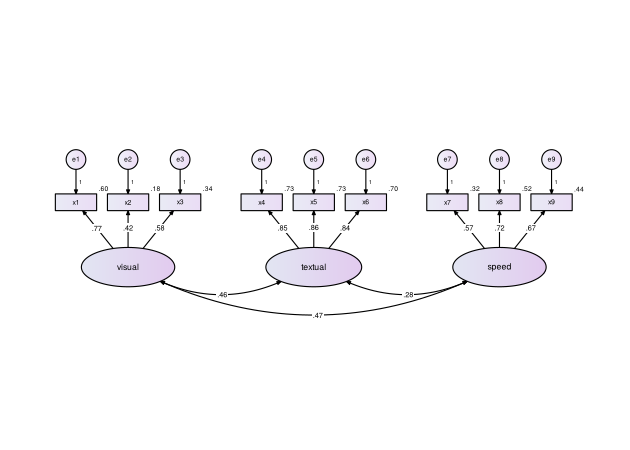

Qué se ve en el diagrama:

- **Rectángulos**: las variables observadas (ítems).
- **Óvalos**: los constructos (variables latentes).
- **Círculos `e1`, `e2`, …**: los errores, con su peso fijo en 1.
- **Números sobre las flechas**: cargas factoriales estandarizadas.
- **Número junto a cada ítem**: su R², la proporción de varianza que
  explica el constructo.
- **Flechas curvas de doble punta**: correlaciones entre constructos.

## Con tus propios datos

El procedimiento es siempre el mismo: leer los datos, escribir el
modelo, estimarlo con `lavaan` y pasárselo a `diagrama_sem()`.

``` r
datos <- read.csv("mis_datos.csv")      # o read_excel(), read_sav(), etc.

modelo <- "
  Factor1 =~ item1 + item2 + item3
  Factor2 =~ item4 + item5 + item6
"
fit <- cfa(modelo, data = datos)        # sem() para trayectorias o SEM

diagrama_sem(fit)
```

Los nombres de los ítems en el modelo deben ser exactamente los nombres
de las columnas de tus datos. Si `cfa()` o `sem()` marcan un error, el
problema está en el modelo o en los datos, no en `diagramaSEM`;
corrígelo primero en `lavaan`.

## Acomodo automático

`diagrama_sem()` detecta el tipo de modelo y elige el acomodo. Al
imprimir el resultado se ve qué decidió:

``` r
d <- diagrama_sem(fit, dibujar = FALSE)
d
#> Diagrama de diagramaSEM
#>   Tipo de modelo: análisis factorial confirmatorio 
#>   Acomodo:        fila 
#>   Constructos:    3  | Variables observadas: 9  | Errores: 9 
#>   Solución:       estandarizada 
#> Usa plot() para dibujarlo o guardar_diagrama() para guardarlo.
```

Los acomodos disponibles son:

| Acomodo          | Descripción                             | Se usa automáticamente en                                       |
|------------------|-----------------------------------------|-----------------------------------------------------------------|
| `"fila"`         | Constructos en fila, ítems arriba       | AFC, AFE y segundo orden con hasta 3 factores                   |
| `"dos_filas"`    | Dos filas, ítems hacia afuera           | AFC, AFE y segundo orden con 4+ factores, o con cargas cruzadas |
| `"arbol"`        | Factor general arriba, ítems abajo      | (a elección)                                                    |
| `"bifactor"`     | General arriba, específicos abajo       | Modelos bifactor                                                |
| `"izq_der"`      | Niveles causales de izquierda a derecha | Trayectorias y SEM                                              |
| `"arriba_abajo"` | Niveles causales de arriba hacia abajo  | MIMIC y trayectorias con 4+ exógenas                            |

Para elegir otro:

``` r
diagrama_sem(fit, acomodo = "dos_filas")
```

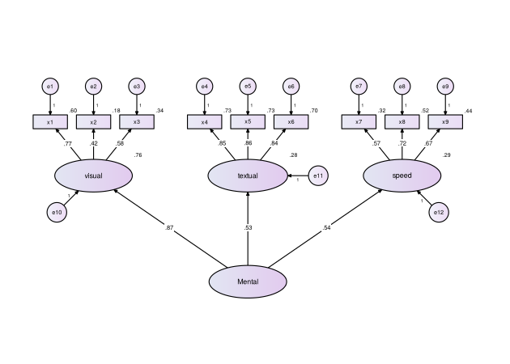

## Segundo orden

``` r
fit2 <- cfa(paste(modelo, "\n Mental =~ visual + textual + speed"),
            data = HolzingerSwineford1939)
diagrama_sem(fit2)
```

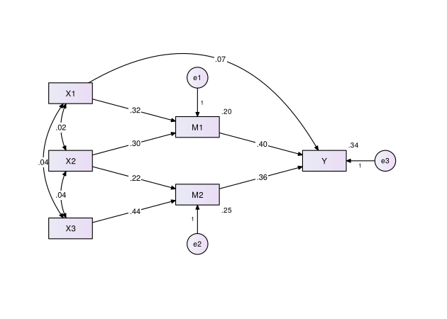

Los constructos de primer orden llevan su propio error (perturbación) y
su R², que indica cuánto de su varianza explica el factor general.

## Análisis de trayectorias

En un análisis de trayectorias todas las variables son observadas (no
hay factores) y el modelo se escribe con `~`, que se lee “es explicada
por”:

| Símbolo | Significado                              | Ejemplo                 |
|---------|------------------------------------------|-------------------------|
| `~`     | efecto (flecha de una punta)             | `Y ~ X`: X influye en Y |
| `~~`    | correlación (flecha curva de dos puntas) | `Y1 ~~ Y2`              |

Este ejemplo usa los datos `swiss`, incluidos en R: indicadores de 47
provincias de Suiza en 1888. Se plantea que la educación influye en los
resultados de un examen y que la educación, el examen y el porcentaje de
católicos influyen en la fecundidad.

``` r
modelo_path <- "
  Examination ~ Education
  Fertility   ~ Education + Examination + Catholic
"
fit3 <- sem(modelo_path, data = swiss)
diagrama_sem(fit3, etiquetas = c(Education = "Educación", Examination = "Examen",
                                 Fertility = "Fecundidad", Catholic = "Católicos"))
```

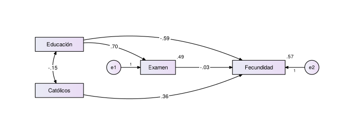

Cómo se lee:

- Las variables se ordenan por **nivel causal**: a la izquierda las que
  solo explican (exógenas), al centro las mediadoras y a la derecha los
  resultados.
- Las **variables exógenas** se correlacionan entre sí (flecha curva).
- Cada variable explicada lleva su **error** (`e1`, `e2`) y su **R²**:
  la proporción de su varianza que explican sus predictores.
- Un efecto que “salta” un nivel (aquí Educación → Fecundidad) se curva
  para no pasar por encima de otras cajas.

Con tus datos, una mediación simple se escribe así:

``` r
modelo <- "
  M ~ X          # X influye en el mediador
  Y ~ M + X      # el mediador y X influyen en el resultado
"
fit <- sem(modelo, data = datos)
diagrama_sem(fit)
```

Los efectos indirectos o totales que definas con `:=` (por ejemplo,
`ind := a*b`) no se dibujan, porque no son flechas del modelo;
consúltalos con `summary(fit)`.

## Modelo de ecuaciones estructurales

``` r
fit4 <- sem("ind60 =~ x1 + x2 + x3
             dem60 =~ y1 + y2 + y3 + y4
             dem65 =~ y5 + y6 + y7 + y8
             dem60 ~ ind60
             dem65 ~ ind60 + dem60
             y1 ~~ y5
             y2 ~~ y4 + y6
             y3 ~~ y7
             y4 ~~ y8
             y6 ~~ y8", data = PoliticalDemocracy)
diagrama_sem(fit4)
```


Cada constructo coloca sus ítems donde menos estorban a las flechas
entre constructos. Las covarianzas entre errores se dibujan como arcos
entre los círculos de error.

## Análisis factorial exploratorio

`diagrama_sem()` también dibuja análisis exploratorios hechos con
`psych::fa()` o con `lavaan::efa()`.

``` r
library(psych)
items <- HolzingerSwineford1939[, paste0("x", 1:9)]   # solo las columnas de los ítems
afe <- fa(items, nfactors = 3, rotate = "oblimin", fm = "ml")
diagrama_sem(afe)
```


En un exploratorio cada ítem carga en todos los factores, así que el
diagrama muestra solo lo importante:

- Cada ítem va con el factor en que **más carga**, ordenado de mayor a
  menor.
- Se agregan las **cargas cruzadas** de .30 o más (aquí, x9 también
  carga en otro factor). El umbral se cambia con `umbral = 0.40`.
- Si un ítem no llega al umbral en ningún factor, su flecha se dibuja
  **punteada** y aparece un aviso.
- Con rotación oblicua (`oblimin`, `promax`) se muestran las
  **correlaciones entre factores**; con rotación ortogonal (`varimax`)
  no hay.
- El número junto a cada ítem es su **comunalidad** (h²).

Los nombres `ML1`, `ML2`… los pone `psych`; cámbialos con `etiquetas`:

``` r
diagrama_sem(afe, etiquetas = c(ML1 = "Verbal", ML2 = "Velocidad", ML3 = "Visual"))
```

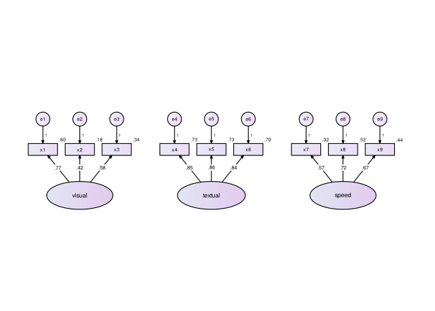

Con `lavaan::efa()` es igual. Si pediste varias soluciones (por ejemplo,
`nfactors = 2:4`), indica cuál dibujar:

``` r
afe2 <- efa(data = items, nfactors = 2:4)
diagrama_sem(afe2, nfactores = 3)
```

## Estilos: clásico, revista y color

El argumento `estilo` cambia el aspecto del diagrama sin cambiar su
contenido.

| Estilo                    | Aspecto                                                                  | Para qué                                                  |
|---------------------------|--------------------------------------------------------------------------|-----------------------------------------------------------|
| `"clasico"` (por omisión) | El de AMOS: degradado, bordes negros, los “1” de los errores             | Clases, tareas, tesis                                     |
| `"revista"`               | Grises, letra más grande, relleno plano, errores y correlaciones en gris | Artículos (sirve en cualquier revista)                    |
| `"color"`                 | Como `"revista"`, pero cada factor y sus ítems con su propio color       | Presentaciones, carteles y revistas que publican en color |

``` r
diagrama_sem(fit, estilo = "revista")
```

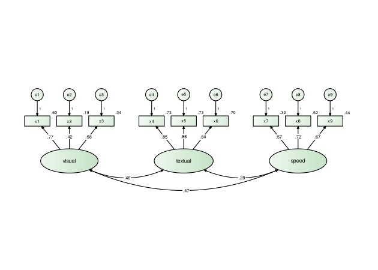

``` r
diagrama_sem(fit, estilo = "color")
```


Qué cambia en los estilos `"revista"` y `"color"`:

- La letra es más grande y sin serifa (Arial o Helvetica, según el
  equipo), y las cajas crecen para que quepa.
- Las cargas y los efectos van en negro; los errores, las correlaciones
  y las R² en gris, para que destaque lo importante.
- Cada valor va sobre un fondo blanco, así que ninguna línea lo cruza.
- Relleno plano, sin degradados ni sombras.
- No se escriben los “1” de las flechas de error. Si su revista o su
  profesor los pide, use el estilo `"clasico"` o explíquelo en la nota
  de la figura (por ejemplo: *Las cargas de los errores se fijaron en
  1*).

Los colores del estilo `"color"` son de la paleta Okabe-Ito: se
distinguen aun con daltonismo y siguen leyéndose si la revista imprime
en blanco y negro. Con más de seis factores los colores se repiten. Las
opciones `paleta` y `degradado` solo aplican al estilo `"clasico"`.

## Tablas en formato APA

El paquete crea las tablas que suelen pedirse en un artículo o una tesis
con análisis factoriales, de trayectorias o SEM. Todas se ven en la
consola, se guardan en Word con formato APA (número, título en cursiva,
solo líneas horizontales y nota) y guardan sus valores numéricos en
`$datos`.

| Etapa       | Función                    | Qué reporta                                                                   |
|-------------|----------------------------|-------------------------------------------------------------------------------|
| Datos       | `tabla_descriptivos()`     | n, M, DE, asimetría, curtosis y correlaciones                                 |
|             | `tabla_perdidos()`         | Datos perdidos por variable y casos completos                                 |
|             | `tabla_normalidad()`       | Normalidad: asimetría y curtosis con c.r. (como AMOS) y Mardia                |
|             | `tabla_atipicos()`         | Atípicos multivariados (Mahalanobis, p1 y p2)                                 |
| AFE         | `tabla_factorabilidad()`   | KMO, Bartlett y número de factores (Kaiser, análisis paralelo, MAP)           |
|             | `tabla_cargas()`           | Cargas, comunalidades y varianza explicada                                    |
| Medición    | `tabla_cargas()`           | Cargas estandarizadas, EE, *p* y R²                                           |
|             | `tabla_confiabilidad()`    | Alfa (con IC), omega y correlaciones ítem-total                               |
|             | `tabla_validez()`          | CR, AVE y criterio de Fornell-Larcker                                         |
|             | `tabla_htmt()`             | Validez discriminante HTMT                                                    |
|             | `tabla_metodo_comun()`     | Sesgo de método común (Harman y AFC de un factor)                             |
| Ajuste      | `tabla_ajuste()`           | χ², CFI, TLI, RMSEA, SRMR de uno o varios modelos                             |
|             | `tabla_criterios_ajuste()` | Cada índice contra criterios excelente/aceptable, e identificación del modelo |
|             | `tabla_modificacion()`     | Índices de modificación                                                       |
|             | `tabla_comparacion()`      | Modelos alternativos con Δχ², ΔCFI, AIC y BIC                                 |
|             | `tabla_invarianza()`       | Invarianza configural, métrica, escalar y estricta                            |
| Estructural | `tabla_parametros()`       | Estimaciones como en AMOS: B, EE, C.R., p, β, covarianzas y varianzas         |
|             | `tabla_efectos()`          | Efectos directos, indirectos (bootstrap) y totales                            |
|             | `tabla_hipotesis()`        | Cada hipótesis: se sostiene o se rechaza                                      |
|             | `tabla_vif()`              | Multicolinealidad entre predictores                                           |
| MANOVA      | `tabla_manova()`           | Pruebas multivariadas, supuestos, ANOVA de seguimiento y medias por grupo     |
| Método      | `parrafo_metodo()`         | Párrafo de software y estimación con sus referencias                          |

### Descriptivos, datos perdidos y normalidad

La “Tabla 1” de casi cualquier artículo: descriptivos y correlaciones
con asteriscos de significancia. La asimetría y la curtosis son las
mismas que da SPSS.

``` r
items <- HolzingerSwineford1939[, paste0("x", 1:9)]
tabla_descriptivos(items[, 1:5])
#> 
#> Estadísticos descriptivos y correlaciones
#> ─────────────────────────────────────────────────────────────────────────────
#> Variable   n    M     DE   Asimetría  Curtosis    1       2       3      4   
#> ─────────────────────────────────────────────────────────────────────────────
#> 1. x1     301  4.94  1.17    -0.26      0.36      —                          
#> 2. x2     301  6.09  1.18    0.47       0.38    .30***    —                  
#> 3. x3     301  2.25  1.13    0.39      -0.89    .44***  .34***    —          
#> 4. x4     301  3.06  1.16    0.27       0.12    .37***  .15**   .16**    —   
#> 5. x5     301  4.34  1.29    -0.35     -0.53    .29***   .14*    .08   .73***
#> ─────────────────────────────────────────────────────────────────────────────
#> Nota. M = media; DE = desviación estándar. Asimetría y curtosis corregidas
#> por sesgo; valores de asimetría entre −2 y 2 y de curtosis entre −7 y 7
#> suelen considerarse aceptables (West et al., 1995). Correlaciones de Pearson
#> con eliminación por pares. * p < .05. ** p < .01. *** p < .001.
```

``` r
tabla_perdidos(airquality)      # datos de ejemplo de R con datos perdidos
#> 
#> Datos perdidos por variable
#> ──────────────────────────────────────────────
#> Variable         Válidos  Perdidos  % perdidos
#> ──────────────────────────────────────────────
#> Ozone              116       37        24.2   
#> Solar.R            146       7         4.6    
#> Wind               153       0         0.0    
#> Temp               153       0         0.0    
#> Month              153       0         0.0    
#> Day                153       0         0.0    
#> ┈┈┈┈┈┈┈┈┈┈┈┈┈┈┈┈┈┈┈┈┈┈┈┈┈┈┈┈┈┈┈┈┈┈┈┈┈┈┈┈┈┈┈┈┈┈
#> Casos completos    111       42        27.5   
#> ──────────────────────────────────────────────
#> Nota. N = 153. En la última fila, casos sin ningún dato
#> perdido y casos con al menos uno. Datos perdidos en total:
#> 4.8 % de las celdas. Para estimar el modelo con todos los
#> casos puede usarse máxima verosimilitud con información
#> completa (missing = "fiml" en lavaan).
```

``` r
tabla_normalidad(items)
#> 
#> Evaluación de la normalidad
#> ─────────────────────────────────────────────────────────────────────
#> Variable               Mín.  Máx.   Asimetría  c.r.   Curtosis  c.r. 
#> ─────────────────────────────────────────────────────────────────────
#> x1                     0.67  8.50     -0.26    -1.81    0.33    1.17 
#> x2                     2.25  9.25     0.47     3.35     0.35    1.26 
#> x3                     0.25  4.50     0.39     2.73    -0.89    -3.16
#> x4                     0.00  6.33     0.27     1.90     0.10    0.36 
#> x5                     1.00  7.00     -0.35    -2.49   -0.54    -1.90
#> x6                     0.14  6.14     0.86     6.11     0.84    2.98 
#> x7                     1.30  7.43     0.25     1.77    -0.29    -1.02
#> x8                     3.05  10.00    0.53     3.74     1.20    4.25 
#> x9                     2.78  9.25     0.20     1.45     0.31    1.10 
#> ┈┈┈┈┈┈┈┈┈┈┈┈┈┈┈┈┈┈┈┈┈┈┈┈┈┈┈┈┈┈┈┈┈┈┈┈┈┈┈┈┈┈┈┈┈┈┈┈┈┈┈┈┈┈┈┈┈┈┈┈┈┈┈┈┈┈┈┈┈
#> Multivariada (Mardia)                                   4.59    2.83 
#> ─────────────────────────────────────────────────────────────────────
#> Nota. c.r. = razón crítica (z): asimetría/√(6/n) y curtosis/√(24/n);
#> la curtosis es el exceso sobre la normal. En negritas, |c.r.| > 1.96
#> (p < .05), que indica falta de normalidad; con p < .01 el límite es
#> 2.58. Multivariada: coeficiente de curtosis de Mardia y su c.r. N =
#> 301 casos completos. Asimetría significativa en x2, x3, x5, x6, x8.
#> Curtosis significativa en x3, x6, x8. El c.r. multivariado indica
#> que no hay normalidad multivariada; se recomienda un estimador
#> robusto (MLR o MLM) o bootstrap.
#> 
#> Pruebas de normalidad multivariada de Mardia
#> ─────────────────────────────────────────────────────────────
#> Prueba                  Coeficiente  Estadístico  gl     p   
#> ─────────────────────────────────────────────────────────────
#> Asimetría multivariada     6.88      χ² = 344.91  165  < .001
#> Curtosis multivariada     103.59      z = 2.83          .005 
#> ─────────────────────────────────────────────────────────────
#> Nota. Pruebas de Mardia (1970) con 301 casos y 9 variables.
#> Se rechaza la normalidad multivariada; se recomienda un
#> estimador robusto (MLR o MLM) o bootstrap.
```

Como en AMOS, cada variable tiene su asimetría y su curtosis con la
razón crítica (c.r. = z); un \|c.r.\| mayor que 1.96 (en la práctica, 2)
indica falta de normalidad, y la última fila es la curtosis multivariada
de Mardia. Si no hay normalidad multivariada, conviene estimar con
`estimator = "MLR"` o bootstrap; la nota lo indica.

Casos atípicos multivariados (distancia de Mahalanobis). Un p1 ≤ .001
señala un atípico (Kline, 2011):

``` r
at <- tabla_atipicos(items)
at
#> 
#> Casos más alejados del centroide (distancia de Mahalanobis)
#> ─────────────────────────
#> Fila   D²      p1     p2 
#> ─────────────────────────
#> 180   28.67  < .001  .199
#> 163   28.29  < .001  .028
#> 262   27.61   .001   .005
#> 78    25.70   .002   .005
#> 233   24.17   .004   .008
#> 196   23.60   .005   .004
#> 107   22.81   .007   .004
#> 105   22.45   .008   .002
#> 254   21.28   .011   .009
#> 268   21.09   .012   .005
#> ─────────────────────────
#> Nota. D² = distancia de Mahalanobis al cuadrado (9
#> variables, N = 301); p1 = P(χ²(9) ≥ D²); p2 = probabilidad
#> de que la i-ésima D² más grande alcance ese valor. Casos
#> ordenados de más a menos alejado. En negritas, 2 casos
#> atípicos (p1 ≤ .001; Kline, 2011): filas 180, 163. Atípicos
#> univariados (|z| > 3): x1 (2), x2 (1), x6 (3), x8 (2), x9
#> (2).
at$atipicos          # filas de los atípicos
#> [1] 163 180
```

Si decides excluirlos, `items[-at$atipicos, ]` da los datos sin ellos;
repórtalo y compara los resultados con y sin esos casos.

### Antes de un análisis exploratorio

Factorabilidad (KMO, Bartlett) y cuántos factores retener según cuatro
criterios:

``` r
tabla_factorabilidad(items)
#> 
#> Factorabilidad de la matriz de correlaciones
#> ───────────────────────────────────────────────────────────────
#> Indicador                      Valor            Criterio       
#> ───────────────────────────────────────────────────────────────
#> KMO global                      .75             ≥ .60 (mediano)
#> MSA mínimo por ítem          .59 (x7)           ≥ .50          
#> Prueba de Bartlett   χ²(36) = 904.10, p < .001  p < .05        
#> Determinante                 4.72e-02           > 0.00001      
#> ───────────────────────────────────────────────────────────────
#> Nota. KMO = medida de adecuación muestral de
#> Kaiser-Meyer-Olkin (calificación de Kaiser, 1974); MSA =
#> adecuación de cada ítem. N = 301 casos completos. Todos los
#> ítems tienen MSA ≥ .50.
#> 
#> Número de factores sugerido por cada criterio
#> ─────────────────────────────────────────────────────
#> Criterio                                     Factores
#> ─────────────────────────────────────────────────────
#> Autovalores mayores que 1 (Kaiser)              3    
#> Análisis paralelo, componentes (Horn, 1965)     3    
#> Análisis paralelo, factores                     3    
#> MAP de Velicer (1976)                           2    
#> ─────────────────────────────────────────────────────
#> Nota. Análisis paralelo con 100 conjuntos de datos
#> aleatorios y el percentil 95. El criterio de Kaiser tiende
#> a sobrestimar el número de factores; se recomienda dar más
#> peso al análisis paralelo y a la MAP, y a la
#> interpretabilidad de la solución.
#> 
#> Autovalores observados y aleatorios (percentil 95)
#> ──────────────────────────────────────────────────
#> N.º  Componentes  Aleatorios  Factores  Aleatorios
#> ──────────────────────────────────────────────────
#> 1       3.22         1.35       2.71       0.41   
#> 2       1.64         1.26       1.07       0.29   
#> 3       1.37         1.16       0.66       0.19   
#> 4       0.70         1.08      -0.03       0.11   
#> 5       0.58         1.04      -0.06       0.06   
#> 6       0.50         0.98      -0.10       0.00   
#> 7       0.47         0.92      -0.16      -0.05   
#> 8       0.29         0.87      -0.18      -0.11   
#> 9       0.24         0.81      -0.24      -0.17   
#> ──────────────────────────────────────────────────
#> Nota. En negritas, autovalores observados mayores que los
#> aleatorios. Factores: autovalores de la matriz reducida
#> (correlaciones múltiples al cuadrado en la diagonal).
```

### Cargas factoriales

En un **exploratorio**, la tabla incluye la matriz de cargas (de patrón
si la rotación es oblicua), las comunalidades, la varianza explicada y
las correlaciones entre factores:

``` r
tabla_cargas(afe, etiquetas = c(ML1 = "Verbal", ML2 = "Velocidad", ML3 = "Visual"))
#> 
#> Cargas factoriales del análisis factorial exploratorio
#> ──────────────────────────────────────────────────
#> Ítem                Verbal  Visual  Velocidad  h² 
#> ──────────────────────────────────────────────────
#> x5                   .89                       .76
#> x4                   .84                       .72
#> x6                   .81                       .69
#> x3                           .69               .46
#> x1                           .60               .49
#> x2                           .51               .25
#> x7                                     .72     .50
#> x8                                     .70     .53
#> x9                           .37       .46     .46
#> ┈┈┈┈┈┈┈┈┈┈┈┈┈┈┈┈┈┈┈┈┈┈┈┈┈┈┈┈┈┈┈┈┈┈┈┈┈┈┈┈┈┈┈┈┈┈┈┈┈┈
#> Varianza explicada   2.24    1.34     1.28        
#> % de varianza        24.9    14.9     14.2        
#> % acumulado          24.9    39.7     53.9        
#> ──────────────────────────────────────────────────
#> Nota. Matriz de patrón. Método: psych::fa (ml, rotación
#> oblimin). N = 301. Se omiten cargas menores que .30. En
#> negritas, la carga más alta de cada ítem. h² = comunalidad.
#> 
#> Correlaciones entre factores
#> ────────────────────────────────────
#> Factor     Verbal  Visual  Velocidad
#> ────────────────────────────────────
#> Verbal       —                      
#> Visual      .33      —              
#> Velocidad   .22     .27        —    
#> ────────────────────────────────────
```

Por omisión se dejan en blanco las cargas menores que .30 y se marca en
negritas la carga más alta de cada ítem (las negritas se ven en Word).
Para ver todas las cargas: `ocultar_bajas = FALSE`.

En un **confirmatorio o SEM**, la tabla muestra las cargas
estandarizadas con su error estándar, valor *p* y R²:

``` r
tabla_cargas(fit)
#> 
#> Cargas factoriales estandarizadas
#> ─────────────────────────────────────
#> Factor   Ítem   λ    EE     p     R² 
#> ─────────────────────────────────────
#> visual   x1    .77  .055  < .001  .60
#>          x2    .42  .060  < .001  .18
#>          x3    .58  .055  < .001  .34
#> textual  x4    .85  .023  < .001  .73
#>          x5    .86  .022  < .001  .73
#>          x6    .84  .023  < .001  .70
#> speed    x7    .57  .053  < .001  .32
#>          x8    .72  .051  < .001  .52
#>          x9    .67  .051  < .001  .44
#> ─────────────────────────────────────
#> Nota. λ = carga factorial estandarizada; EE = error
#> estándar; R² = proporción de varianza del ítem explicada
#> por su factor. N = 301.
```

### Confiabilidad y validez

Alfa de Cronbach con su intervalo de confianza, omega de McDonald y el
rango de las correlaciones ítem-total:

``` r
tabla_confiabilidad(fit)
#> 
#> Confiabilidad de las escalas
#> ──────────────────────────────────────────────────
#> Factor   Ítems   α    IC 95 %     ω   r ítem-total
#> ──────────────────────────────────────────────────
#> visual     3    .63  [.55, .69]  .63    .37–.48   
#> textual    3    .88  [.86, .90]  .89    .77–.79   
#> speed      3    .69  [.62, .74]  .69    .46–.57   
#> ──────────────────────────────────────────────────
#> Nota. α = alfa de Cronbach; IC 95 % de Feldt; ω = omega de
#> McDonald, calculado con las cargas del modelo; r ítem-total
#> = correlación ítem-total corregida (mínima–máxima). Valores
#> de α y ω ≥ .70 suelen considerarse aceptables (Nunnally y
#> Bernstein, 1994) y una correlación ítem-total ≥ .30
#> adecuada. n = 301 casos completos.
```

Sin un modelo, indica los ítems de cada factor:
`tabla_confiabilidad(datos, factores = list(F1 = c("i1", "i2", "i3"), F2 = c(...)))`.

Confiabilidad compuesta (CR), varianza promedio extraída (AVE) y la
matriz de Fornell y Larcker:

``` r
tabla_validez(fit)
#> 
#> Confiabilidad compuesta, varianza promedio extraída y correlaciones entre factores
#> ─────────────────────────────────────────
#> Factor   CR   AVE  visual  textual  speed
#> ─────────────────────────────────────────
#> visual   .63  .37   .61                  
#> textual  .89  .72   .46      .85         
#> speed    .69  .43   .47      .28     .66 
#> ─────────────────────────────────────────
#> Nota. CR = confiabilidad compuesta; AVE = varianza promedio
#> extraída. En negritas, la raíz cuadrada del AVE; debajo de
#> la diagonal, correlaciones entre factores. Criterios: CR >
#> .70, AVE > .50 (Hair et al., 2014) y raíz del AVE mayor que
#> las correlaciones del factor (Fornell y Larcker, 1981).
#> Todos los factores cumplen el criterio de Fornell-Larcker.
```

Las fórmulas son las clásicas, con las cargas estandarizadas; con
`metodo = "semtools"` se obtienen exactamente los valores de `semTools`.

Muchos revisores piden además el **HTMT**, un criterio de validez
discriminante más exigente que el de Fornell-Larcker. Valores menores
que .85 indican validez discriminante:

``` r
tabla_htmt(fit)
#> 
#> Validez discriminante: razón heterorrasgo-monorrasgo (HTMT)
#> ────────────────────────
#> Factor   visual  textual
#> ────────────────────────
#> visual     —            
#> textual   .42       —   
#> speed     .47      .29  
#> ────────────────────────
#> Nota. HTMT = razón heterorrasgo-monorrasgo (Henseler et
#> al., 2015). Valores menores que .85 (criterio estricto) o
#> .90 (flexible) indican validez discriminante. Todos los
#> pares son menores que .85.
```

Si todos los datos vienen de un mismo cuestionario, es habitual reportar
el **sesgo de método común**:

``` r
tabla_metodo_comun(fit)
#> 
#> Pruebas de sesgo de método común
#> ───────────────────────────────────────────────────────────────────────────────────────────────────────────────────────────────────────────────────────────────
#> Prueba                  Resultado                                            Criterio                                   Conclusión                             
#> ───────────────────────────────────────────────────────────────────────────────────────────────────────────────────────────────────────────────────────────────
#> Factor único de Harman  Primer componente: 35.7 % de la varianza             < 50 %                                     No hay un factor general dominante     
#> AFC de un factor        CFI = .677, RMSEA = .187; Δχ²(3) = 226.96, p < .001  Peor que el modelo propuesto (CFI = .931)  El sesgo de método no explica los datos
#> ───────────────────────────────────────────────────────────────────────────────────────────────────────────────────────────────────────────────────────────────
#> Nota. Pruebas según Podsakoff et al. (2003). Harman: análisis de componentes principales sin rotar de los 9 ítems. AFC de un factor: todos los ítems en un
#> factor, comparado con el modelo propuesto (Δχ² y ΔCFI). Estas pruebas son poco sensibles: un resultado favorable no descarta por completo el sesgo de método
#> común.
```

### Índices de ajuste y comparación de modelos

``` r
tabla_ajuste(fit)
#> 
#> Índices de ajuste
#> ───────────────────────────────────────────────────────────────────────
#> Modelo     χ²    gl    p     χ²/gl  CFI   TLI    RMSEA [IC 90 %]   SRMR
#> ───────────────────────────────────────────────────────────────────────
#> Modelo 1  85.31  24  < .001  3.55   .931  .896  .092 [.071, .114]  .065
#> ───────────────────────────────────────────────────────────────────────
#> Nota. Criterios de buen ajuste (Hu y Bentler, 1999): CFI y TLI ≥ .95
#> (≥ .90 aceptable), RMSEA ≤ .06 (≤ .08 aceptable), SRMR ≤ .08. Con
#> muestras grandes la prueba χ² suele ser significativa aunque el ajuste
#> sea bueno.
```

Si estimaste con un estimador robusto (`estimator = "MLR"`, `"MLM"`,
`"WLSMV"`…), las tablas usan automáticamente los índices corregidos.

Para comparar modelos alternativos, con la prueba de diferencias Δχ²,
ΔCFI, AIC y BIC:

``` r
un_factor <- cfa("g =~ x1 + x2 + x3 + x4 + x5 + x6 + x7 + x8 + x9",
                 data = HolzingerSwineford1939)
tabla_comparacion("Un factor" = un_factor, "Tres factores" = fit)
#> 
#> Comparación de modelos alternativos
#> ───────────────────────────────────────────────────────────────────────────────────────────────────────
#> Modelo           χ²    gl  CFI   TLI   RMSEA  SRMR    AIC      BIC    Δχ² (Δgl)     p     ΔCFI   ΔRMSEA
#> ───────────────────────────────────────────────────────────────────────────────────────────────────────
#> Un factor      312.26  27  .677  .569  .187   .143  7,738.4  7,805.2      —         —       —      —   
#> Tres factores  85.31   24  .931  .896  .092   .065  7,517.5  7,595.3  226.96 (3)  < .001  +.254  -.095 
#> ───────────────────────────────────────────────────────────────────────────────────────────────────────
#> Nota. Diferencias respecto del modelo anterior. Δχ² válida solo para modelos anidados. Un ΔCFI menor
#> que −.010 junto con un ΔRMSEA mayor que .015 indica un ajuste apreciablemente peor (Chen, 2007). AIC y
#> BIC: menor es mejor; el AIC más bajo es el de Tres factores y también el BIC.
```

La Δχ² solo es válida si un modelo es una versión restringida del otro
(modelos anidados); si no lo son, usa `anidados = FALSE` y compara AIC y
BIC.

### Invarianza de medición

¿El instrumento mide lo mismo en distintos grupos? Indica el modelo, los
datos y la variable de grupo:

``` r
tabla_invarianza(modelo, HolzingerSwineford1939, grupo = "school")
#> 
#> Invarianza de medición entre grupos
#> ──────────────────────────────────────────────────────────────────────────────────────────────────
#> Modelo        χ²    gl  CFI   RMSEA  SRMR  Δχ² (Δgl)    p     ΔCFI   ΔRMSEA  ΔSRMR     Decisión   
#> ──────────────────────────────────────────────────────────────────────────────────────────────────
#> Configural  115.85  48  .923  .097   .068      —        —       —      —       —          —       
#> Métrica     124.04  54  .921  .093   .072  8.19 (6)    .224   -.002  -.004   +.004   Se sostiene  
#> Escalar     164.10  60  .882  .107   .082  40.06 (6)  < .001  -.038  +.015   +.011  No se sostiene
#> Estricta    181.51  69  .873  .104   .088  17.41 (9)   .043   -.009  -.003   +.006   No se evalúa 
#> ──────────────────────────────────────────────────────────────────────────────────────────────────
#> Nota. Grupos: Pasteur (n = 156), Grant-White (n = 145). Cada modelo se compara con el anterior.
#> No se sostiene la invarianza si ΔCFI < −.010 junto con ΔRMSEA > .015 o ΔSRMR > .030 (métrica) o >
#> .010 (escalar y estricta) (Chen, 2007). Nivel más alto sostenido: métrica. Para probar invarianza
#> parcial, los parámetros cuya igualdad más empeora el ajuste son, en orden: x3 ~ 1; x7 ~ 1; x2 ~
#> 1. Libérelos de uno en uno, empezando por el primero (liberar = "x3 ~ 1"), y vuelva a revisar la
#> tabla.
```

Cada nivel se compara con el anterior con el criterio de Chen (2007);
también puedes usar `criterio = "cfi"` o `criterio = "chi2"`. Si un
nivel no se sostiene, la nota indica qué parámetro conviene liberar para
probar la **invarianza parcial**:

``` r
tabla_invarianza(modelo, HolzingerSwineford1939, grupo = "school", liberar = "x3 ~ 1")
#> 
#> Invarianza de medición entre grupos
#> ─────────────────────────────────────────────────────────────────────────────────────────────────────
#> Modelo              χ²    gl  CFI   RMSEA  SRMR  Δχ² (Δgl)    p     ΔCFI   ΔRMSEA  ΔSRMR   Decisión  
#> ─────────────────────────────────────────────────────────────────────────────────────────────────────
#> Configural        115.85  48  .923  .097   .068      —        —       —      —       —         —     
#> Métrica           124.04  54  .921  .093   .072  8.19 (6)    .224   -.002  -.004   +.004  Se sostiene
#> Escalar parcial   144.58  59  .903  .098   .077  20.54 (5)  < .001  -.018  +.005   +.006  Se sostiene
#> Estricta parcial  162.12  68  .894  .096   .083  17.55 (9)   .041   -.010  -.002   +.006  Se sostiene
#> ─────────────────────────────────────────────────────────────────────────────────────────────────────
#> Nota. Grupos: Pasteur (n = 156), Grant-White (n = 145). Cada modelo se compara con el anterior. No
#> se sostiene la invarianza si ΔCFI < −.010 junto con ΔRMSEA > .015 o ΔSRMR > .030 (métrica) o > .010
#> (escalar y estricta) (Chen, 2007). Parámetros liberados (invarianza parcial): x3 ~ 1. Se sostiene la
#> invarianza estricta.
```

Con ítems ordinales agrega `ordered = TRUE` (se igualan los umbrales);
con un estimador robusto, `estimator = "MLR"`.

### Efectos directos, indirectos y totales

Para trayectorias y SEM. Las trayectorias indirectas se encuentran solas
(no hace falta definirlas con `:=`) y sus intervalos se calculan por
bootstrap:

``` r
tabla_efectos(fit3, bootstrap = 500)
#> 
#> Efectos directos, indirectos y totales
#> ─────────────────────────────────────────────────────────────────────────────────
#> Efecto                                    B     EE      IC 95 %       β      p   
#> ─────────────────────────────────────────────────────────────────────────────────
#> Efectos directos                                                                 
#>    Education → Examination              0.58   0.12   [0.42, 0.89]   .70   < .001
#>    Education → Fertility                -0.76  0.26  [-1.08, -0.02]  -.59  < .001
#>    Examination → Fertility              -0.05  0.29  [-0.71, 0.40]   -.03   .796 
#>    Catholic → Fertility                 0.11   0.04   [0.02, 0.18]   .36   < .001
#> ┈┈┈┈┈┈┈┈┈┈┈┈┈┈┈┈┈┈┈┈┈┈┈┈┈┈┈┈┈┈┈┈┈┈┈┈┈┈┈┈┈┈┈┈┈┈┈┈┈┈┈┈┈┈┈┈┈┈┈┈┈┈┈┈┈┈┈┈┈┈┈┈┈┈┈┈┈┈┈┈┈
#> Efectos indirectos                                                               
#>    Education → Examination → Fertility  -0.03  0.19  [-0.52, 0.23]   -.02        
#> ┈┈┈┈┈┈┈┈┈┈┈┈┈┈┈┈┈┈┈┈┈┈┈┈┈┈┈┈┈┈┈┈┈┈┈┈┈┈┈┈┈┈┈┈┈┈┈┈┈┈┈┈┈┈┈┈┈┈┈┈┈┈┈┈┈┈┈┈┈┈┈┈┈┈┈┈┈┈┈┈┈
#> Efectos totales                                                                  
#>    Education → Fertility                -0.79  0.16  [-1.05, -0.39]  -.61        
#> ─────────────────────────────────────────────────────────────────────────────────
#> Nota. B = coeficiente no estandarizado; EE = error estándar; IC 95 % por
#> bootstrap de percentiles con 500 remuestreos; β = coeficiente estandarizado. Los
#> valores p de los efectos directos son los de lavaan; para los indirectos y
#> totales la significancia se juzga por el intervalo. En negritas, efectos
#> indirectos cuyo intervalo no incluye el 0 (significativos).
#> 
#> Varianza explicada de las variables endógenas
#> ────────────────
#> Variable     R² 
#> ────────────────
#> Examination  .49
#> Fertility    .57
#> ────────────────
```

Usa 1000 o más remuestreos para un artículo (`bootstrap = 1000`, el
valor por omisión). Un efecto indirecto es significativo si su intervalo
no incluye el 0; esos van en negritas en Word.

### Análisis de trayectorias y SEM paso a paso

El orden habitual del análisis, con el ejemplo de trayectorias de la
guía (`fit3`, datos `swiss`):

**1. Supuestos.** Normalidad (sobre todo de las variables dependientes),
atípicos y multicolinealidad entre predictores:

``` r
tabla_normalidad(fit3)
#> 
#> Evaluación de la normalidad
#> ───────────────────────────────────────────────────────────────────────
#> Variable               Mín.    Máx.   Asimetría  c.r.   Curtosis  c.r. 
#> ───────────────────────────────────────────────────────────────────────
#> Examination            3.00   37.00     0.46     1.29    -0.01    -0.02
#> Fertility              35.00  92.50     -0.47    -1.32    0.40    0.56 
#> Education              1.00   53.00     2.34     6.56     6.54    9.15 
#> Catholic               2.15   100.00    0.49     1.38    -1.61    -2.25
#> ┈┈┈┈┈┈┈┈┈┈┈┈┈┈┈┈┈┈┈┈┈┈┈┈┈┈┈┈┈┈┈┈┈┈┈┈┈┈┈┈┈┈┈┈┈┈┈┈┈┈┈┈┈┈┈┈┈┈┈┈┈┈┈┈┈┈┈┈┈┈┈
#> Multivariada (Mardia)                                     2.02    1.00 
#> ───────────────────────────────────────────────────────────────────────
#> Nota. c.r. = razón crítica (z): asimetría/√(6/n) y curtosis/√(24/n);
#> la curtosis es el exceso sobre la normal. En negritas, |c.r.| > 1.96
#> (p < .05), que indica falta de normalidad; con p < .01 el límite es
#> 2.58. Multivariada: coeficiente de curtosis de Mardia y su c.r. N = 47
#> casos completos. Asimetría significativa en Education. Curtosis
#> significativa en Education, Catholic. El c.r. multivariado sugiere
#> normalidad multivariada.
#> 
#> Pruebas de normalidad multivariada de Mardia
#> ────────────────────────────────────────────────────────────
#> Prueba                  Coeficiente  Estadístico  gl    p   
#> ────────────────────────────────────────────────────────────
#> Asimetría multivariada     8.28      χ² = 64.83   20  < .001
#> Curtosis multivariada      26.02      z = 1.00         .317 
#> ────────────────────────────────────────────────────────────
#> Nota. Pruebas de Mardia (1970) con 47 casos y 4 variables.
#> Se rechaza la normalidad multivariada; se recomienda un
#> estimador robusto (MLR o MLM) o bootstrap.
tabla_vif(fit3)
#> 
#> Diagnóstico de multicolinealidad
#> ───────────────────────────────────────────────────
#> Variable dependiente  Predictor    Tolerancia  VIF 
#> ───────────────────────────────────────────────────
#> Fertility             Education       .51      1.98
#>                       Examination     .51      1.95
#>                       Catholic        .98      1.02
#> ───────────────────────────────────────────────────
#> Nota. VIF = factor de inflación de la varianza
#> (1/tolerancia), calculado con las correlaciones del modelo.
#> VIF > 5 (tolerancia < .20) indica multicolinealidad
#> preocupante y VIF > 10, grave. Ningún predictor supera VIF
#> = 5.
```

**2. Diagrama** estandarizado (cargas y β, R²) y no estandarizado (B, y,
como en AMOS, la varianza de cada variable exógena y de cada error):

``` r
diagrama_sem(fit3, estandarizado = FALSE)
```

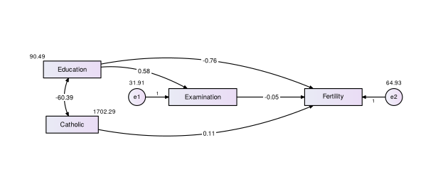

**3. Ajuste e identificación.** Cada índice contra los criterios
excelente y aceptable, con su fuente, y la identificación del modelo
(observaciones, parámetros, gl):

``` r
tabla_criterios_ajuste(fit3)
#> 
#> Evaluación del ajuste del modelo
#> ──────────────────────────────────────────────────────────────────────────────────────────────────────────────────────
#> Índice                    Valor            Excelente  Aceptable   Evaluación   Fuente                                 
#> ──────────────────────────────────────────────────────────────────────────────────────────────────────────────────────
#> χ²               26.66 (gl = 1, p < .001)   p > .05              No adecuado   Hair et al. (2014); Kline (2011)       
#> χ²/gl                     26.66               ≤ 2        ≤ 3     No aceptable  Hair et al. (2014)                     
#> RMSEA [IC 90 %]     .739 [.513, .993]        ≤ .05      ≤ .06    No aceptable  Kline (2011); Hu y Bentler (1999)      
#> SRMR                       .156              ≤ .08      ≤ .10    No aceptable  Hu y Bentler (1999); Hair et al. (2014)
#> CFI                        .725              ≥ .95      ≥ .90    No aceptable  Hu y Bentler (1999); Hair et al. (2014)
#> TLI (NNFI)                -.375              ≥ .95      ≥ .90    No aceptable  Tabachnick y Fidell (2013)             
#> GFI                        .879              ≥ .95      ≥ .90    No aceptable  Hair et al. (2014)                     
#> PNFI                       .146                         ≥ .50    No aceptable  Mulaik et al. (1989)                   
#> PRATIO                     .200                         ≥ .50    No aceptable  Mulaik et al. (1989)                   
#> ──────────────────────────────────────────────────────────────────────────────────────────────────────────────────────
#> Nota. RMSEA = error cuadrático medio de aproximación; SRMR = raíz del residuo cuadrático medio estandarizado; CFI =
#> índice de ajuste comparativo; TLI = índice de Tucker-Lewis; GFI = índice de bondad de ajuste; PNFI = índice de ajuste
#> normado parsimonioso; PRATIO = razón de parsimonia. La prueba χ² es sensible al tamaño de la muestra; con muestras
#> grandes suele ser significativa aunque el ajuste sea bueno.
#> 
#> Identificación del modelo y tamaño de la muestra
#> ───────────────────────────────────────────────────────────────────────────────────────
#> Elemento                    Valor  Interpretación                                      
#> ───────────────────────────────────────────────────────────────────────────────────────
#> Observaciones (p)             7    Elementos no redundantes de la matriz de covarianzas
#> Parámetros estimados (q)      6                                                        
#> Grados de libertad (p − q)    1    Sobreidentificado                                   
#> Tamaño de la muestra (N)     47                                                        
#> Razón N:q                   7.8:1  Baja (< 10:1)                                       
#> ───────────────────────────────────────────────────────────────────────────────────────
#> Nota. gl > 0: modelo sobreidentificado (el deseable); gl = 0: exactamente identificado
#> (χ² = 0, el ajuste no puede evaluarse); gl < 0: subidentificado (no puede estimarse).
#> Razón N:q: se recomiendan al menos 10 casos por parámetro y, de preferencia, 20
#> (Kline, 2011).
```

**4. Estimaciones**, agrupadas como en AMOS (pesos de regresión,
covarianzas, varianzas), con la razón crítica (C.R.):

``` r
tabla_parametros(fit3)
#> 
#> Estimaciones del modelo
#> ───────────────────────────────────────────────────────────────────────────
#> Parámetro                                 B       EE    C.R.     p      β  
#> ───────────────────────────────────────────────────────────────────────────
#> Pesos de regresión                                                         
#>    Examination ← Education               0.58    0.09   6.69   < .001  .70 
#>    Fertility ← Education                -0.76    0.17   -4.38  < .001  -.59
#>    Fertility ← Examination              -0.05    0.21   -0.26   .796   -.03
#>    Fertility ← Catholic                  0.11    0.03   3.68   < .001  .36 
#> ┈┈┈┈┈┈┈┈┈┈┈┈┈┈┈┈┈┈┈┈┈┈┈┈┈┈┈┈┈┈┈┈┈┈┈┈┈┈┈┈┈┈┈┈┈┈┈┈┈┈┈┈┈┈┈┈┈┈┈┈┈┈┈┈┈┈┈┈┈┈┈┈┈┈┈
#> Covarianzas (correlación en β)                                             
#>    Education ↔ Catholic                 -60.39     —      —      —     -.15
#> ┈┈┈┈┈┈┈┈┈┈┈┈┈┈┈┈┈┈┈┈┈┈┈┈┈┈┈┈┈┈┈┈┈┈┈┈┈┈┈┈┈┈┈┈┈┈┈┈┈┈┈┈┈┈┈┈┈┈┈┈┈┈┈┈┈┈┈┈┈┈┈┈┈┈┈
#> Varianzas de las variables exógenas                                        
#>    Education                            90.49      —      —      —     1.00
#>    Catholic                            1,702.29    —      —      —     1.00
#> ┈┈┈┈┈┈┈┈┈┈┈┈┈┈┈┈┈┈┈┈┈┈┈┈┈┈┈┈┈┈┈┈┈┈┈┈┈┈┈┈┈┈┈┈┈┈┈┈┈┈┈┈┈┈┈┈┈┈┈┈┈┈┈┈┈┈┈┈┈┈┈┈┈┈┈
#> Varianzas de los errores (residuales)                                      
#>    Error de Examination                 31.91    6.58   4.85   < .001  .51 
#>    Error de Fertility                   64.93    13.39  4.85   < .001  .43 
#> ───────────────────────────────────────────────────────────────────────────
#> Nota. B = estimación no estandarizada; EE = error estándar; C.R. = razón
#> crítica (B/EE); |C.R.| > 1.96 indica un parámetro significativo (p < .05);
#> β = estimación estandarizada (en las covarianzas, la correlación; en los
#> errores, la proporción de varianza no explicada, 1 − R²). — = parámetro
#> fijo (por ejemplo, la carga de referencia fijada en 1). N = 47.
```

**5. Hipótesis.** Escribe cada hipótesis como una trayectoria; agrega
`(+)` o `(-)` si predice un signo. Las de mediación (`X -> M -> Y`) se
evalúan con el intervalo del efecto indirecto:

``` r
tabla_hipotesis(fit3, c(H1 = "Education -> Examination (+)",
                        H2 = "Examination -> Fertility (-)",
                        H3 = "Catholic -> Fertility (+)",
                        H4 = "Education -> Examination -> Fertility"),
                bootstrap = 500)
#> 
#> Contraste de hipótesis
#> ──────────────────────────────────────────────────────────────────────────────────────────────
#> Hipótesis  Trayectoria                          Efecto      β      p / IC 95 %     Decisión   
#> ──────────────────────────────────────────────────────────────────────────────────────────────
#> H1         Education → Examination (+)          Directo    .70        < .001       Se sostiene
#> H2         Examination → Fertility (-)          Directo    -.03        .796        Se rechaza 
#> H3         Catholic → Fertility (+)             Directo    .36        < .001       Se sostiene
#> H4         Education → Examination → Fertility  Indirecto  -.02  IC [-0.52, 0.23]  Se rechaza 
#> ──────────────────────────────────────────────────────────────────────────────────────────────
#> Nota. β = coeficiente estandarizado. Efectos directos: se sostienen si p < .05. Efectos
#> indirectos: se sostienen si el intervalo de confianza al 95 % (bootstrap con 500 remuestreos)
#> no incluye el 0. Si la hipótesis indica un signo (+ o −), el efecto debe tener ese signo.
```

**6. Efectos directos, indirectos y totales** con `tabla_efectos()`
(véase arriba).

**7. Modelo alternativo.** Si quitas trayectorias no significativas o
agregas parámetros, compara los modelos con `tabla_comparacion()`. Los
índices de modificación muestran qué parámetro agregado mejoraría el
ajuste; solo deben liberarse si tiene sentido teórico:

``` r
tabla_modificacion(fit, n = 5)
#> 
#> Índices de modificación
#> ───────────────────────────────────────────────────────────────
#> Parámetro               Sintaxis lavaan   IM     EPC   EPC est.
#> ───────────────────────────────────────────────────────────────
#> Carga de x9 en visual   visual =~ x9     36.41  0.58     .52   
#> Covarianza x7 ↔ x8      x7 ~~ x8         34.15  0.54     .86   
#> Carga de x7 en visual   visual =~ x7     18.63  -0.42    -.35  
#> Covarianza x8 ↔ x9      x8 ~~ x9         14.95  -0.42    -.81  
#> Carga de x3 en textual  textual =~ x3    9.15   -0.27    -.24  
#> ───────────────────────────────────────────────────────────────
#> Nota. IM = índice de modificación (disminución esperada del χ²
#> al liberar el parámetro); EPC = cambio esperado en el
#> parámetro (no estandarizado y estandarizado). Se muestran los
#> IM ≥ 3.84. Liberar un parámetro solo se justifica si tiene
#> sentido teórico; la sintaxis de lavaan para agregarlo está en
#> la segunda columna.
```

### MANOVA de un factor

¿Difieren los grupos en un conjunto de variables dependientes? La tabla
reúne las pruebas multivariadas (Pillai, Wilks, Hotelling-Lawley y Roy,
con η²p), los supuestos (M de Box, tamaños de grupo, normalidad por
grupo, atípicos, multicolinealidad), los ANOVA de seguimiento con
corrección de Bonferroni y las medias por grupo. Con los datos `iris` de
la clase:

``` r
tabla_manova(iris, dependientes = c("Petal.Length", "Sepal.Length"), grupo = "Species")
#> 
#> MANOVA de un factor: pruebas multivariadas
#> ──────────────────────────────────────────────────────────────────
#> Prueba                     Valor      F      gl1  gl2    p     η²p
#> ──────────────────────────────────────────────────────────────────
#> Traza de Pillai            0.989    71.83     4   294  < .001  .49
#> Lambda de Wilks            0.040    292.56    4   292  < .001  .80
#> Traza de Hotelling-Lawley  23.365   846.97    4   290  < .001  .92
#> Raíz mayor de Roy          23.334  1,715.06   2   147  < .001  .96
#> ──────────────────────────────────────────────────────────────────
#> Nota. F aproximada; η²p = eta cuadrada parcial (en un MANOVA de
#> un factor coincide con la eta cuadrada). La traza de Pillai es la
#> prueba más robusta si no se cumple la igualdad de matrices de
#> covarianza. Variables dependientes: Petal.Length, Sepal.Length;
#> factor: Species (3 grupos, N = 150).
#> 
#> Supuestos del MANOVA
#> ──────────────────────────────────────────────────────────────────────────────────────────────────────────────────────────
#> Supuesto                                        Resultado                              Criterio               Conclusión  
#> ──────────────────────────────────────────────────────────────────────────────────────────────────────────────────────────
#> Igualdad de matrices de covarianza (M de Box)   M = 59.55, χ²(6) = 58.38, p < .001     p > .001               No se cumple
#> Razón de tamaños de grupo (mayor/menor)         1.00                                   < 1.5                  Se cumple   
#> Normalidad multivariada por grupo (Mardia)                                                                                
#>    setosa                                       Asimetría p = .191; curtosis p = .243  p > .05                Se cumple   
#>    versicolor                                   Asimetría p = .156; curtosis p = .445  p > .05                Se cumple   
#>    virginica                                    Asimetría p = .426; curtosis p = .597  p > .05                Se cumple   
#> Atípicos multivariados por grupo (Mahalanobis)  Ninguno                                D² > 13.82 (p < .001)  Se cumple   
#> Multicolinealidad entre variables dependientes  |r| máxima = .87                       < .90                  Se cumple   
#> ──────────────────────────────────────────────────────────────────────────────────────────────────────────────────────────
#> Nota. La M de Box es muy sensible a la falta de normalidad, por eso se evalúa con α = .001. Si no se cumple la igualdad
#> de matrices de covarianza, use la traza de Pillai, procure grupos de tamaño similar y un nivel de significancia más
#> estricto. La linealidad entre pares de variables dependientes se revisa con diagramas de dispersión; la independencia de
#> las observaciones, con el diseño del estudio.
#> 
#> ANOVA univariados de seguimiento
#> ─────────────────────────────────────────────
#> Variable         F      gl1  gl2    p     η²p
#> ─────────────────────────────────────────────
#> Petal.Length  1,180.16   2   147  < .001  .94
#> Sepal.Length   119.26    2   147  < .001  .62
#> ─────────────────────────────────────────────
#> Nota. η²p = eta cuadrada parcial. Con la corrección de
#> Bonferroni, cada ANOVA se evalúa con α = .05/2 = .025; en
#> negritas, los significativos.
#> 
#> Medias (desviaciones estándar) por grupo
#> ───────────────────────────────────────────────────
#> Variable        setosa     versicolor    virginica 
#> ───────────────────────────────────────────────────
#> Petal.Length  1.46 (0.17)  4.26 (0.47)  5.55 (0.55)
#> Sepal.Length  5.01 (0.35)  5.94 (0.52)  6.59 (0.64)
#> ┈┈┈┈┈┈┈┈┈┈┈┈┈┈┈┈┈┈┈┈┈┈┈┈┈┈┈┈┈┈┈┈┈┈┈┈┈┈┈┈┈┈┈┈┈┈┈┈┈┈┈
#> n                 50           50           50     
#> ───────────────────────────────────────────────────
#> Nota. Valores: M (DE).
```

Si la M de Box es significativa (p \< .001), reporta la traza de Pillai,
que es la más robusta.

### Párrafo de método

Redacta el párrafo de análisis de datos (software, versiones, estimador,
datos perdidos y criterios de ajuste) con sus referencias en formato
APA. Es un punto de partida para adaptar:

``` r
parrafo_metodo(fit, paquetes = c("semTools", "diagramaSEM"))
#> 
#> Los análisis se realizaron en R (versión 4.3.3; R Core Team, 2024) con los
#> paquetes lavaan (versión 0.6-17; Rosseel, 2012), semTools (versión 0.5-6;
#> Jorgensen et al., 2022) y diagramaSEM (versión 0.5.0; Moreno Valladares, 2026).
#> El análisis factorial confirmatorio se estimó con una muestra de 301
#> participantes por máxima verosimilitud (ML). El ajuste se evaluó con la prueba
#> χ², el índice de ajuste comparativo (CFI), el índice de Tucker-Lewis (TLI), el
#> error cuadrático medio de aproximación (RMSEA) con su intervalo de confianza al
#> 90 % y la raíz del residuo cuadrático medio estandarizado (SRMR). Se
#> consideraron indicadores de buen ajuste CFI y TLI ≥ .95, RMSEA ≤ .06 y SRMR ≤
#> .08 (Hu y Bentler, 1999).
#> 
#> Referencias
#> 
#> Hu, L., & Bentler, P. M. (1999). Cutoff criteria for fit indexes in covariance
#>     structure analysis: Conventional criteria versus new alternatives.
#>     Structural Equation Modeling, 6(1), 1–55.
#>     https://doi.org/10.1080/10705519909540118
#> 
#> Jorgensen, T. D., Pornprasertmanit, S., Schoemann, A. M., & Rosseel, Y. (2022).
#>     semTools: Useful tools for structural equation modeling (Paquete de R,
#>     versión 0.5-6). https://CRAN.R-project.org/package=semTools.
#> 
#> Moreno Valladares, J. (2026). diagramaSEM: Diagramas de trayectorias y tablas
#>     APA para modelos lavaan y psych (Paquete de R, versión 0.5.0).
#>     https://github.com/jeshuamv/diagramaSEM.
#> 
#> R Core Team. (2024). R: A language and environment for statistical computing. R
#>     Foundation for Statistical Computing. https://www.R-project.org/
#> 
#> Rosseel, Y. (2012). lavaan: An R package for structural equation modeling.
#>     Journal of Statistical Software, 48(2), 1–36.
#>     https://doi.org/10.18637/jss.v048.i02
```

Con `archivo = "metodo.docx"` se guarda en Word.

### Guardar las tablas

Una tabla:

``` r
tabla_validez(fit, archivo = "tabla_validez.docx")   # Word
tabla_ajuste(fit, archivo = "tabla_ajuste.html")     # para copiar y pegar
tabla_cargas(fit, archivo = "tabla_cargas.csv")      # para Excel
```

Todas las tablas de un artículo en un solo documento de Word, numeradas:

``` r
guardar_tablas(
  tabla_descriptivos(items),
  tabla_confiabilidad(fit),
  tabla_ajuste(fit),
  tabla_validez(fit),
  tabla_htmt(fit),
  archivo = "tablas_articulo.docx"
)
```

Las tablas anchas se pasan a letra de 10 pt y, si aún no caben, se
colocan en una página horizontal. También se puede guardar en `.rtf`.

## Personalizar el diagrama

### Nombres

``` r
diagrama_sem(fit, etiquetas = c(visual = "Visual", textual = "Verbal",
                                speed = "Velocidad", x1 = "Ítem 1"))
```


Use `"\n"` dentro de un nombre para partirlo en dos renglones.

### Significancia, decimales y solución no estandarizada

``` r
diagrama_sem(fit, estrellas = TRUE, decimales = 3)
```


Con `estandarizado = FALSE` se muestran los valores no estandarizados (y
no se muestra R²):

``` r
diagrama_sem(fit, estandarizado = FALSE)
```

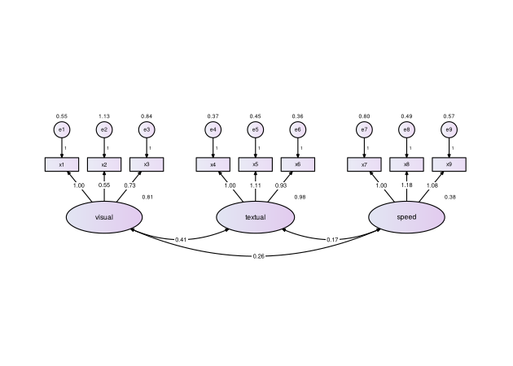

### Correlaciones

``` r
diagrama_sem(fit, correlaciones = FALSE)   # ocultarlas
```

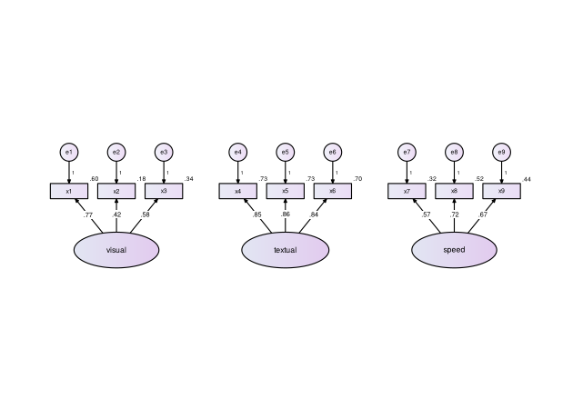

``` r
diagrama_sem(fit, correlaciones = 0.40)    # solo las de |r| >= .40
```


En AFC con 5 o más factores se ocultan automáticamente, porque se cruzan
entre sí sin importar el acomodo. Siguen disponibles en el resultado:

``` r
d <- diagrama_sem(fit, correlaciones = FALSE, dibujar = FALSE)
d$correlaciones_ocultas
#>    variable_1 variable_2     valor            p
#> 10     visual    textual 0.4585093 6.528111e-13
#> 11     visual      speed 0.4705345 1.040015e-10
#> 12    textual      speed 0.2829847 3.832000e-05
```

### Colores

``` r
diagrama_sem(fit, paleta = paleta_sem("verde"))
```

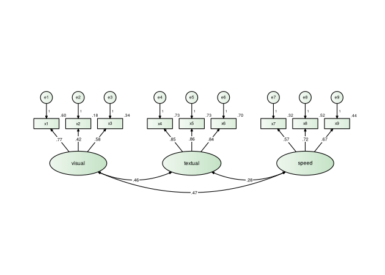

``` r
diagrama_sem(fit, paleta = paleta_sem("blanco"), degradado = FALSE)
```

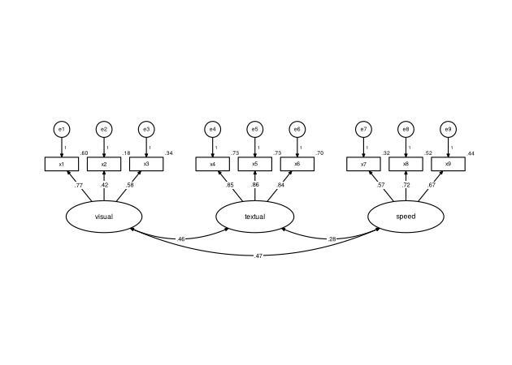

``` r
diagrama_sem(fit, paleta = paleta_sem(latente = c("white", "#FAD3B5"),
                                      observada = "#FFF3EA"))
```


Paletas incluidas: `"lila"` (por omisión), `"azul"`, `"verde"`,
`"gris"`, `"durazno"` y `"blanco"`.

### Ajustes a mano

Hacia dónde van los ítems de un constructo:

``` r
diagrama_sem(fit, lados = c(speed = "abajo"))
```


Mover un elemento (un constructo se mueve con sus ítems y errores). La
unidad equivale aproximadamente al ancho de un ítem:

``` r
diagrama_sem(fit, mover = list(speed = c(0, -1)))
```


## Guardar el diagrama

``` r
diagrama_sem(fit, archivo = "figura1.png")    # imagen para Word o PowerPoint
diagrama_sem(fit, archivo = "figura1.pdf")    # PDF vectorial (nítido a cualquier tamaño)
```

Si no se indican medidas, se calculan solas según el tamaño del
diagrama. También se aceptan `.tiff`, `.eps`, `.svg` y `.jpg`. Para
guardar un diagrama que ya dibujó, use `guardar_diagrama()`:

``` r
d <- diagrama_sem(fit, estilo = "revista")
guardar_diagrama(d, "figura1.pdf", ancho = "pagina")
```

## Figuras para una revista

Las revistas piden que el texto de la figura mida **al menos 8 pt ya
impresa** (APA pide de 8 a 14 pt, sin serifa) y que la figura se
entregue al ancho con que se publicará. Por eso, para un artículo:

``` r
diagrama_sem(fit, estilo = "revista", archivo = "figura1.pdf", ancho = "pagina")
```

Al indicar `ancho`, el paquete informa el tamaño real del texto:

    Figura de 174 x 62 mm; texto de los ítems y valores: 8.4 pt.

Si queda por debajo de 8 pt, aparece un aviso con sugerencias.

**`ancho`**

- `"pagina"`: 174 mm, a lo ancho de la página. Es la opción adecuada
  para casi cualquier modelo.
- `"columna"`: 85 mm, una columna en revistas de dos columnas. Solo
  alcanza para modelos muy pequeños (un factor con pocos ítems, una
  trayectoria simple).
- Un número: el ancho en pulgadas.

**Formato**

| Formato | Cuándo usarlo                                                                                                                    |
|---------|----------------------------------------------------------------------------------------------------------------------------------|
| `.pdf`  | La mejor opción en general: vectorial, con las fuentes incluidas. La aceptan Elsevier, Springer, Taylor & Francis, Wiley y SAGE. |
| `.eps`  | Cuando la revista pide EPS (vectorial).                                                                                          |
| `.tiff` | Cuando la revista pide imagen (por ejemplo PLOS). Se guarda a 600 ppp con compresión LZW.                                        |
| `.png`  | Para Word, PowerPoint o la tesis (300 ppp).                                                                                      |

**Formato APA del resto de la figura.** En APA el número de la figura
(en negritas) y su título (en cursiva) van **arriba y fuera de la
imagen**, y las notas debajo; escríbalos en Word, no con `titulo =`. Por
ejemplo:

> **Figura 1**  
> *Modelo de medición de tres factores*  
> \[diagrama\]  
> *Nota.* Cargas estandarizadas. Los números junto a cada ítem son las
> R². Las cargas de los errores se fijaron en 1. *N* = 301.

Siempre revise las instrucciones para autores de la revista elegida:
algunas piden otro ancho, otro formato o la figura en un archivo aparte.

## Preguntas frecuentes

**El diagrama sale muy pequeño o el texto muy chico.** Guárdelo con
`guardar_diagrama()`; en la ventana de RStudio el tamaño depende del
panel. Para un artículo use `estilo = "revista"` y `ancho = "pagina"`
(véase [Figuras para una revista](#figuras-para-una-revista)).

**¿Qué estilo uso?** Para clases y tareas, el que prefiera. Para un
artículo, `"revista"`; `"color"` si la revista publica en color o para
una presentación.

**Una flecha pasa por donde no quiero.** Pruebe otro `acomodo`, cambie
el lado de los ítems con `lados` o desplace el constructo con `mover`.

**El modelo es multigrupo.** Se dibuja un grupo a la vez con
`grupo = 1`, `grupo = 2`, etc.

**Aparece el aviso “El modelo no convergió”.** Revise el modelo en
`lavaan`; el diagrama se dibuja, pero sus valores no son confiables.

**`fa()` marca un error sobre `GPArotation`.** Instala el paquete con
`install.packages("GPArotation")`; `psych` lo necesita para las
rotaciones oblicuas.

**El archivo `.rtf` se abre en otro programa.** Haz clic derecho →
*Abrir con* → *Microsoft Word*.
