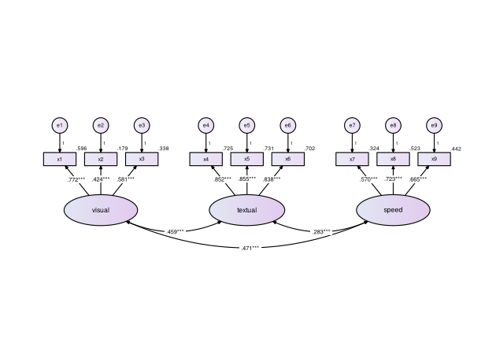
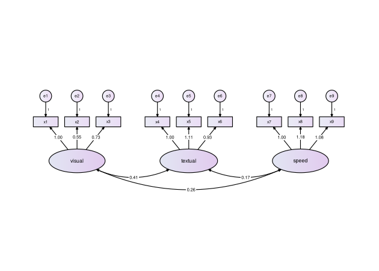
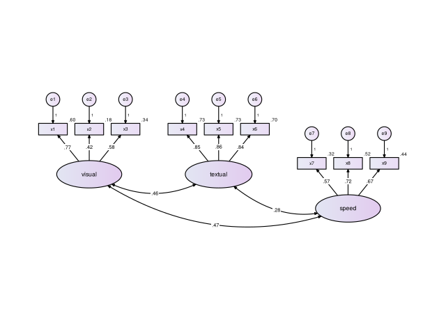

Guía de uso de diagramaSEM
================

`diagramaSEM` dibuja el diagrama de trayectorias de tus análisis
factoriales (exploratorios y confirmatorios), de trayectorias y de
ecuaciones estructurales, con la convención gráfica clásica de los
programas de SEM, y crea las tablas en formato APA que suelen pedirse en
artículos y tesis. Esta guía muestra cómo usarlo, paso a paso.

## Contenido

1.  [El primer diagrama](#el-primer-diagrama)
2.  [Con tus propios datos](#con-tus-propios-datos)
3.  [Acomodo automático](#acomodo-automático)
4.  [Segundo orden](#segundo-orden)
5.  [Análisis de trayectorias](#análisis-de-trayectorias)
6.  [Modelo de ecuaciones
    estructurales](#modelo-de-ecuaciones-estructurales)
7.  [Análisis factorial exploratorio](#análisis-factorial-exploratorio)
8.  [Estilos: clásico, revista y
    color](#estilos-clásico-revista-y-color)
9.  [Tablas en formato APA](#tablas-en-formato-apa)
10. [Personalizar el diagrama](#personalizar-el-diagrama)
11. [Guardar el diagrama](#guardar-el-diagrama)
12. [Figuras para una revista](#figuras-para-una-revista)
13. [Preguntas frecuentes](#preguntas-frecuentes)

## Instalación

Solo la primera vez, con conexión a internet:

``` r
install.packages("remotes")
remotes::install_github("jeshuamv/diagramaSEM")
```

Para análisis exploratorios con `psych` instala también:

``` r
install.packages(c("psych", "GPArotation"))
```

En cada sesión de R se cargan los dos paquetes:

``` r
library(lavaan)
library(diagramaSEM)
```

## El primer diagrama

Basta con estimar el modelo en `lavaan` y pasárselo a `diagrama_sem()`.

``` r
modelo <- "visual  =~ x1 + x2 + x3
           textual =~ x4 + x5 + x6
           speed   =~ x7 + x8 + x9"
fit <- cfa(modelo, data = HolzingerSwineford1939)
diagrama_sem(fit)
```


Qué se ve en el diagrama:

- **Rectángulos**: las variables observadas (ítems).
- **Óvalos**: los constructos (variables latentes).
- **Círculos `e1`, `e2`, …**: los errores, con su peso fijo en 1.
- **Números sobre las flechas**: cargas factoriales estandarizadas.
- **Número junto a cada ítem**: su R², la proporción de varianza que
  explica el constructo.
- **Flechas curvas de doble punta**: correlaciones entre constructos.

## Con tus propios datos

El procedimiento es siempre el mismo: leer los datos, escribir el
modelo, estimarlo con `lavaan` y pasárselo a `diagrama_sem()`.

``` r
datos <- read.csv("mis_datos.csv")      # o read_excel(), read_sav(), etc.

modelo <- "
  Factor1 =~ item1 + item2 + item3
  Factor2 =~ item4 + item5 + item6
"
fit <- cfa(modelo, data = datos)        # sem() para trayectorias o SEM

diagrama_sem(fit)
```

Los nombres de los ítems en el modelo deben ser exactamente los nombres
de las columnas de tus datos. Si `cfa()` o `sem()` marcan un error, el
problema está en el modelo o en los datos, no en `diagramaSEM`;
corrígelo primero en `lavaan`.

## Acomodo automático

`diagrama_sem()` detecta el tipo de modelo y elige el acomodo. Al
imprimir el resultado se ve qué decidió:

``` r
d <- diagrama_sem(fit, dibujar = FALSE)
d
#> Diagrama de diagramaSEM
#>   Tipo de modelo: análisis factorial confirmatorio 
#>   Acomodo:        fila 
#>   Constructos:    3  | Variables observadas: 9  | Errores: 9 
#>   Solución:       estandarizada 
#> Usa plot() para dibujarlo o guardar_diagrama() para guardarlo.
```

Los acomodos disponibles son:

| Acomodo          | Descripción                             | Se usa automáticamente en                                       |
|------------------|-----------------------------------------|-----------------------------------------------------------------|
| `"fila"`         | Constructos en fila, ítems arriba       | AFC, AFE y segundo orden con hasta 3 factores                   |
| `"dos_filas"`    | Dos filas, ítems hacia afuera           | AFC, AFE y segundo orden con 4+ factores, o con cargas cruzadas |
| `"arbol"`        | Factor general arriba, ítems abajo      | (a elección)                                                    |
| `"bifactor"`     | General arriba, específicos abajo       | Modelos bifactor                                                |
| `"izq_der"`      | Niveles causales de izquierda a derecha | Trayectorias y SEM                                              |
| `"arriba_abajo"` | Niveles causales de arriba hacia abajo  | MIMIC y trayectorias con 4+ exógenas                            |

Para elegir otro:

``` r
diagrama_sem(fit, acomodo = "dos_filas")
```


## Segundo orden

``` r
fit2 <- cfa(paste(modelo, "\n Mental =~ visual + textual + speed"),
            data = HolzingerSwineford1939)
diagrama_sem(fit2)
```


Los constructos de primer orden llevan su propio error (perturbación) y
su R², que indica cuánto de su varianza explica el factor general.

## Análisis de trayectorias

En un análisis de trayectorias todas las variables son observadas (no
hay factores) y el modelo se escribe con `~`, que se lee “es explicada
por”:

| Símbolo | Significado                              | Ejemplo                 |
|---------|------------------------------------------|-------------------------|
| `~`     | efecto (flecha de una punta)             | `Y ~ X`: X influye en Y |
| `~~`    | correlación (flecha curva de dos puntas) | `Y1 ~~ Y2`              |

Este ejemplo usa los datos `swiss`, incluidos en R: indicadores de 47
provincias de Suiza en 1888. Se plantea que la educación influye en los
resultados de un examen y que la educación, el examen y el porcentaje de
católicos influyen en la fecundidad.

``` r
modelo_path <- "
  Examination ~ Education
  Fertility   ~ Education + Examination + Catholic
"
fit3 <- sem(modelo_path, data = swiss)
diagrama_sem(fit3, etiquetas = c(Education = "Educación", Examination = "Examen",
                                 Fertility = "Fecundidad", Catholic = "Católicos"))
```


Cómo se lee:

- Las variables se ordenan por **nivel causal**: a la izquierda las que
  solo explican (exógenas), al centro las mediadoras y a la derecha los
  resultados.
- Las **variables exógenas** se correlacionan entre sí (flecha curva).
- Cada variable explicada lleva su **error** (`e1`, `e2`) y su **R²**:
  la proporción de su varianza que explican sus predictores.
- Un efecto que “salta” un nivel (aquí Educación → Fecundidad) se curva
  para no pasar por encima de otras cajas.

Con tus datos, una mediación simple se escribe así:

``` r
modelo <- "
  M ~ X          # X influye en el mediador
  Y ~ M + X      # el mediador y X influyen en el resultado
"
fit <- sem(modelo, data = datos)
diagrama_sem(fit)
```

Los efectos indirectos o totales que definas con `:=` (por ejemplo,
`ind := a*b`) no se dibujan, porque no son flechas del modelo;
consúltalos con `summary(fit)`.

## Modelo de ecuaciones estructurales

``` r
fit4 <- sem("ind60 =~ x1 + x2 + x3
             dem60 =~ y1 + y2 + y3 + y4
             dem65 =~ y5 + y6 + y7 + y8
             dem60 ~ ind60
             dem65 ~ ind60 + dem60
             y1 ~~ y5
             y2 ~~ y4 + y6
             y3 ~~ y7
             y4 ~~ y8
             y6 ~~ y8", data = PoliticalDemocracy)
diagrama_sem(fit4)
```


Cada constructo coloca sus ítems donde menos estorban a las flechas
entre constructos. Las covarianzas entre errores se dibujan como arcos
entre los círculos de error.

## Análisis factorial exploratorio

`diagrama_sem()` también dibuja análisis exploratorios hechos con
`psych::fa()` o con `lavaan::efa()`.

``` r
library(psych)
items <- HolzingerSwineford1939[, paste0("x", 1:9)]   # solo las columnas de los ítems
afe <- fa(items, nfactors = 3, rotate = "oblimin", fm = "ml")
diagrama_sem(afe)
```


En un exploratorio cada ítem carga en todos los factores, así que el
diagrama muestra solo lo importante:

- Cada ítem va con el factor en que **más carga**, ordenado de mayor a
  menor.
- Se agregan las **cargas cruzadas** de .30 o más (aquí, x9 también
  carga en otro factor). El umbral se cambia con `umbral = 0.40`.
- Si un ítem no llega al umbral en ningún factor, su flecha se dibuja
  **punteada** y aparece un aviso.
- Con rotación oblicua (`oblimin`, `promax`) se muestran las
  **correlaciones entre factores**; con rotación ortogonal (`varimax`)
  no hay.
- El número junto a cada ítem es su **comunalidad** (h²).

Los nombres `ML1`, `ML2`… los pone `psych`; cámbialos con `etiquetas`:

``` r
diagrama_sem(afe, etiquetas = c(ML1 = "Verbal", ML2 = "Velocidad", ML3 = "Visual"))
```


Con `lavaan::efa()` es igual. Si pediste varias soluciones (por ejemplo,
`nfactors = 2:4`), indica cuál dibujar:

``` r
afe2 <- efa(data = items, nfactors = 2:4)
diagrama_sem(afe2, nfactores = 3)
```

## Estilos: clásico, revista y color

El argumento `estilo` cambia el aspecto del diagrama sin cambiar su
contenido.

| Estilo                    | Aspecto                                                                  | Para qué                                                  |
|---------------------------|--------------------------------------------------------------------------|-----------------------------------------------------------|
| `"clasico"` (por omisión) | El de AMOS: degradado, bordes negros, los “1” de los errores             | Clases, tareas, tesis                                     |
| `"revista"`               | Grises, letra más grande, relleno plano, errores y correlaciones en gris | Artículos (sirve en cualquier revista)                    |
| `"color"`                 | Como `"revista"`, pero cada factor y sus ítems con su propio color       | Presentaciones, carteles y revistas que publican en color |

``` r
diagrama_sem(fit, estilo = "revista")
```


``` r
diagrama_sem(fit, estilo = "color")
```


Qué cambia en los estilos `"revista"` y `"color"`:

- La letra es más grande y sin serifa (Arial o Helvetica, según el
  equipo), y las cajas crecen para que quepa.
- Las cargas y los efectos van en negro; los errores, las correlaciones
  y las R² en gris, para que destaque lo importante.
- Cada valor va sobre un fondo blanco, así que ninguna línea lo cruza.
- Relleno plano, sin degradados ni sombras.
- No se escriben los “1” de las flechas de error. Si su revista o su
  profesor los pide, use el estilo `"clasico"` o explíquelo en la nota
  de la figura (por ejemplo: *Las cargas de los errores se fijaron en
  1*).

Los colores del estilo `"color"` son de la paleta Okabe-Ito: se
distinguen aun con daltonismo y siguen leyéndose si la revista imprime
en blanco y negro. Con más de seis factores los colores se repiten. Las
opciones `paleta` y `degradado` solo aplican al estilo `"clasico"`.

## Tablas en formato APA

Tres funciones crean las tablas que suelen pedirse en un reporte. Todas
se ven en la consola y se pueden guardar para Word.

### Cargas factoriales

En un **exploratorio**, la tabla incluye la matriz de cargas (de patrón
si la rotación es oblicua), las comunalidades, la varianza explicada y
las correlaciones entre factores:

``` r
tabla_cargas(afe, etiquetas = c(ML1 = "Verbal", ML2 = "Velocidad", ML3 = "Visual"))
#> 
#> Cargas factoriales del análisis factorial exploratorio
#> ──────────────────────────────────────────────────
#> Ítem                Verbal  Visual  Velocidad  h² 
#> ──────────────────────────────────────────────────
#> x5                   .89                       .76
#> x4                   .84                       .72
#> x6                   .81                       .69
#> x3                           .69               .46
#> x1                           .60               .49
#> x2                           .51               .25
#> x7                                     .72     .50
#> x8                                     .70     .53
#> x9                           .37       .46     .46
#> ┈┈┈┈┈┈┈┈┈┈┈┈┈┈┈┈┈┈┈┈┈┈┈┈┈┈┈┈┈┈┈┈┈┈┈┈┈┈┈┈┈┈┈┈┈┈┈┈┈┈
#> Varianza explicada   2.24    1.34     1.28        
#> % de varianza        24.9    14.9     14.2        
#> % acumulado          24.9    39.7     53.9        
#> ──────────────────────────────────────────────────
#> Nota. Matriz de patrón. Método: psych::fa (ml, rotación
#> oblimin). N = 301. Se omiten cargas menores que .30. En
#> negritas, la carga más alta de cada ítem. h² = comunalidad.
#> 
#> Correlaciones entre factores
#> ────────────────────────────────────
#> Factor     Verbal  Visual  Velocidad
#> ────────────────────────────────────
#> Verbal       —                      
#> Visual      .33      —              
#> Velocidad   .22     .27        —    
#> ────────────────────────────────────
```

Por omisión se dejan en blanco las cargas menores que .30 y se marca en
negritas la carga más alta de cada ítem (las negritas se ven en Word).
Para ver todas las cargas: `ocultar_bajas = FALSE`.

En un **confirmatorio o SEM**, la tabla muestra las cargas
estandarizadas con su error estándar, valor *p* y R²:

``` r
tabla_cargas(fit)
#> 
#> Cargas factoriales estandarizadas
#> ─────────────────────────────────────
#> Factor   Ítem   λ    EE     p     R² 
#> ─────────────────────────────────────
#> visual   x1    .77  .055  < .001  .60
#>          x2    .42  .060  < .001  .18
#>          x3    .58  .055  < .001  .34
#> textual  x4    .85  .023  < .001  .73
#>          x5    .86  .022  < .001  .73
#>          x6    .84  .023  < .001  .70
#> speed    x7    .57  .053  < .001  .32
#>          x8    .72  .051  < .001  .52
#>          x9    .67  .051  < .001  .44
#> ─────────────────────────────────────
#> Nota. λ = carga factorial estandarizada; EE = error
#> estándar; R² = proporción de varianza del ítem explicada
#> por su factor. N = 301.
```

### Índices de ajuste

``` r
tabla_ajuste(fit)
#> 
#> Índices de ajuste
#> ───────────────────────────────────────────────────────────────────────
#> Modelo     χ²    gl    p     χ²/gl  CFI   TLI    RMSEA [IC 90 %]   SRMR
#> ───────────────────────────────────────────────────────────────────────
#> Modelo 1  85.31  24  < .001  3.55   .931  .896  .092 [.071, .114]  .065
#> ───────────────────────────────────────────────────────────────────────
#> Nota. Criterios de buen ajuste (Hu y Bentler, 1999): CFI y TLI ≥ .95
#> (≥ .90 aceptable), RMSEA ≤ .06 (≤ .08 aceptable), SRMR ≤ .08. Con
#> muestras grandes la prueba χ² suele ser significativa aunque el ajuste
#> sea bueno.
```

Para comparar modelos, ponles nombre y pásalos juntos. Con `extra` se
agregan otros índices (`"gfi"`, `"agfi"`, `"nfi"`, `"pnfi"`, `"aic"`,
`"bic"`):

``` r
un_factor <- cfa("g =~ x1 + x2 + x3 + x4 + x5 + x6 + x7 + x8 + x9",
                 data = HolzingerSwineford1939)
tabla_ajuste("Un factor" = un_factor, "Tres factores" = fit, extra = c("aic", "bic"))
#> 
#> Índices de ajuste
#> ─────────────────────────────────────────────────────────────────────────────────────────────────
#> Modelo           χ²    gl    p     χ²/gl  CFI   TLI    RMSEA [IC 90 %]   SRMR    AIC       BIC   
#> ─────────────────────────────────────────────────────────────────────────────────────────────────
#> Un factor      312.26  27  < .001  11.57  .677  .569  .187 [.169, .206]  .143  7,738.45  7,805.18
#> Tres factores  85.31   24  < .001  3.55   .931  .896  .092 [.071, .114]  .065  7,517.49  7,595.34
#> ─────────────────────────────────────────────────────────────────────────────────────────────────
#> Nota. Criterios de buen ajuste (Hu y Bentler, 1999): CFI y TLI ≥ .95 (≥ .90 aceptable), RMSEA ≤
#> .06 (≤ .08 aceptable), SRMR ≤ .08. Con muestras grandes la prueba χ² suele ser significativa
#> aunque el ajuste sea bueno.
```

Si estimaste con un estimador robusto (`estimator = "MLR"`, `"MLM"`,
`"WLSMV"`…), la tabla usa automáticamente los índices corregidos.

### Confiabilidad y validez

Confiabilidad compuesta (CR), varianza promedio extraída (AVE) y la
matriz de Fornell y Larcker (raíz del AVE en la diagonal, correlaciones
debajo):

``` r
tabla_validez(fit)
#> 
#> Confiabilidad compuesta, varianza promedio extraída y correlaciones entre factores
#> ─────────────────────────────────────────
#> Factor   CR   AVE  visual  textual  speed
#> ─────────────────────────────────────────
#> visual   .63  .37   .61                  
#> textual  .89  .72   .46      .85         
#> speed    .69  .43   .47      .28     .66 
#> ─────────────────────────────────────────
#> Nota. CR = confiabilidad compuesta; AVE = varianza promedio
#> extraída. En negritas, la raíz cuadrada del AVE; debajo de
#> la diagonal, correlaciones entre factores. Criterios: CR >
#> .70, AVE > .50 (Hair et al., 2014) y raíz del AVE mayor que
#> las correlaciones del factor (Fornell y Larcker, 1981).
#> Todos los factores cumplen el criterio de Fornell-Larcker.
```

La nota indica qué factores no cumplen el criterio de Fornell-Larcker.
Las fórmulas usadas son las clásicas, con las cargas estandarizadas. Si
en tu curso o revista se usa `semTools`, puedes obtener exactamente sus
valores con `tabla_validez(fit, metodo = "semtools")`.

### Guardar las tablas

``` r
tabla_cargas(afe, archivo = "tabla_cargas.rtf")    # se abre en Word
tabla_ajuste(fit, archivo = "tabla_ajuste.html")   # para copiar y pegar
tabla_validez(fit, archivo = "tabla_validez.csv")  # para Excel

t <- tabla_validez(fit)
guardar_tabla(t, "tabla2.rtf", numero = 2)          # "Tabla 2" en el encabezado
```

El archivo `.rtf` se abre en Word con la tabla en formato APA: título,
líneas horizontales y nota. Desde Word puedes guardarlo como `.docx`.
Los valores numéricos de cada tabla están en `$datos`, por si quieres
usarlos en R.

## Personalizar el diagrama

### Nombres

``` r
diagrama_sem(fit, etiquetas = c(visual = "Visual", textual = "Verbal",
                                speed = "Velocidad", x1 = "Ítem 1"))
```


Use `"\n"` dentro de un nombre para partirlo en dos renglones.

### Significancia, decimales y solución no estandarizada

``` r
diagrama_sem(fit, estrellas = TRUE, decimales = 3)
```



Con `estandarizado = FALSE` se muestran los valores no estandarizados (y
no se muestra R²):

``` r
diagrama_sem(fit, estandarizado = FALSE)
```



### Correlaciones

``` r
diagrama_sem(fit, correlaciones = FALSE)   # ocultarlas
```


``` r
diagrama_sem(fit, correlaciones = 0.40)    # solo las de |r| >= .40
```


En AFC con 5 o más factores se ocultan automáticamente, porque se cruzan
entre sí sin importar el acomodo. Siguen disponibles en el resultado:

``` r
d <- diagrama_sem(fit, correlaciones = FALSE, dibujar = FALSE)
d$correlaciones_ocultas
#>    variable_1 variable_2     valor            p
#> 10     visual    textual 0.4585093 6.528111e-13
#> 11     visual      speed 0.4705345 1.040015e-10
#> 12    textual      speed 0.2829847 3.832000e-05
```

### Colores

``` r
diagrama_sem(fit, paleta = paleta_sem("verde"))
```


``` r
diagrama_sem(fit, paleta = paleta_sem("blanco"), degradado = FALSE)
```


``` r
diagrama_sem(fit, paleta = paleta_sem(latente = c("white", "#FAD3B5"),
                                      observada = "#FFF3EA"))
```


Paletas incluidas: `"lila"` (por omisión), `"azul"`, `"verde"`,
`"gris"`, `"durazno"` y `"blanco"`.

### Ajustes a mano

Hacia dónde van los ítems de un constructo:

``` r
diagrama_sem(fit, lados = c(speed = "abajo"))
```


Mover un elemento (un constructo se mueve con sus ítems y errores). La
unidad equivale aproximadamente al ancho de un ítem:

``` r
diagrama_sem(fit, mover = list(speed = c(0, -1)))
```



## Guardar el diagrama

``` r
diagrama_sem(fit, archivo = "figura1.png")    # imagen para Word o PowerPoint
diagrama_sem(fit, archivo = "figura1.pdf")    # PDF vectorial (nítido a cualquier tamaño)
```

Si no se indican medidas, se calculan solas según el tamaño del
diagrama. También se aceptan `.tiff`, `.eps`, `.svg` y `.jpg`. Para
guardar un diagrama que ya dibujó, use `guardar_diagrama()`:

``` r
d <- diagrama_sem(fit, estilo = "revista")
guardar_diagrama(d, "figura1.pdf", ancho = "pagina")
```

## Figuras para una revista

Las revistas piden que el texto de la figura mida **al menos 8 pt ya
impresa** (APA pide de 8 a 14 pt, sin serifa) y que la figura se
entregue al ancho con que se publicará. Por eso, para un artículo:

``` r
diagrama_sem(fit, estilo = "revista", archivo = "figura1.pdf", ancho = "pagina")
```

Al indicar `ancho`, el paquete informa el tamaño real del texto:

    Figura de 174 x 62 mm; texto de los ítems y valores: 8.4 pt.

Si queda por debajo de 8 pt, aparece un aviso con sugerencias.

**`ancho`**

- `"pagina"`: 174 mm, a lo ancho de la página. Es la opción adecuada
  para casi cualquier modelo.
- `"columna"`: 85 mm, una columna en revistas de dos columnas. Solo
  alcanza para modelos muy pequeños (un factor con pocos ítems, una
  trayectoria simple).
- Un número: el ancho en pulgadas.

**Formato**

| Formato | Cuándo usarlo                                                                                                                    |
|---------|----------------------------------------------------------------------------------------------------------------------------------|
| `.pdf`  | La mejor opción en general: vectorial, con las fuentes incluidas. La aceptan Elsevier, Springer, Taylor & Francis, Wiley y SAGE. |
| `.eps`  | Cuando la revista pide EPS (vectorial).                                                                                          |
| `.tiff` | Cuando la revista pide imagen (por ejemplo PLOS). Se guarda a 600 ppp con compresión LZW.                                        |
| `.png`  | Para Word, PowerPoint o la tesis (300 ppp).                                                                                      |

**Formato APA del resto de la figura.** En APA el número de la figura
(en negritas) y su título (en cursiva) van **arriba y fuera de la
imagen**, y las notas debajo; escríbalos en Word, no con `titulo =`. Por
ejemplo:

> **Figura 1**  
> *Modelo de medición de tres factores*  
> \[diagrama\]  
> *Nota.* Cargas estandarizadas. Los números junto a cada ítem son las
> R². Las cargas de los errores se fijaron en 1. *N* = 301.

Siempre revise las instrucciones para autores de la revista elegida:
algunas piden otro ancho, otro formato o la figura en un archivo aparte.

## Preguntas frecuentes

**El diagrama sale muy pequeño o el texto muy chico.** Guárdelo con
`guardar_diagrama()`; en la ventana de RStudio el tamaño depende del
panel. Para un artículo use `estilo = "revista"` y `ancho = "pagina"`
(véase [Figuras para una revista](#figuras-para-una-revista)).

**¿Qué estilo uso?** Para clases y tareas, el que prefiera. Para un
artículo, `"revista"`; `"color"` si la revista publica en color o para
una presentación.

**Una flecha pasa por donde no quiero.** Pruebe otro `acomodo`, cambie
el lado de los ítems con `lados` o desplace el constructo con `mover`.

**El modelo es multigrupo.** Se dibuja un grupo a la vez con
`grupo = 1`, `grupo = 2`, etc.

**Aparece el aviso “El modelo no convergió”.** Revise el modelo en
`lavaan`; el diagrama se dibuja, pero sus valores no son confiables.

**`fa()` marca un error sobre `GPArotation`.** Instala el paquete con
`install.packages("GPArotation")`; `psych` lo necesita para las
rotaciones oblicuas.

**El archivo `.rtf` se abre en otro programa.** Haz clic derecho →
*Abrir con* → *Microsoft Word*.
