Guía de uso de apaMultivariate
================

`apaMultivariate` dibuja el diagrama de trayectorias de tus análisis
factoriales (exploratorios y confirmatorios), de trayectorias y de
ecuaciones estructurales, en el estilo clásico de AMOS o en estilos
listos para revista, y crea, en español o en inglés, las tablas en
formato APA que suelen pedirse en tareas, tesis y artículos: desde los
descriptivos y los supuestos hasta la invarianza, la mediación, la
moderación, los índices bifactor y la MANOVA, además del párrafo de
método. Esta guía muestra cómo usarlo, paso a paso.

## Contenido

1.  [El primer diagrama](#el-primer-diagrama)
2.  [Con tus propios datos](#con-tus-propios-datos)
3.  [Acomodo automático](#acomodo-automático)
4.  [Segundo orden](#segundo-orden)
5.  [Análisis de trayectorias](#análisis-de-trayectorias)
6.  [Modelo de ecuaciones
    estructurales](#modelo-de-ecuaciones-estructurales)
7.  [Análisis factorial exploratorio](#análisis-factorial-exploratorio)
8.  [Estilos: clásico, revista y
    color](#estilos-clásico-revista-y-color)
9.  [Tablas en formato APA](#tablas-en-formato-apa)
    - [Descriptivos, datos perdidos y
      normalidad](#descriptivos-datos-perdidos-y-normalidad)
    - [Antes de un análisis
      exploratorio](#antes-de-un-análisis-exploratorio)
    - [Cargas factoriales](#cargas-factoriales)
    - [Confiabilidad y validez](#confiabilidad-y-validez)
    - [Índices de ajuste y comparación de
      modelos](#índices-de-ajuste-y-comparación-de-modelos)
    - [Invarianza de medición](#invarianza-de-medición)
    - [Efectos directos, indirectos y
      totales](#efectos-directos-indirectos-y-totales)
    - [Análisis de trayectorias y SEM paso a
      paso](#análisis-de-trayectorias-y-sem-paso-a-paso)
    - [Regresión lineal múltiple](#regresión-lineal-múltiple)
    - [MANOVA de un factor](#manova-de-un-factor)
    - [Modelos bifactor y de segundo
      orden](#modelos-bifactor-y-de-segundo-orden)
    - [Moderación y mediación
      moderada](#moderación-y-mediación-moderada)
    - [Párrafo de método](#párrafo-de-método)
    - [Resultados en inglés](#resultados-en-inglés)
    - [Guardar las tablas](#guardar-las-tablas)
10. [Personalizar el diagrama](#personalizar-el-diagrama)
11. [Guardar el diagrama](#guardar-el-diagrama)
12. [Figuras para una revista](#figuras-para-una-revista)
13. [Preguntas frecuentes](#preguntas-frecuentes)

## Instalación

Solo la primera vez, con conexión a internet:

``` r
install.packages("remotes")
remotes::install_github("jeshuamv/apaMultivariate")
```

Para análisis exploratorios con `psych` instala también:

``` r
install.packages(c("psych", "GPArotation"))
```

En cada sesión de R se cargan los dos paquetes:

``` r
library(lavaan)
library(apaMultivariate)
```

## El primer diagrama

Basta con estimar el modelo en `lavaan` y pasárselo a `diagrama_sem()`.

``` r
modelo <- "visual  =~ x1 + x2 + x3
           textual =~ x4 + x5 + x6
           speed   =~ x7 + x8 + x9"
fit <- cfa(modelo, data = HolzingerSwineford1939)
diagrama_sem(fit)
```

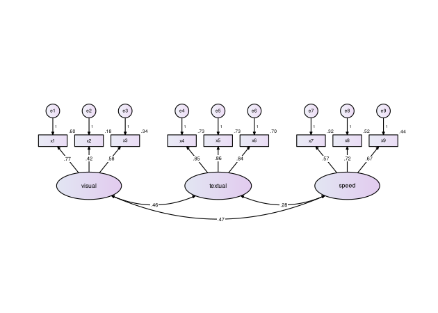

Qué se ve en el diagrama:

- **Rectángulos**: las variables observadas (ítems).
- **Óvalos**: los constructos (variables latentes).
- **Círculos `e1`, `e2`, …**: los errores, con su peso fijo en 1.
- **Números sobre las flechas**: cargas factoriales estandarizadas.
- **Número junto a cada ítem**: su R², la proporción de varianza que
  explica el constructo.
- **Flechas curvas de doble punta**: correlaciones entre constructos.

## Con tus propios datos

El procedimiento es siempre el mismo: leer los datos, revisarlos,
escribir el modelo, estimarlo con `lavaan` y pasárselo a
`diagrama_sem()`.

``` r
datos <- leer_datos("mis_datos.xlsx")   # Excel, SPSS (.sav), CSV, Stata...
# datos <- leer_datos()                 # o elige el archivo en una ventana

modelo <- "
  Factor1 =~ item1 + item2 + item3
  Factor2 =~ item4 + item5 + item6
"
revisar_datos(datos, modelo)            # revisa nombres, perdidos, N...
fit <- cfa(modelo, data = datos)        # sem() para trayectorias o SEM
revisar_modelo(fit)                     # ¿hubo problemas al estimar?

diagrama_sem(fit)
```

`revisar_modelo()` traduce los avisos de `lavaan` (en inglés) a mensajes
claros con qué hacer: si el modelo no convergió o no está identificado,
si hay varianzas negativas (*casos Heywood*), cargas estandarizadas
mayores que 1, factores con correlación de 1 o muy alta, factores con
uno o dos ítems, y cargas bajas o no significativas.

`leer_datos()` reconoce el formato por la extensión del archivo, detecta
si un CSV usa coma o punto y coma (y la coma decimal), quita las
etiquetas de SPSS y convierte los nombres de columna con espacios o
acentos en nombres que R acepta, avisándote de cada cambio. Si tus datos
tienen códigos de dato perdido, indícalos:
`leer_datos("encuesta.sav", perdidos = c(99, 999))`.

`revisar_datos()` te avisa, antes de estimar, de lo que suele hacer
fallar el análisis: nombres del modelo que no están en los datos (y te
sugiere el correcto), errores de sintaxis, columnas de texto o
constantes, códigos como 99 que parecen datos perdidos, el porcentaje de
perdidos, si los ítems son tipo Likert y qué estimador conviene, y el
tamaño de la muestra.

### Plantillas

Si prefieres no escribir el código desde cero, `plantilla()` crea un
script con todo el análisis explicado paso a paso; solo cambias lo
marcado con `>>> CAMBIA AQUÍ <<<`:

``` r
plantilla()                 # muestra las plantillas disponibles
plantilla("afc")            # crea analisis_afc.R y lo abre en RStudio
```

Hay plantillas para `"afe"`, `"afc"`, `"trayectorias"`, `"sem"`,
`"moderacion"` y `"manova"`, y cada una trae datos de ejemplo para
probarla. Para saber cómo interpretar y redactar cada resultado,
consulta la guía [Cómo interpretar y redactar los
resultados](INTERPRETACION.md).

## Acomodo automático

`diagrama_sem()` detecta el tipo de modelo y elige el acomodo. Al
imprimir el resultado se ve qué decidió:

``` r
d <- diagrama_sem(fit, dibujar = FALSE)
d
#> Diagrama de apaMultivariate
#>   Tipo de modelo: análisis factorial confirmatorio 
#>   Acomodo:        fila 
#>   Constructos:    3  | Variables observadas: 9  | Errores: 9 
#>   Solución:       estandarizada 
#> Usa plot() para dibujarlo o guardar_diagrama() para guardarlo.
```

Los acomodos disponibles son:

| Acomodo          | Descripción                             | Se usa automáticamente en                                       |
|------------------|-----------------------------------------|-----------------------------------------------------------------|
| `"fila"`         | Constructos en fila, ítems arriba       | AFC, AFE y segundo orden con hasta 3 factores                   |
| `"dos_filas"`    | Dos filas, ítems hacia afuera           | AFC, AFE y segundo orden con 4+ factores, o con cargas cruzadas |
| `"arbol"`        | Factor general arriba, ítems abajo      | (a elección)                                                    |
| `"bifactor"`     | General arriba, específicos abajo       | Modelos bifactor                                                |
| `"izq_der"`      | Niveles causales de izquierda a derecha | Trayectorias y SEM                                              |
| `"arriba_abajo"` | Niveles causales de arriba hacia abajo  | MIMIC y trayectorias con 4+ exógenas                            |

Para elegir otro:

``` r
diagrama_sem(fit, acomodo = "dos_filas")
```

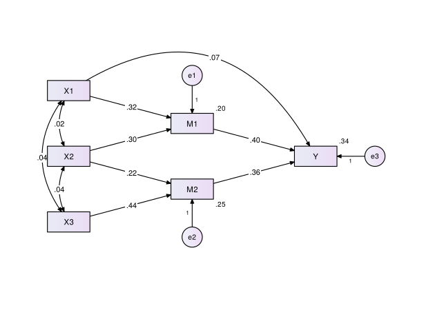

## Segundo orden

``` r
fit2 <- cfa(paste(modelo, "\n Mental =~ visual + textual + speed"),
            data = HolzingerSwineford1939)
diagrama_sem(fit2)
```

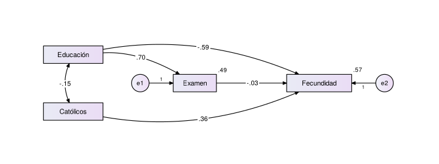

Los constructos de primer orden llevan su propio error (perturbación) y
su R², que indica cuánto de su varianza explica el factor general.

## Análisis de trayectorias

En un análisis de trayectorias todas las variables son observadas (no
hay factores) y el modelo se escribe con `~`, que se lee “es explicada
por”:

| Símbolo | Significado                              | Ejemplo                 |
|---------|------------------------------------------|-------------------------|
| `~`     | efecto (flecha de una punta)             | `Y ~ X`: X influye en Y |
| `~~`    | correlación (flecha curva de dos puntas) | `Y1 ~~ Y2`              |

Este ejemplo usa los datos `swiss`, incluidos en R: indicadores de 47
provincias de Suiza en 1888. Se plantea que la educación influye en los
resultados de un examen y que la educación, el examen y el porcentaje de
católicos influyen en la fecundidad.

``` r
modelo_path <- "
  Examination ~ Education
  Fertility   ~ Education + Examination + Catholic
"
fit3 <- sem(modelo_path, data = swiss)
diagrama_sem(fit3, etiquetas = c(Education = "Educación", Examination = "Examen",
                                 Fertility = "Fecundidad", Catholic = "Católicos"))
```


Cómo se lee:

- Las variables se ordenan por **nivel causal**: a la izquierda las que
  solo explican (exógenas), al centro las mediadoras y a la derecha los
  resultados.
- Las **variables exógenas** se correlacionan entre sí (flecha curva).
- Cada variable explicada lleva su **error** (`e1`, `e2`) y su **R²**:
  la proporción de su varianza que explican sus predictores.
- Un efecto que “salta” un nivel (aquí Educación → Fecundidad) se curva
  para no pasar por encima de otras cajas.

Con tus datos, una mediación simple se escribe así:

``` r
modelo <- "
  M ~ X          # X influye en el mediador
  Y ~ M + X      # el mediador y X influyen en el resultado
"
fit <- sem(modelo, data = datos)
diagrama_sem(fit)
```

Los efectos indirectos o totales que definas con `:=` (por ejemplo,
`ind := a*b`) no se dibujan, porque no son flechas del modelo;
consúltalos con `summary(fit)`.

## Modelo de ecuaciones estructurales

``` r
fit4 <- sem("ind60 =~ x1 + x2 + x3
             dem60 =~ y1 + y2 + y3 + y4
             dem65 =~ y5 + y6 + y7 + y8
             dem60 ~ ind60
             dem65 ~ ind60 + dem60
             y1 ~~ y5
             y2 ~~ y4 + y6
             y3 ~~ y7
             y4 ~~ y8
             y6 ~~ y8", data = PoliticalDemocracy)
diagrama_sem(fit4)
```

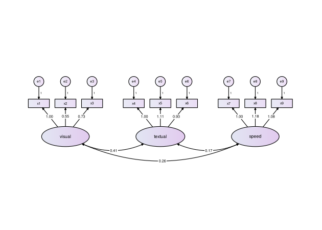

Cada constructo coloca sus ítems donde menos estorban a las flechas
entre constructos. Las covarianzas entre errores se dibujan como arcos
entre los círculos de error.

## Análisis factorial exploratorio

`diagrama_sem()` también dibuja análisis exploratorios hechos con
`psych::fa()` o con `lavaan::efa()`.

``` r
library(psych)
items <- HolzingerSwineford1939[, paste0("x", 1:9)]   # solo las columnas de los ítems
afe <- fa(items, nfactors = 3, rotate = "oblimin", fm = "ml")
diagrama_sem(afe)
```

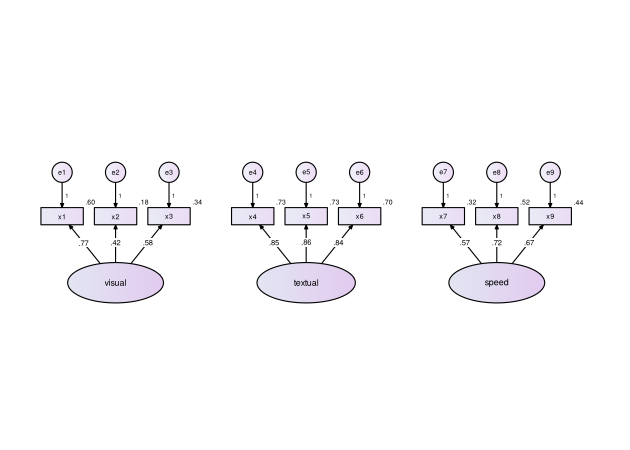

En un exploratorio cada ítem carga en todos los factores, así que el
diagrama muestra solo lo importante:

- Cada ítem va con el factor en que **más carga**, ordenado de mayor a
  menor.
- Se agregan las **cargas cruzadas** de .30 o más (aquí, x9 también
  carga en otro factor). El umbral se cambia con `umbral = 0.40`.
- Si un ítem no llega al umbral en ningún factor, su flecha se dibuja
  **punteada** y aparece un aviso.
- Con rotación oblicua (`oblimin`, `promax`) se muestran las
  **correlaciones entre factores**; con rotación ortogonal (`varimax`)
  no hay.
- El número junto a cada ítem es su **comunalidad** (h²).

Los nombres `ML1`, `ML2`… los pone `psych`; cámbialos con `etiquetas`:

``` r
diagrama_sem(afe, etiquetas = c(ML1 = "Verbal", ML2 = "Velocidad", ML3 = "Visual"))
```

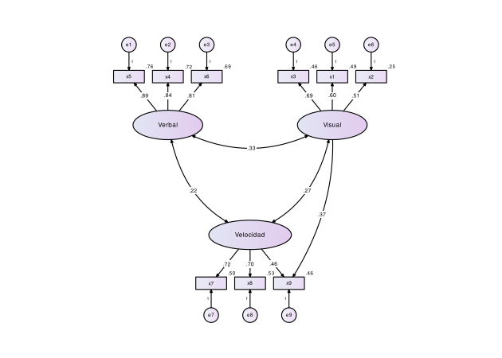

Con `lavaan::efa()` es igual. Si pediste varias soluciones (por ejemplo,
`nfactors = 2:4`), indica cuál dibujar:

``` r
afe2 <- efa(data = items, nfactors = 2:4)
diagrama_sem(afe2, nfactores = 3)
```

## Estilos: clásico, revista y color

El argumento `estilo` cambia el aspecto del diagrama sin cambiar su
contenido.

| Estilo                    | Aspecto                                                                  | Para qué                                                  |
|---------------------------|--------------------------------------------------------------------------|-----------------------------------------------------------|
| `"clasico"` (por omisión) | El de AMOS: degradado, bordes negros, los “1” de los errores             | Clases, tareas, tesis                                     |
| `"revista"`               | Grises, letra más grande, relleno plano, errores y correlaciones en gris | Artículos (sirve en cualquier revista)                    |
| `"color"`                 | Como `"revista"`, pero cada factor y sus ítems con su propio color       | Presentaciones, carteles y revistas que publican en color |

``` r
diagrama_sem(fit, estilo = "revista")
```

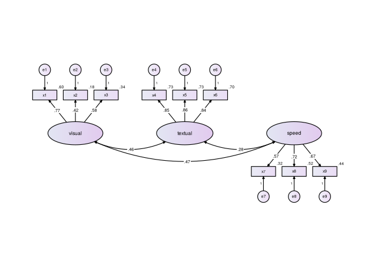

``` r
diagrama_sem(fit, estilo = "color")
```

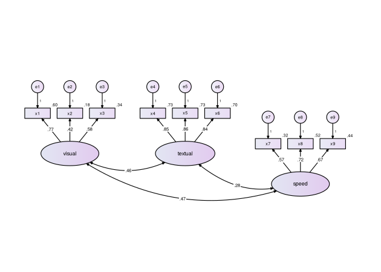

Qué cambia en los estilos `"revista"` y `"color"`:

- La letra es más grande y sin serifa (Arial o Helvetica, según el
  equipo), y las cajas crecen para que quepa.
- Las cargas y los efectos van en negro; los errores, las correlaciones
  y las R² en gris, para que destaque lo importante.
- Cada valor va sobre un fondo blanco, así que ninguna línea lo cruza.
- Relleno plano, sin degradados ni sombras.
- No se escriben los “1” de las flechas de error. Si tu revista o tu
  profesor los piden, usa el estilo `"clasico"` o explícalo en la nota
  de la figura (por ejemplo: *Las cargas de los errores se fijaron en
  1*).

Los colores del estilo `"color"` son de la paleta Okabe-Ito: se
distinguen aun con daltonismo y siguen leyéndose si la revista imprime
en blanco y negro. Con más de seis factores los colores se repiten. Las
opciones `paleta` y `degradado` solo aplican al estilo `"clasico"`.

## Tablas en formato APA

El paquete crea las tablas que suelen pedirse en un artículo o una tesis
con análisis factoriales, de trayectorias o SEM. Todas se ven en la
consola, se guardan en Word con formato APA (número, título en cursiva,
solo líneas horizontales y nota) y guardan sus valores numéricos en
`$datos`.

| Etapa       | Función                    | Qué reporta                                                                         |
|-------------|----------------------------|-------------------------------------------------------------------------------------|
| Datos       | `tabla_descriptivos()`     | n, M, DE, asimetría, curtosis y correlaciones                                       |
|             | `tabla_perdidos()`         | Datos perdidos por variable y casos completos                                       |
|             | `tabla_normalidad()`       | Normalidad: asimetría y curtosis con c.r. (como AMOS) y Mardia                      |
|             | `tabla_atipicos()`         | Atípicos multivariados (Mahalanobis, p1 y p2)                                       |
|             | `quitar_atipicos()`        | Los datos sin los atípicos                                                          |
| AFE         | `tabla_factorabilidad()`   | KMO, Bartlett y número de factores (Kaiser, análisis paralelo, MAP)                 |
|             | `tabla_cargas()`           | Cargas, comunalidades y varianza explicada                                          |
| Medición    | `tabla_cargas()`           | Cargas estandarizadas, EE, *p* y R²                                                 |
|             | `tabla_confiabilidad()`    | Alfa (con IC), omega y correlaciones ítem-total                                     |
|             | `tabla_validez()`          | CR, AVE y criterio de Fornell-Larcker                                               |
|             | `tabla_htmt()`             | Validez discriminante HTMT                                                          |
|             | `tabla_bifactor()`         | Índices bifactor: ωH, ωHS, ECV, PUC, H y FD                                         |
|             | `tabla_metodo_comun()`     | Sesgo de método común (Harman y AFC de un factor)                                   |
| Ajuste      | `tabla_ajuste()`           | χ², CFI, TLI, RMSEA, SRMR de uno o varios modelos                                   |
|             | `tabla_criterios_ajuste()` | Cada índice contra criterios excelente/aceptable, e identificación del modelo       |
|             | `tabla_modificacion()`     | Índices de modificación                                                             |
|             | `tabla_residuales()`       | Residuales de correlación (dónde ajusta mal el modelo)                              |
|             | `tabla_comparacion()`      | Modelos alternativos con Δχ², ΔCFI, AIC y BIC                                       |
|             | `tabla_invarianza()`       | Invarianza configural, métrica, escalar y estricta                                  |
| Estructural | `tabla_parametros()`       | Estimaciones como en AMOS: B, EE, C.R., p, β, covarianzas y varianzas               |
|             | `tabla_efectos()`          | Efectos directos, indirectos (bootstrap) y totales                                  |
|             | `tabla_hipotesis()`        | Cada hipótesis (directa, indirecta, total o covarianza): se sostiene o no                                        |
|             | `tabla_vif()`              | Multicolinealidad entre predictores                                                 |
| Moderación  | `tabla_moderacion()`       | Moderación y mediación moderada (modelos 1, 7 y 14 de PROCESS)                      |
|             | `grafica_interaccion()`    | Gráfica de pendientes simples                                                       |
| MANOVA      | `tabla_manova()`           | Pruebas multivariadas, supuestos, ANOVA de seguimiento, post hoc y medias por grupo |
| Método      | `parrafo_metodo()`         | Párrafo de software y estimación con sus referencias                                |

### Descriptivos, datos perdidos y normalidad

La “Tabla 1” de casi cualquier artículo: descriptivos y correlaciones
con asteriscos de significancia. La asimetría y la curtosis son las
mismas que da SPSS.

``` r
items <- HolzingerSwineford1939[, paste0("x", 1:9)]
tabla_descriptivos(items[, 1:5])
#> 
#> Estadísticos descriptivos y correlaciones
#> ─────────────────────────────────────────────────────────────────────────────
#> Variable   n    M     DE   Asimetría  Curtosis    1       2       3      4   
#> ─────────────────────────────────────────────────────────────────────────────
#> 1. x1     301  4.94  1.17    -0.26      0.36      —                          
#> 2. x2     301  6.09  1.18    0.47       0.38    .30***    —                  
#> 3. x3     301  2.25  1.13    0.39      -0.89    .44***  .34***    —          
#> 4. x4     301  3.06  1.16    0.27       0.12    .37***  .15**   .16**    —   
#> 5. x5     301  4.34  1.29    -0.35     -0.53    .29***   .14*    .08   .73***
#> ─────────────────────────────────────────────────────────────────────────────
#> Nota. M = media; DE = desviación estándar. Asimetría y curtosis corregidas
#> por sesgo; valores de asimetría entre −2 y 2 y de curtosis entre −7 y 7
#> suelen considerarse aceptables (West et al., 1995). Correlaciones de Pearson
#> con eliminación por pares. * p < .05. ** p < .01. *** p < .001.
```

``` r
tabla_perdidos(airquality)      # datos de ejemplo de R con datos perdidos
#> 
#> Datos perdidos por variable
#> ──────────────────────────────────────────────
#> Variable         Válidos  Perdidos  % perdidos
#> ──────────────────────────────────────────────
#> Ozone              116       37        24.2   
#> Solar.R            146       7         4.6    
#> Wind               153       0         0.0    
#> Temp               153       0         0.0    
#> Month              153       0         0.0    
#> Day                153       0         0.0    
#> ┈┈┈┈┈┈┈┈┈┈┈┈┈┈┈┈┈┈┈┈┈┈┈┈┈┈┈┈┈┈┈┈┈┈┈┈┈┈┈┈┈┈┈┈┈┈
#> Casos completos    111       42        27.5   
#> ──────────────────────────────────────────────
#> Nota. N = 153. En la última fila, casos sin ningún dato
#> perdido y casos con al menos uno. Datos perdidos en total:
#> 4.8 % de las celdas. Para estimar el modelo con todos los
#> casos puede usarse máxima verosimilitud con información
#> completa (missing = "fiml" en lavaan).
```

``` r
tabla_normalidad(items)
#> 
#> Evaluación de la normalidad
#> ─────────────────────────────────────────────────────────────────────
#> Variable               Mín.  Máx.   Asimetría  c.r.   Curtosis  c.r. 
#> ─────────────────────────────────────────────────────────────────────
#> x1                     0.67  8.50     -0.26    -1.81    0.33    1.17 
#> x2                     2.25  9.25     0.47     3.35     0.35    1.26 
#> x3                     0.25  4.50     0.39     2.73    -0.89    -3.16
#> x4                     0.00  6.33     0.27     1.90     0.10    0.36 
#> x5                     1.00  7.00     -0.35    -2.49   -0.54    -1.90
#> x6                     0.14  6.14     0.86     6.11     0.84    2.98 
#> x7                     1.30  7.43     0.25     1.77    -0.29    -1.02
#> x8                     3.05  10.00    0.53     3.74     1.20    4.25 
#> x9                     2.78  9.25     0.20     1.45     0.31    1.10 
#> ┈┈┈┈┈┈┈┈┈┈┈┈┈┈┈┈┈┈┈┈┈┈┈┈┈┈┈┈┈┈┈┈┈┈┈┈┈┈┈┈┈┈┈┈┈┈┈┈┈┈┈┈┈┈┈┈┈┈┈┈┈┈┈┈┈┈┈┈┈
#> Multivariada (Mardia)                                   4.59    2.83 
#> ─────────────────────────────────────────────────────────────────────
#> Nota. c.r. = razón crítica (z): asimetría/√(6/n) y curtosis/√(24/n);
#> la curtosis es el exceso sobre la normal. En negritas, |c.r.| > 1.96
#> (p < .05), que indica falta de normalidad; con p < .01 el límite es
#> 2.58. Multivariada: coeficiente de curtosis de Mardia y su c.r. N =
#> 301 casos completos. Asimetría significativa en x2, x3, x5, x6, x8.
#> Curtosis significativa en x3, x6, x8. El c.r. multivariado indica
#> que no hay normalidad multivariada; se recomienda un estimador
#> robusto (MLR o MLM) o bootstrap.
#> 
#> Pruebas de normalidad multivariada de Mardia
#> ─────────────────────────────────────────────────────────────
#> Prueba                  Coeficiente  Estadístico  gl     p   
#> ─────────────────────────────────────────────────────────────
#> Asimetría multivariada     6.88      χ² = 344.91  165  < .001
#> Curtosis multivariada     103.59      z = 2.83          .005 
#> ─────────────────────────────────────────────────────────────
#> Nota. Pruebas de Mardia (1970) con 301 casos y 9 variables.
#> Se rechaza la normalidad multivariada (asimetría y
#> curtosis); se recomienda un estimador robusto (MLR o MLM) o
#> bootstrap.
```

Como en AMOS, cada variable tiene su asimetría y su curtosis con la
razón crítica (c.r. = z); un \|c.r.\| mayor que 1.96 (en la práctica, 2)
indica falta de normalidad, y la última fila es la curtosis multivariada
de Mardia. Si no hay normalidad multivariada, conviene estimar con
`estimator = "MLR"` o bootstrap; la nota lo indica.

Casos atípicos multivariados (distancia de Mahalanobis). Un p1 ≤ .001
señala un atípico (Kline, 2011):

``` r
at <- tabla_atipicos(items)
at
#> 
#> Casos más alejados del centroide (distancia de Mahalanobis)
#> ─────────────────────────
#> Fila   D²      p1     p2 
#> ─────────────────────────
#> 180   28.67  < .001  .199
#> 163   28.29  < .001  .028
#> 262   27.61   .001   .005
#> 78    25.70   .002   .005
#> 233   24.17   .004   .008
#> 196   23.60   .005   .004
#> 107   22.81   .007   .004
#> 105   22.45   .008   .002
#> 254   21.28   .011   .009
#> 268   21.09   .012   .005
#> ─────────────────────────
#> Nota. D² = distancia de Mahalanobis al cuadrado (9
#> variables, N = 301); p1 = P(χ²(9) ≥ D²); p2 = probabilidad
#> de que la i-ésima D² más grande alcance ese valor. Casos
#> ordenados de más a menos alejado. En negritas, 2 casos
#> atípicos (p1 ≤ .001; Kline, 2011): filas 180, 163. Atípicos
#> univariados (|z| > 3): x1 (2), x2 (1), x6 (3), x8 (2), x9
#> (2).
at$atipicos          # filas de los atípicos
#> [1] 163 180
```

Si decides excluirlos, `quitar_atipicos()` devuelve los datos sin ellos
y te dice cuántos quitó (el mismo criterio, *p* \< .001). Puedes
indicarle el modelo para que use solo sus variables:

``` r
datos2 <- quitar_atipicos(datos, modelo)
fit2 <- cfa(modelo, data = datos2)
```

Repórtalo y, si puedes, compara los resultados con y sin esos casos.

### Antes de un análisis exploratorio

Factorabilidad (KMO, Bartlett) y cuántos factores retener según cuatro
criterios:

``` r
tabla_factorabilidad(items)
#> 
#> Factorabilidad de la matriz de correlaciones
#> ───────────────────────────────────────────────────────────────
#> Indicador                      Valor            Criterio       
#> ───────────────────────────────────────────────────────────────
#> KMO global                      .75             ≥ .60 (mediano)
#> MSA mínimo por ítem          .59 (x7)           ≥ .50          
#> Prueba de Bartlett   χ²(36) = 904.10, p < .001  p < .05        
#> Determinante                 4.72e-02           > 0.00001      
#> ───────────────────────────────────────────────────────────────
#> Nota. KMO = medida de adecuación muestral de
#> Kaiser-Meyer-Olkin (calificación de Kaiser, 1974); MSA =
#> adecuación de cada ítem. N = 301 casos completos. Todos los
#> ítems tienen MSA ≥ .50.
#> 
#> Número de factores sugerido por cada criterio
#> ─────────────────────────────────────────────────────
#> Criterio                                     Factores
#> ─────────────────────────────────────────────────────
#> Autovalores mayores que 1 (Kaiser)              3    
#> Análisis paralelo, componentes (Horn, 1965)     3    
#> Análisis paralelo, factores                     3    
#> MAP de Velicer (1976)                           2    
#> ─────────────────────────────────────────────────────
#> Nota. Análisis paralelo con 100 conjuntos de datos
#> aleatorios y el percentil 95. El criterio de Kaiser tiende
#> a sobrestimar el número de factores; se recomienda dar más
#> peso al análisis paralelo y a la MAP, y a la
#> interpretabilidad de la solución.
#> 
#> Autovalores observados y aleatorios (percentil 95)
#> ──────────────────────────────────────────────────
#> N.º  Componentes  Aleatorios  Factores  Aleatorios
#> ──────────────────────────────────────────────────
#> 1       3.22         1.35       2.70       1.06   
#> 2       1.64         1.26       0.92       0.27   
#> 3       1.37         1.16       0.45       0.19   
#> 4       0.70         1.08       0.01       0.12   
#> 5       0.58         1.04      -0.02       0.06   
#> 6       0.50         0.98      -0.22       0.01   
#> 7       0.47         0.92      -0.36      -0.05   
#> 8       0.29         0.87      -0.40      -0.10   
#> 9       0.24         0.81      -0.50      -0.16   
#> ──────────────────────────────────────────────────
#> Nota. En negritas, autovalores observados mayores que los
#> aleatorios. Factores: autovalores de la solución factorial
#> (fm = "ml"), como en psych::fa.parallel().
```

El análisis paralelo de factores se calcula igual que
`psych::fa.parallel()` con el método de extracción `fm` (por defecto
`"ml"`); usa el mismo método que en tu análisis factorial, por ejemplo
`tabla_factorabilidad(items, fm = "pa")`.

Cuando los criterios no coinciden, compara las soluciones candidatas.
`comparar_soluciones()` estima el AFE con el número de factores que
sugieren (o los que indiques) y resume cada solución: varianza
explicada, ítems sin ninguna carga destacada, cargas cruzadas, factores
con menos de tres ítems, correlación más alta entre factores e índices
de ajuste. También dibuja cada solución:

``` r
soluciones <- comparar_soluciones(items, 2:4, dibujar = FALSE)
soluciones
#> 
#> Comparación de soluciones factoriales
#> ─────────────────────────────────────────────────────────────────────────────
#> Factores  % var.  Sin carga  Cruzadas  < 3 ítems  r máx.  RMSEA   TLI    BIC 
#> ─────────────────────────────────────────────────────────────────────────────
#> 2          43.4       1         0          0       .35    .138   .762   19.2 
#> 3          53.9       0         1          0       .33    .053   .964   -46.1
#> 4          58.4       0         2          2       .72    .000   1.003  -28.7
#> ─────────────────────────────────────────────────────────────────────────────
#> Nota. Extracción ml, rotación oblimin. % var. = varianza común explicada
#> (suma de comunalidades); Sin carga = ítems sin ninguna carga ≥ .40; Cruzadas
#> = ítems con dos cargas ≥ .30 que difieren en menos de .20; < 3 ítems =
#> factores con menos de tres ítems; r máx. = correlación más alta entre
#> factores. En negritas, lo que conviene revisar. 2 factores (sin carga: x2).
#> 3 factores (cruzadas: x9). 4 factores (cruzadas: x6, x9).
#> 
#> Factor con la carga más alta de cada ítem, por solución
#> ────────────────────────────────────────
#> Ítem  2 factores  3 factores  4 factores
#> ────────────────────────────────────────
#> x1    ML2 (.43)   ML3 (.60)   ML4 (.63) 
#> x2    ML2 (.25)   ML3 (.51)   ML4 (.51) 
#> x3    ML2 (.46)   ML3 (.69)   ML4 (.67) 
#> x4    ML1 (.85)   ML1 (.84)   ML2 (.85) 
#> x5    ML1 (.87)   ML1 (.89)   ML1 (.97) 
#> x6    ML1 (.82)   ML1 (.81)   ML2 (.41) 
#> x7    ML2 (.45)   ML2 (.72)   ML3 (.77) 
#> x8    ML2 (.63)   ML2 (.70)   ML3 (.65) 
#> x9    ML2 (.74)   ML2 (.46)   ML3 (.42) 
#> ────────────────────────────────────────
#> Nota. Entre paréntesis, la carga (de patrón, si la rotación
#> es oblicua). Para la tabla completa de una solución:
#> tabla_cargas(r$soluciones[["nombre"]]).
#> 
#> Elige la solución que tenga sentido teórico y una estructura clara: cada ítem
#> en un solo factor y al menos tres ítems por factor. Para ver sus cargas:
#> tabla_cargas(r$soluciones[["2"]]) (nombres disponibles: 2, 3, 4).
```

Elige la que tenga sentido teórico y una estructura clara; sus cargas,
con `tabla_cargas(soluciones$soluciones[["3"]])`.

La **gráfica de sedimentación** muestra los mismos autovalores que la
tabla, con la línea del análisis paralelo: se retienen los factores cuyo
punto queda por encima de la línea punteada.

``` r
grafica_sedimentacion(items, iteraciones = 50)
```

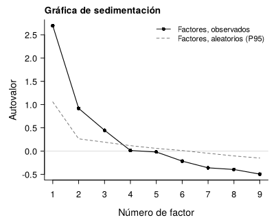

Para **comparar rotaciones** (o métodos de extracción) con un número de
factores fijo, pasa varias a `rotate` (o a `fm`). La rotación no cambia
la varianza total explicada ni el ajuste; solo reparte la varianza entre
los factores. La segunda tabla muestra en qué factor carga cada ítem en
cada solución:

``` r
rotaciones <- comparar_soluciones(items, 3, rotate = c("none", "varimax", "promax"),
                                  fm = "pa", dibujar = FALSE)
rotaciones
#> 
#> Comparación de soluciones factoriales
#> ─────────────────────────────────────────────────────────────────────────────────────────────
#> Rotación   % var.   % por factor   Sin carga  Cruzadas  < 3 ítems  r máx.  RMSEA  TLI    BIC 
#> ─────────────────────────────────────────────────────────────────────────────────────────────
#> sin rotar   54.0   31.4/13.5/9.0       1         5          2        —     .054   .963  -45.9
#> varimax     54.0   24.3/14.9/14.8      0         1          0        —     .054   .963  -45.9
#> promax      54.0   24.6/14.7/14.6      0         1          0       .39    .054   .963  -45.9
#> ─────────────────────────────────────────────────────────────────────────────────────────────
#> Nota. Extracción pa, 3 factores. % var. = varianza común explicada (suma de
#> comunalidades); % por factor = varianza de cada factor después de rotar; Sin
#> carga = ítems sin ninguna carga ≥ .40; Cruzadas = ítems con dos cargas ≥ .30
#> que difieren en menos de .20; < 3 ítems = factores con menos de tres ítems; r
#> máx. = correlación más alta entre factores. En negritas, lo que conviene
#> revisar. La rotación no cambia la varianza total explicada ni el ajuste
#> (RMSEA, TLI, BIC); solo reparte la varianza entre los factores para que cada
#> ítem cargue en uno (estructura simple). Las rotaciones oblicuas (promax,
#> oblimin) permiten que los factores se correlacionen, lo habitual en ciencias
#> sociales. sin rotar (sin carga: x2; cruzadas: x2, x3, x7, x8, x9). varimax
#> (cruzadas: x9). promax (cruzadas: x9).
#> 
#> Factor con la carga más alta de cada ítem, por solución
#> ──────────────────────────────────────
#> Ítem  sin rotar    varimax    promax  
#> ──────────────────────────────────────
#> x1    PA1 (.58)   PA3 (.61)  PA3 (.60)
#> x2    PA3 (.39)   PA3 (.49)  PA3 (.53)
#> x3    PA3 (.44)   PA3 (.66)  PA3 (.70)
#> x4    PA1 (.77)   PA1 (.83)  PA1 (.85)
#> x5    PA1 (.75)   PA1 (.86)  PA1 (.89)
#> x6    PA1 (.76)   PA1 (.80)  PA1 (.80)
#> x7    PA3 (-.48)  PA2 (.70)  PA2 (.75)
#> x8    PA2 (.54)   PA2 (.70)  PA2 (.71)
#> x9    PA1 (.51)   PA2 (.52)  PA2 (.48)
#> ──────────────────────────────────────
#> Nota. Entre paréntesis, la carga (de patrón, si la rotación
#> es oblicua). Para la tabla completa de una solución:
#> tabla_cargas(r$soluciones[["nombre"]]).
#> 
#> Elige la solución que tenga sentido teórico y una estructura clara: cada ítem
#> en un solo factor y al menos tres ítems por factor. Para ver sus cargas:
#> tabla_cargas(r$soluciones[["none"]]) (nombres disponibles: none, varimax,
#> promax).
```

La tabla completa de una de ellas:
`tabla_cargas(rotaciones$soluciones[["promax"]])`.

**Si limpias los datos y los guardas en CSV**, usa
`write.csv(datos, "archivo.csv", row.names = FALSE)`. Sin
`row.names = FALSE`, R agrega una columna con los números de fila que,
al volver a leer el archivo con `read.csv()`, entra al análisis como si
fuera un ítem. `leer_datos()` la quita sola y `revisar_datos()` avisa si
la encuentra.

### Cargas factoriales

En un **exploratorio**, la tabla incluye la matriz de cargas (de patrón
si la rotación es oblicua), las comunalidades, la varianza explicada y
las correlaciones entre factores:

``` r
tabla_cargas(afe, etiquetas = c(ML1 = "Verbal", ML2 = "Velocidad", ML3 = "Visual"))
#> 
#> Cargas factoriales del análisis factorial exploratorio
#> ──────────────────────────────────────────────────
#> Ítem                Verbal  Visual  Velocidad  h² 
#> ──────────────────────────────────────────────────
#> x5                   .89                       .76
#> x4                   .84                       .72
#> x6                   .81                       .69
#> x3                           .69               .46
#> x1                           .60               .49
#> x2                           .51               .25
#> x7                                     .72     .50
#> x8                                     .70     .53
#> x9                           .37       .46     .46
#> ┈┈┈┈┈┈┈┈┈┈┈┈┈┈┈┈┈┈┈┈┈┈┈┈┈┈┈┈┈┈┈┈┈┈┈┈┈┈┈┈┈┈┈┈┈┈┈┈┈┈
#> Varianza explicada   2.24    1.34     1.28        
#> % de varianza        24.9    14.9     14.2        
#> % acumulado          24.9    39.7     53.9        
#> ──────────────────────────────────────────────────
#> Nota. Matriz de patrón. Método: psych::fa (ml, rotación
#> oblimin). N = 301. Se omiten cargas menores que .30. En
#> negritas, la carga más alta de cada ítem. h² = comunalidad.
#> 
#> Correlaciones entre factores
#> ────────────────────────────────────
#> Factor     Verbal  Visual  Velocidad
#> ────────────────────────────────────
#> Verbal       —                      
#> Visual      .33      —              
#> Velocidad   .22     .27        —    
#> ────────────────────────────────────
```

Por omisión se dejan en blanco las cargas menores que .30 y se marca en
negritas la carga más alta de cada ítem (las negritas se ven en Word).
Para ver todas las cargas: `ocultar_bajas = FALSE`.

En un **confirmatorio o SEM**, la tabla muestra las cargas
estandarizadas con su error estándar, valor *p* y R²:

``` r
tabla_cargas(fit)
#> 
#> Cargas factoriales estandarizadas
#> ─────────────────────────────────────
#> Factor   Ítem   λ    EE     p     R² 
#> ─────────────────────────────────────
#> visual   x1    .77  .055  < .001  .60
#>          x2    .42  .060  < .001  .18
#>          x3    .58  .055  < .001  .34
#> textual  x4    .85  .023  < .001  .73
#>          x5    .86  .022  < .001  .73
#>          x6    .84  .023  < .001  .70
#> speed    x7    .57  .053  < .001  .32
#>          x8    .72  .051  < .001  .52
#>          x9    .67  .051  < .001  .44
#> ─────────────────────────────────────
#> Nota. λ = carga factorial estandarizada; EE = error
#> estándar; R² = proporción de varianza del ítem explicada
#> por su factor. N = 301.
```

### Confiabilidad y validez

Alfa de Cronbach con su intervalo de confianza, omega de McDonald y el
rango de las correlaciones ítem-total:

``` r
tabla_confiabilidad(fit)
#> 
#> Confiabilidad de las escalas
#> ──────────────────────────────────────────────────
#> Factor   Ítems   α    IC 95 %     ω   r ítem-total
#> ──────────────────────────────────────────────────
#> visual     3    .63  [.55, .69]  .61    .37–.48   
#> textual    3    .88  [.86, .90]  .89    .77–.79   
#> speed      3    .69  [.62, .74]  .69    .46–.57   
#> ──────────────────────────────────────────────────
#> Nota. α = alfa de Cronbach; IC 95 % de Feldt; ω = omega de
#> McDonald, calculado con las cargas del modelo y la varianza
#> observada de la suma de los ítems; r ítem-total =
#> correlación ítem-total corregida (mínima–máxima). Valores
#> de α y ω ≥ .70 suelen considerarse aceptables (Nunnally y
#> Bernstein, 1994) y una correlación ítem-total ≥ .30
#> adecuada. n = 301 casos completos.
```

Sin un modelo, indica los ítems de cada factor:
`tabla_confiabilidad(datos, factores = list(F1 = c("i1", "i2", "i3"), F2 = c(...)))`.

Confiabilidad compuesta (CR), varianza promedio extraída (AVE) y la
matriz de Fornell y Larcker:

``` r
tabla_validez(fit)
#> 
#> Confiabilidad compuesta, varianza promedio extraída y correlaciones entre factores
#> ─────────────────────────────────────────
#> Factor   CR   AVE  visual  textual  speed
#> ─────────────────────────────────────────
#> visual   .63  .37   .61                  
#> textual  .89  .72   .46      .85         
#> speed    .69  .43   .47      .28     .66 
#> ─────────────────────────────────────────
#> Nota. CR = confiabilidad compuesta; AVE = varianza promedio
#> extraída. En negritas, la raíz cuadrada del AVE; debajo de
#> la diagonal, correlaciones entre factores. Criterios: CR >
#> .70, AVE > .50 (Hair et al., 2014) y raíz del AVE mayor que
#> las correlaciones del factor (Fornell y Larcker, 1981).
#> Todos los factores cumplen el criterio de Fornell-Larcker.
```

Las fórmulas son las clásicas, con las cargas estandarizadas; con
`metodo = "semtools"` se obtienen exactamente los valores de `semTools`.

Muchos revisores piden además el **HTMT**, un criterio de validez
discriminante más exigente que el de Fornell-Larcker. Valores menores
que .85 indican validez discriminante:

``` r
tabla_htmt(fit)
#> 
#> Validez discriminante: razón heterorrasgo-monorrasgo (HTMT)
#> ────────────────────────
#> Factor   visual  textual
#> ────────────────────────
#> visual     —            
#> textual   .42       —   
#> speed     .47      .29  
#> ────────────────────────
#> Nota. HTMT = razón heterorrasgo-monorrasgo (Henseler et
#> al., 2015). Valores menores que .85 (criterio estricto) o
#> .90 (flexible) indican validez discriminante. Todos los
#> pares son menores que .85.
```

Si todos los datos vienen de un mismo cuestionario, es habitual reportar
el **sesgo de método común**:

``` r
tabla_metodo_comun(fit)
#> 
#> Pruebas de sesgo de método común
#> ───────────────────────────────────────────────────────────────────────────────────────────────────────────────────────────────────────────────────────────────
#> Prueba                  Resultado                                            Criterio                                   Conclusión                             
#> ───────────────────────────────────────────────────────────────────────────────────────────────────────────────────────────────────────────────────────────────
#> Factor único de Harman  Primer componente: 35.7 % de la varianza             < 50 %                                     No hay un factor general dominante     
#> AFC de un factor        CFI = .677, RMSEA = .187; Δχ²(3) = 226.96, p < .001  Peor que el modelo propuesto (CFI = .931)  El sesgo de método no explica los datos
#> ───────────────────────────────────────────────────────────────────────────────────────────────────────────────────────────────────────────────────────────────
#> Nota. Pruebas según Podsakoff et al. (2003). Harman: análisis de componentes
#> principales sin rotar de los 9 ítems. AFC de un factor: todos los ítems en un
#> factor, comparado con el modelo propuesto (Δχ² y ΔCFI). Estas pruebas son
#> poco sensibles: un resultado favorable no descarta por completo el sesgo de
#> método común.
#> La tabla es más ancha que la consola y puede verse cortada. Agranda el panel de la consola o guárdala en Word: guardar_tabla(tabla, "tabla.docx").
```

### Índices de ajuste y comparación de modelos

``` r
tabla_ajuste(fit)
#> 
#> Índices de ajuste
#> ───────────────────────────────────────────────────────────────────────
#> Modelo     χ²    gl    p     χ²/gl  CFI   TLI    RMSEA [IC 90 %]   SRMR
#> ───────────────────────────────────────────────────────────────────────
#> Modelo 1  85.31  24  < .001  3.55   .931  .896  .092 [.071, .114]  .065
#> ───────────────────────────────────────────────────────────────────────
#> Nota. Criterios de buen ajuste (Hu y Bentler, 1999): CFI y TLI ≥ .95
#> (≥ .90 aceptable), RMSEA ≤ .06 (≤ .08 aceptable), SRMR ≤ .08. Con
#> muestras grandes la prueba χ² suele ser significativa aunque el ajuste
#> sea bueno.
```

Si estimaste con un estimador robusto (`estimator = "MLR"`, `"MLM"`,
`"WLSMV"`…), las tablas usan automáticamente los índices corregidos.

Para comparar modelos alternativos, con la prueba de diferencias Δχ²,
ΔCFI, AIC y BIC:

``` r
un_factor <- cfa("g =~ x1 + x2 + x3 + x4 + x5 + x6 + x7 + x8 + x9",
                 data = HolzingerSwineford1939)
tabla_comparacion("Un factor" = un_factor, "Tres factores" = fit)
#> 
#> Comparación de modelos alternativos
#> ───────────────────────────────────────────────────────────────────────────────────────────────────────
#> Modelo           χ²    gl  CFI   TLI   RMSEA  SRMR    AIC      BIC    Δχ² (Δgl)     p     ΔCFI   ΔRMSEA
#> ───────────────────────────────────────────────────────────────────────────────────────────────────────
#> Un factor      312.26  27  .677  .569  .187   .143  7,738.4  7,805.2      —         —       —      —   
#> Tres factores  85.31   24  .931  .896  .092   .065  7,517.5  7,595.3  226.96 (3)  < .001  +.254  -.095 
#> ───────────────────────────────────────────────────────────────────────────────────────────────────────
#> Nota. Diferencias respecto del modelo anterior. Δχ² válida solo para modelos
#> anidados. Un ΔCFI menor que −.010 junto con un ΔRMSEA mayor que .015 indica
#> un ajuste apreciablemente peor (Chen, 2007). AIC y BIC: menor es mejor; el
#> AIC más bajo es el de Tres factores y también el BIC.
#> La tabla es más ancha que la consola y puede verse cortada. Agranda el panel de la consola o guárdala en Word: guardar_tabla(tabla, "tabla.docx").
```

La Δχ² solo es válida si un modelo es una versión restringida del otro
(modelos anidados); si no lo son, usa `anidados = FALSE` y compara AIC y
BIC.

#### Modelos rivales de un AFC

`modelos_rivales()` genera, estima y compara de una vez los rivales
habituales de tu modelo de medición: un factor, factores independientes,
segundo orden y bifactor (estos dos, con tres o más factores). Usa las
mismas opciones que tu modelo, marca los que tuvieron problemas de
estimación y dibuja cada uno (en pantalla, o en archivos con
`archivo = "rival.png"`):

``` r
rivales <- modelos_rivales(fit, dibujar = FALSE)
rivales
#> 
#> Comparación del modelo propuesto con sus modelos rivales
#> ──────────────────────────────────────────────────────────────────────────────────────────────────────────────────────────────
#> Modelo                                  χ²    gl  CFI   TLI   RMSEA  SRMR    AIC      BIC    Δχ² (Δgl)     p     ΔCFI   ΔRMSEA
#> ──────────────────────────────────────────────────────────────────────────────────────────────────────────────────────────────
#> Factores correlacionados (tu modelo)  85.31   24  .931  .896  .092   .065  7,517.5  7,595.3      —         —       —      —   
#> Un factor                             312.26  27  .677  .569  .187   .143  7,738.4  7,805.2  226.96 (3)  < .001  -.254  +.095 
#> Factores independientes               153.53  27  .857  .809  .125   .161  7,579.7  7,646.4  68.22 (3)   < .001  -.074  +.033 
#> Segundo orden                         85.31   24  .931  .896  .092   .065  7,517.5  7,595.3   0.00 (0)           +.000  +.000 
#> Bifactor                              34.88   18  .981  .962  .056   .047  7,479.1  7,579.2  50.43 (6)   < .001  +.050  -.036 
#> ──────────────────────────────────────────────────────────────────────────────────────────────────────────────────────────────
#> Nota. Diferencias respecto de Factores correlacionados (tu modelo). Δχ²
#> válida solo para modelos anidados. Un ΔCFI menor que −.010 junto con un
#> ΔRMSEA mayor que .015 indica un ajuste apreciablemente peor (Chen, 2007). AIC
#> y BIC: menor es mejor; el AIC más bajo es el de Bifactor y también el BIC.
#> Los modelos rivales están anidados en el propuesto, salvo el bifactor, en el
#> que el propuesto está anidado. Con tres factores, el de segundo orden es
#> equivalente al de factores correlacionados (mismo ajuste). Problemas de
#> estimación: Bifactor (varianza negativa (caso Heywood)).
#> 
#> Cómo leerla: tu modelo se sostiene si ajusta mejor que los rivales más simples
#> (un factor, factores independientes): Δχ² significativa y un AIC y BIC más
#> altos en ellos. Si el de segundo orden ajusta casi igual, la correlación entre
#> tus factores puede explicarse con un factor general. El bifactor suele ajustar
#> mejor por tener más parámetros; para decidir si la escala es esencialmente
#> unidimensional usa tabla_bifactor(r$fits$bifactor), no solo el ajuste.
#> 
#> Sintaxis de cada modelo en r$sintaxis; sus tablas con r$fits, por ejemplo tabla_cargas(r$fits$segundo_orden).
```

Tu modelo se sostiene si ajusta mejor que los rivales más simples. Con
tres factores, el de segundo orden es equivalente al de factores
correlacionados; el bifactor suele ajustar mejor por tener más
parámetros, así que para él revisa también
`tabla_bifactor(rivales$fits$bifactor)`. Las tablas de cada rival se
obtienen con `rivales$fits`, por ejemplo
`tabla_cargas(rivales$fits$segundo_orden)`.

#### Si el ajuste no es bueno

`modelo_alternativo(fit)` también funciona con un AFC: quita uno por uno
los ítems (o las cargas cruzadas) con carga estandarizada menor que .40,
sin dejar un factor con menos de tres ítems, y lista las covarianzas
entre errores y las cargas cruzadas que sugieren los índices de
modificación. Con `agregar = 1` las incorpora. Es exploratorio: cada
cambio debe justificarse con la teoría.

### Invarianza de medición

¿El instrumento mide lo mismo en distintos grupos? Indica el modelo, los
datos y la variable de grupo:

``` r
tabla_invarianza(modelo, HolzingerSwineford1939, grupo = "school")
#> 
#> Invarianza de medición entre grupos
#> ──────────────────────────────────────────────────────────────────────────────────────────────────
#> Modelo        χ²    gl  CFI   RMSEA  SRMR  Δχ² (Δgl)    p     ΔCFI   ΔRMSEA  ΔSRMR     Decisión   
#> ──────────────────────────────────────────────────────────────────────────────────────────────────
#> Configural  115.85  48  .923  .097   .068      —        —       —      —       —          —       
#> Métrica     124.04  54  .921  .093   .072  8.19 (6)    .224   -.002  -.004   +.004   Se sostiene  
#> Escalar     164.10  60  .882  .107   .082  40.06 (6)  < .001  -.038  +.015   +.011  No se sostiene
#> Estricta    181.51  69  .873  .104   .088  17.41 (9)   .043   -.009  -.003   +.006   No se evalúa 
#> ──────────────────────────────────────────────────────────────────────────────────────────────────
#> Nota. Grupos: Pasteur (n = 156), Grant-White (n = 145). Cada modelo se
#> compara con el anterior. No se sostiene la invarianza si ΔCFI < −.010 junto
#> con ΔRMSEA > .015 o ΔSRMR > .030 (métrica) o > .010 (escalar y estricta)
#> (Chen, 2007). Nivel más alto sostenido: métrica. Para probar invarianza
#> parcial, los parámetros cuya igualdad más empeora el ajuste son, en orden: x3
#> ~ 1; x7 ~ 1; x2 ~ 1. Libérelos de uno en uno, empezando por el primero
#> (liberar = "x3 ~ 1"), y vuelva a revisar la tabla.
#> La tabla es más ancha que la consola y puede verse cortada. Agranda el panel de la consola o guárdala en Word: guardar_tabla(tabla, "tabla.docx").
```

Cada nivel se compara con el anterior con el criterio de Chen (2007);
también puedes usar `criterio = "cfi"` o `criterio = "chi2"`. Si un
nivel no se sostiene, la nota indica qué parámetro conviene liberar para
probar la **invarianza parcial**:

``` r
tabla_invarianza(modelo, HolzingerSwineford1939, grupo = "school", liberar = "x3 ~ 1")
#> 
#> Invarianza de medición entre grupos
#> ─────────────────────────────────────────────────────────────────────────────────────────────────────
#> Modelo              χ²    gl  CFI   RMSEA  SRMR  Δχ² (Δgl)    p     ΔCFI   ΔRMSEA  ΔSRMR   Decisión  
#> ─────────────────────────────────────────────────────────────────────────────────────────────────────
#> Configural        115.85  48  .923  .097   .068      —        —       —      —       —         —     
#> Métrica           124.04  54  .921  .093   .072  8.19 (6)    .224   -.002  -.004   +.004  Se sostiene
#> Escalar parcial   144.58  59  .903  .098   .077  20.54 (5)  < .001  -.018  +.005   +.006  Se sostiene
#> Estricta parcial  162.12  68  .894  .096   .083  17.55 (9)   .041   -.010  -.002   +.006  Se sostiene
#> ─────────────────────────────────────────────────────────────────────────────────────────────────────
#> Nota. Grupos: Pasteur (n = 156), Grant-White (n = 145). Cada modelo se
#> compara con el anterior. No se sostiene la invarianza si ΔCFI < −.010 junto
#> con ΔRMSEA > .015 o ΔSRMR > .030 (métrica) o > .010 (escalar y estricta)
#> (Chen, 2007). Parámetros liberados (invarianza parcial): x3 ~ 1. Se sostiene
#> la invarianza estricta.
#> La tabla es más ancha que la consola y puede verse cortada. Agranda el panel de la consola o guárdala en Word: guardar_tabla(tabla, "tabla.docx").
```

Con ítems ordinales agrega `ordered = TRUE` (se igualan los umbrales);
con un estimador robusto, `estimator = "MLR"`.

### Efectos directos, indirectos y totales

Para trayectorias y SEM. Las trayectorias indirectas se encuentran solas
(no hace falta definirlas con `:=`) y sus intervalos se calculan por
bootstrap:

``` r
tabla_efectos(fit3, bootstrap = 500)
#> 
#> Efectos directos, indirectos y totales
#> ─────────────────────────────────────────────────────────────────────────────────
#> Efecto                                    B     EE      IC 95 %       β      p   
#> ─────────────────────────────────────────────────────────────────────────────────
#> Efectos directos                                                                 
#>    Education → Examination              0.58   0.12   [0.42, 0.89]   .70   < .001
#>    Education → Fertility                -0.76  0.26  [-1.08, -0.02]  -.59  < .001
#>    Examination → Fertility              -0.05  0.29  [-0.71, 0.40]   -.03   .796 
#>    Catholic → Fertility                 0.11   0.04   [0.02, 0.18]   .36   < .001
#> ┈┈┈┈┈┈┈┈┈┈┈┈┈┈┈┈┈┈┈┈┈┈┈┈┈┈┈┈┈┈┈┈┈┈┈┈┈┈┈┈┈┈┈┈┈┈┈┈┈┈┈┈┈┈┈┈┈┈┈┈┈┈┈┈┈┈┈┈┈┈┈┈┈┈┈┈┈┈┈┈┈
#> Efectos indirectos                                                               
#>    Education → Examination → Fertility  -0.03  0.19  [-0.52, 0.23]   -.02        
#> ┈┈┈┈┈┈┈┈┈┈┈┈┈┈┈┈┈┈┈┈┈┈┈┈┈┈┈┈┈┈┈┈┈┈┈┈┈┈┈┈┈┈┈┈┈┈┈┈┈┈┈┈┈┈┈┈┈┈┈┈┈┈┈┈┈┈┈┈┈┈┈┈┈┈┈┈┈┈┈┈┈
#> Efectos totales                                                                  
#>    Education → Fertility                -0.79  0.16  [-1.05, -0.39]  -.61        
#> ─────────────────────────────────────────────────────────────────────────────────
#> Nota. B = coeficiente no estandarizado; EE = error estándar; IC 95 % por
#> bootstrap de percentiles con 500 remuestreos; β = coeficiente estandarizado.
#> Los valores p de los efectos directos son los de lavaan; para los indirectos
#> y totales la significancia se juzga por el intervalo. En negritas, efectos
#> indirectos cuyo intervalo no incluye el 0 (significativos).
#> 
#> Varianza explicada de las variables endógenas
#> ────────────────
#> Variable     R² 
#> ────────────────
#> Examination  .49
#> Fertility    .57
#> ────────────────
```

Usa 1000 o más remuestreos para un artículo (`bootstrap = 1000`, el
valor por omisión). Un efecto indirecto es significativo si su intervalo
no incluye el 0; esos van en negritas en Word.

### Análisis de trayectorias y SEM paso a paso

El orden habitual del análisis, con el ejemplo de trayectorias de la
guía (`fit3`, datos `swiss`):

**1. Supuestos.** Normalidad (sobre todo de las variables dependientes),
atípicos y multicolinealidad entre predictores:

``` r
tabla_normalidad(fit3)
#> 
#> Evaluación de la normalidad
#> ───────────────────────────────────────────────────────────────────────
#> Variable               Mín.    Máx.   Asimetría  c.r.   Curtosis  c.r. 
#> ───────────────────────────────────────────────────────────────────────
#> Examination            3.00   37.00     0.46     1.29    -0.01    -0.02
#> Fertility              35.00  92.50     -0.47    -1.32    0.40    0.56 
#> Education              1.00   53.00     2.34     6.56     6.54    9.15 
#> Catholic               2.15   100.00    0.49     1.38    -1.61    -2.25
#> ┈┈┈┈┈┈┈┈┈┈┈┈┈┈┈┈┈┈┈┈┈┈┈┈┈┈┈┈┈┈┈┈┈┈┈┈┈┈┈┈┈┈┈┈┈┈┈┈┈┈┈┈┈┈┈┈┈┈┈┈┈┈┈┈┈┈┈┈┈┈┈
#> Multivariada (Mardia)                                     2.02    1.00 
#> ───────────────────────────────────────────────────────────────────────
#> Nota. c.r. = razón crítica (z): asimetría/√(6/n) y curtosis/√(24/n);
#> la curtosis es el exceso sobre la normal. En negritas, |c.r.| > 1.96
#> (p < .05), que indica falta de normalidad; con p < .01 el límite es
#> 2.58. Multivariada: coeficiente de curtosis de Mardia y su c.r. N = 47
#> casos completos. Asimetría significativa en Education. Curtosis
#> significativa en Education, Catholic. El c.r. multivariado (curtosis)
#> no indica problemas, pero la asimetría multivariada sí es
#> significativa (segunda parte de la tabla).
#> 
#> Pruebas de normalidad multivariada de Mardia
#> ────────────────────────────────────────────────────────────
#> Prueba                  Coeficiente  Estadístico  gl    p   
#> ────────────────────────────────────────────────────────────
#> Asimetría multivariada     8.28      χ² = 64.83   20  < .001
#> Curtosis multivariada      26.02      z = 1.00         .317 
#> ────────────────────────────────────────────────────────────
#> Nota. Pruebas de Mardia (1970) con 47 casos y 4 variables.
#> Se rechaza la normalidad multivariada (por la asimetría);
#> se recomienda un estimador robusto (MLR o MLM) o bootstrap.
tabla_vif(fit3)
#> 
#> Diagnóstico de multicolinealidad
#> ───────────────────────────────────────────────────
#> Variable dependiente  Predictor    Tolerancia  VIF 
#> ───────────────────────────────────────────────────
#> Fertility             Education       .51      1.98
#>                       Examination     .51      1.95
#>                       Catholic        .98      1.02
#> ───────────────────────────────────────────────────
#> Nota. VIF = factor de inflación de la varianza
#> (1/tolerancia), calculado con las correlaciones del modelo.
#> VIF > 5 (tolerancia < .20) indica multicolinealidad
#> preocupante y VIF > 10, grave. Ningún predictor supera VIF
#> = 5.
```

La misma idea en una gráfica Q-Q chi-cuadrado: si hay normalidad
multivariada, los puntos siguen la línea punteada; los atípicos (*p* \<
.001) se marcan con su número de fila.

``` r
grafica_normalidad(fit3)
```

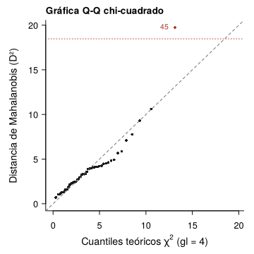

**2. Diagrama** estandarizado (cargas y β, R²) y no estandarizado (B, y,
como en AMOS, la varianza de cada variable exógena y de cada error):

``` r
diagrama_sem(fit3, estandarizado = FALSE)
```


**3. Ajuste e identificación.** Cada índice contra los criterios
excelente y aceptable, con su fuente, y la identificación del modelo
(observaciones, parámetros, gl):

``` r
tabla_criterios_ajuste(fit3)
#> 
#> Evaluación del ajuste del modelo
#> ──────────────────────────────────────────────────────────────────────────────────────────────────────────────────────────
#> Índice                    Valor            Excelente  Aceptable   Evaluación   Fuente                                     
#> ──────────────────────────────────────────────────────────────────────────────────────────────────────────────────────────
#> χ²               26.66 (gl = 1, p < .001)   p > .05              No adecuado   Hair et al. (2014); Kline (2011)           
#> χ²/gl                     26.66               ≤ 2        ≤ 3     No aceptable  Hair et al. (2014)                         
#> RMSEA [IC 90 %]     .739 [.513, .993]        ≤ .06      ≤ .08    No aceptable  Hu y Bentler (1999); Browne y Cudeck (1993)
#> SRMR                       .156              ≤ .08      ≤ .10    No aceptable  Hu y Bentler (1999); Hair et al. (2014)    
#> CFI                        .725              ≥ .95      ≥ .90    No aceptable  Hu y Bentler (1999); Hair et al. (2014)    
#> TLI (NNFI)                -.375              ≥ .95      ≥ .90    No aceptable  Tabachnick y Fidell (2013)                 
#> GFI                        .879              ≥ .95      ≥ .90    No aceptable  Hair et al. (2014)                         
#> PNFI                       .146                         ≥ .50    No aceptable  Mulaik et al. (1989)                       
#> PRATIO                     .200                         ≥ .50    No aceptable  Mulaik et al. (1989)                       
#> ──────────────────────────────────────────────────────────────────────────────────────────────────────────────────────────
#> Nota. RMSEA = error cuadrático medio de aproximación; SRMR = raíz del residuo
#> cuadrático medio estandarizado; CFI = índice de ajuste comparativo; TLI =
#> índice de Tucker-Lewis; GFI = índice de bondad de ajuste; PNFI = índice de
#> ajuste normado parsimonioso; PRATIO = razón de parsimonia. La prueba χ² es
#> sensible al tamaño de la muestra; con muestras grandes suele ser
#> significativa aunque el ajuste sea bueno.
#> 
#> Identificación del modelo y tamaño de la muestra
#> ───────────────────────────────────────────────────────────────────────────────────────
#> Elemento                    Valor  Interpretación                                      
#> ───────────────────────────────────────────────────────────────────────────────────────
#> Observaciones (p)            10    Elementos no redundantes de la matriz de covarianzas
#> Parámetros estimados (q)      9                                                        
#> Grados de libertad (p − q)    1    Sobreidentificado                                   
#> Tamaño de la muestra (N)     47                                                        
#> Razón N:q                   5.2:1  Baja (< 10:1)                                       
#> Variables exógenas            2    Education, Catholic                                 
#> Variables endógenas           2    Examination, Fertility                              
#> ───────────────────────────────────────────────────────────────────────────────────────
#> Nota. gl > 0: modelo sobreidentificado (el deseable); gl = 0: exactamente
#> identificado (χ² = 0, el ajuste no puede evaluarse); gl < 0: subidentificado
#> (no puede estimarse). Razón N:q: se recomiendan al menos 10 casos por
#> parámetro y, de preferencia, 20 (Kline, 2011). Exógenas: no reciben ninguna
#> flecha de otra variable del modelo; endógenas: reciben al menos una (sin
#> contar los errores). p y q incluyen las 3 varianzas y covarianzas (y medias,
#> si las hay) de las variables exógenas observadas, como en AMOS; lavaan las
#> fija en sus valores de la muestra y no las cuenta, pero los grados de
#> libertad son los mismos.
#> La tabla es más ancha que la consola y puede verse cortada. Agranda el panel de la consola o guárdala en Word: guardar_tabla(tabla, "tabla.docx").
```

Los criterios son los de Hu y Bentler (1999) y Browne y Cudeck (1993).
Si tu curso o tu revista usan otros, cámbialos con `cortes`, y para un
artículo puedes quitar la columna de evaluación:

``` r
tabla_criterios_ajuste(fit3, cortes = list(rmsea = c(.05, .06)))   # excelente, aceptable
tabla_criterios_ajuste(fit3, evaluacion = FALSE)
tabla_criterios_ajuste(fit3, ic_rmsea = .95)   # IC del RMSEA al 95 % (por defecto, 90 %)
```

La segunda parte de la tabla resume la identificación del modelo: p, q y
gl contados como en AMOS, y qué variables son exógenas (no reciben
ninguna flecha) y cuáles endógenas.

**4. Estimaciones**, agrupadas como en AMOS (pesos de regresión,
covarianzas, varianzas), con la razón crítica (C.R.):

``` r
tabla_parametros(fit3)
#> 
#> Estimaciones del modelo
#> ───────────────────────────────────────────────────────────────────────────
#> Parámetro                                 B       EE    C.R.     p      β  
#> ───────────────────────────────────────────────────────────────────────────
#> Pesos de regresión                                                         
#>    Examination ← Education               0.58    0.09   6.69   < .001  .70 
#>    Fertility ← Education                -0.76    0.17   -4.38  < .001  -.59
#>    Fertility ← Examination              -0.05    0.21   -0.26   .796   -.03
#>    Fertility ← Catholic                  0.11    0.03   3.68   < .001  .36 
#> ┈┈┈┈┈┈┈┈┈┈┈┈┈┈┈┈┈┈┈┈┈┈┈┈┈┈┈┈┈┈┈┈┈┈┈┈┈┈┈┈┈┈┈┈┈┈┈┈┈┈┈┈┈┈┈┈┈┈┈┈┈┈┈┈┈┈┈┈┈┈┈┈┈┈┈
#> Covarianzas (correlación en β)                                             
#>    Education ↔ Catholic                 -60.39     —      —      —     -.15
#> ┈┈┈┈┈┈┈┈┈┈┈┈┈┈┈┈┈┈┈┈┈┈┈┈┈┈┈┈┈┈┈┈┈┈┈┈┈┈┈┈┈┈┈┈┈┈┈┈┈┈┈┈┈┈┈┈┈┈┈┈┈┈┈┈┈┈┈┈┈┈┈┈┈┈┈
#> Varianzas de las variables exógenas                                        
#>    Education                            90.49      —      —      —     1.00
#>    Catholic                            1,702.29    —      —      —     1.00
#> ┈┈┈┈┈┈┈┈┈┈┈┈┈┈┈┈┈┈┈┈┈┈┈┈┈┈┈┈┈┈┈┈┈┈┈┈┈┈┈┈┈┈┈┈┈┈┈┈┈┈┈┈┈┈┈┈┈┈┈┈┈┈┈┈┈┈┈┈┈┈┈┈┈┈┈
#> Varianzas de los errores (residuales)                                      
#>    Error de Examination                 31.91    6.58   4.85   < .001  .51 
#>    Error de Fertility                   64.93    13.39  4.85   < .001  .43 
#> ───────────────────────────────────────────────────────────────────────────
#> Nota. B = estimación no estandarizada; EE = error estándar; C.R. = razón
#> crítica (B/EE); |C.R.| > 1.96 indica un parámetro significativo (p < .05);
#> β = estimación estandarizada (en las covarianzas, la correlación; en los
#> errores, la proporción de varianza no explicada, 1 − R²). — = parámetro
#> fijo (por ejemplo, la carga de referencia fijada en 1). N = 47.
```

**5. Hipótesis.** Escribe cada hipótesis como una trayectoria; agrega
`(+)` o `(-)` si predice un signo. Las de mediación (`X -> M -> Y`) se
evalúan con el intervalo del efecto indirecto:

``` r
tabla_hipotesis(fit3, c(H1 = "Education -> Examination (+)",
                        H2 = "Examination -> Fertility (-)",
                        H3 = "Catholic -> Fertility (+)",
                        H4 = "Education -> Examination -> Fertility"),
                bootstrap = 500)
#> 
#> Contraste de hipótesis
#> ─────────────────────────────────────────────────────────────────────────────────────────────────
#> Hipótesis  Trayectoria                          Efecto      β      p / IC 95 %     Decisión      
#> ─────────────────────────────────────────────────────────────────────────────────────────────────
#> H1         Education → Examination (+)          Directo    .70        < .001       Se sostiene   
#> H2         Examination → Fertility (-)          Directo    -.03        .796        No se sostiene
#> H3         Catholic → Fertility (+)             Directo    .36        < .001       Se sostiene   
#> H4         Education → Examination → Fertility  Indirecto  -.02  IC [-0.52, 0.23]  No se sostiene
#> ─────────────────────────────────────────────────────────────────────────────────────────────────
#> Nota. β = coeficiente estandarizado. Efectos directos: se sostienen si p <
#> .05. Efectos indirectos: se sostienen si el intervalo de confianza al 95 %
#> (bootstrap con 500 remuestreos, calculado con el efecto no estandarizado) no
#> incluye el 0. Si la hipótesis indica un signo (+ o −), el efecto debe tener
#> ese signo.
```

**6. Efectos directos, indirectos y totales** con `tabla_efectos()`
(véase arriba).

**7. Modelo alternativo.** `modelo_alternativo()` propone uno: quita una
por una las trayectorias no significativas (la de mayor *p* primero,
volviendo a estimar cada vez), prueba con una Δχ² si quitarlas empeora
el ajuste, compara el modelo original con el alternativo y dibuja el
diagrama del alternativo. Conserva el estimador y las demás opciones del
modelo original.

``` r
alt <- modelo_alternativo(fit3)
```

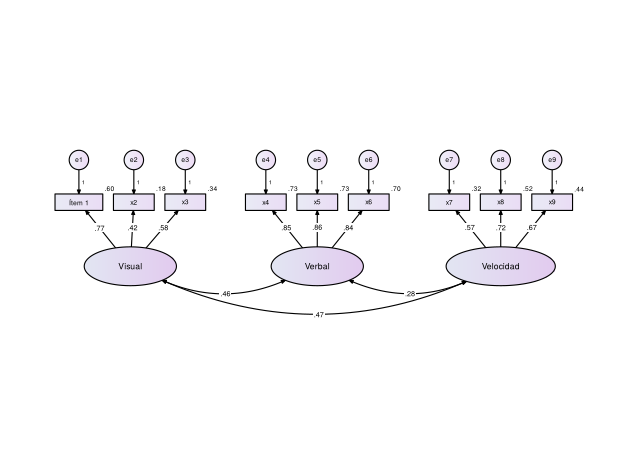

``` r
alt
#> 
#> Modelo alternativo propuesto
#> 
#> 
#> Cambios respecto del modelo original
#> ─────────────────────────────────────────────────
#> Cambio          Trayectoria         β    Criterio
#> ─────────────────────────────────────────────────
#> Se quita  Examination → Fertility  -.03  p = .796
#> ─────────────────────────────────────────────────
#> Nota. Se quitan las trayectorias con p ≥ .05; se agregan
#> las que sugieren los índices de modificación (IM). β =
#> coeficiente estandarizado (en las agregadas, el cambio
#> esperado).
#> 
#> ¿Quitar esas trayectorias empeora el ajuste? Δχ²(1) = 0.04, p = .846. No: el modelo más simple ajusta igual de bien.
#> 
#> Sintaxis del modelo alternativo (cópiala a tu script):
#> modelo_alt <- "
#>   Examination ~ Education
#>   Fertility ~ Education + Catholic
#>   Examination ~~ 0*Fertility
#>   # covarianza(s) fijada(s) en 0: lavaan la(s) agregaría solo y el modelo original no la(s) incluía
#> "
#> 
#> 
#> Modelo original y modelo alternativo
#> ──────────────────────────────────────────────────────────────────────────────────────────────
#> Modelo        χ²    gl  CFI    TLI   RMSEA  SRMR   AIC    BIC   Δχ² (Δgl)   p    ΔCFI   ΔRMSEA
#> ──────────────────────────────────────────────────────────────────────────────────────────────
#> Original     26.66  1   .725  -.375  .739   .156  637.7  648.8      —       —      —      —   
#> Alternativo  26.70  2   .735  .338   .513   .158  635.7  644.9  0.04 (1)   .846  +.010  -.226 
#> ──────────────────────────────────────────────────────────────────────────────────────────────
#> Nota. Diferencias respecto del modelo anterior. Δχ² válida solo para modelos
#> anidados. Un ΔCFI menor que −.010 junto con un ΔRMSEA mayor que .015 indica
#> un ajuste apreciablemente peor (Chen, 2007). AIC y BIC: menor es mejor; el
#> AIC más bajo es el de Alternativo y también el BIC.
#> La tabla es más ancha que la consola y puede verse cortada. Agranda el panel de la consola o guárdala en Word: guardar_tabla(tabla, "tabla.docx").
#> Lo que sugieren los índices de modificación (no se agregó; solo si tiene sustento teórico, usa agregar = 1):
#>   Catholic → Examination  (IM = 20.35, cambio esperado = -.48)
#> 
#> Atención: este modelo se obtuvo a partir de los resultados, así que es
#> exploratorio. Justifica cada cambio con la teoría, repórtalo como modificado
#> después de ver los datos y, si puedes, confírmalo en otra muestra (MacCallum et
#> al., 1992). Para sus tablas usa $fit, por ejemplo tabla_cargas(alt$fit) o
#> tabla_efectos(alt$fit).
```

Con `agregar = 1` (o más) también agrega, una por una, las trayectorias
que más sugieren los índices de modificación. Sin ese argumento solo las
lista, para que decidas si tienen sustento teórico. Las tablas del
modelo alternativo se obtienen con `alt$fit`, por ejemplo
`tabla_efectos(alt$fit)`.

Dos cuidados. Primero, un modelo obtenido así es **exploratorio**:
repórtalo como modificado después de ver los datos y justifica cada
cambio. Segundo, si una variable sale del modelo o los modelos usan
distintos casos, su χ², AIC y BIC ya no son comparables;
`tabla_comparacion()` lo detecta y no muestra esas comparaciones.

Los índices de modificación del modelo completo, con sus parámetros de
cualquier tipo (no solo trayectorias), están en `tabla_modificacion()`;
solo deben liberarse si tiene sentido teórico:

``` r
tabla_modificacion(fit, n = 5)
#> 
#> Índices de modificación
#> ───────────────────────────────────────────────────────────────
#> Parámetro               Sintaxis lavaan   IM     EPC   EPC est.
#> ───────────────────────────────────────────────────────────────
#> Carga de x9 en visual   visual =~ x9     36.41  0.58     .52   
#> Covarianza x7 ↔ x8      x7 ~~ x8         34.15  0.54     .86   
#> Carga de x7 en visual   visual =~ x7     18.63  -0.42    -.35  
#> Covarianza x8 ↔ x9      x8 ~~ x9         14.95  -0.42    -.81  
#> Carga de x3 en textual  textual =~ x3    9.15   -0.27    -.24  
#> ───────────────────────────────────────────────────────────────
#> Nota. IM = índice de modificación (disminución esperada del χ²
#> al liberar el parámetro); EPC = cambio esperado en el
#> parámetro (no estandarizado y estandarizado). Se muestran los
#> IM ≥ 3.84. Liberar un parámetro solo se justifica si tiene
#> sentido teórico; la sintaxis de lavaan para agregarlo está en
#> la segunda columna.
```

Los **residuales de correlación** muestran qué pares de variables
explica mal el modelo (\|residual\| \> .10), algo que los índices
globales no dicen y que los estándares de reporte recomiendan incluir:

``` r
tabla_residuales(fit)
#> 
#> Residuales de correlación
#> ────────────────────────────────────────────────────────
#> Variable   1     2     3     4     5     6     7     8  
#> ────────────────────────────────────────────────────────
#> 1. x1      —                                            
#> 2. x2     -.03   —                                      
#> 3. x3     -.01  .09    —                                
#> 4. x4     .07   -.01  -.07   —                          
#> 5. x5     -.01  -.03  -.15  .01    —                    
#> 6. x6     .06   .03   -.03  -.01  .00    —              
#> 7. x7     -.14  -.19  -.08  .04   -.04  -.01   —        
#> 8. x8     -.04  -.05  -.01  -.07  -.04  -.02  .07    —  
#> 9. x9     .15   .07   .15   .05   .07   .06   -.04  -.03
#> ────────────────────────────────────────────────────────
#> Nota. Residual = correlación observada menos la reproducida
#> por el modelo. En negritas, |residual| > .10 (Kline, 2016):
#> 5 de 36 pares. El residual más grande es el de x2 y x7
#> (-.19). SRMR = .065.
```

### Regresión lineal múltiple

Para una regresión estimada con `lm()` hay cuatro tablas; la plantilla
`plantilla("regresion")` las reúne. Con los datos del cemento de Hald
(13 mezclas, calor desprendido según cuatro ingredientes):

``` r
fit_hald <- lm(y ~ x1 + x2 + x3 + x4, data = MASS::cement)
tabla_regresion(fit_hald)
#> 
#> Regresión lineal múltiple para predecir y
#> ─────────────────────────────────────────────────────────────────────────────
#> Predictor       B     EE        IC 95 %        β      t     p    sr²    VIF  
#> ─────────────────────────────────────────────────────────────────────────────
#> (Intercepto)  62.41  70.07  [-99.18, 223.99]        0.89   .399              
#> x1            1.55   0.74    [-0.17, 3.27]    .61   2.08   .071  .010  38.50 
#> x2            0.51   0.72    [-1.16, 2.18]    .53   0.70   .501  .001  254.42
#> x3            0.10   0.75    [-1.64, 1.84]    .04   0.14   .896  .000  46.87 
#> x4            -0.14  0.71    [-1.78, 1.49]    -.16  -0.20  .844  .000  282.51
#> ─────────────────────────────────────────────────────────────────────────────
#> Nota. N = 13. R² = .982, R² ajustada = .974, F(4, 8) = 111.48, p < .001. B =
#> coeficiente no estandarizado; EE = error estándar; IC = intervalo de
#> confianza; β = coeficiente estandarizado; sr² = correlación semiparcial al
#> cuadrado (varianza que explica cada predictor por sí solo); VIF = factor de
#> inflación de la varianza. Hay VIF mayores que 10 (en negritas): la
#> multicolinealidad es grave y los coeficientes individuales son inestables y
#> difíciles de interpretar, aunque el R² del modelo sí es válido. Con 3.2
#> casos por predictor (se recomiendan al menos 10 a 15), las estimaciones son
#> poco estables.
```

La nota avisa de los dos problemas de este ejemplo clásico: VIF muy
altos (los ingredientes suman casi 100 %, así que unos se predicen con
otros) y muy pocos casos por predictor. Por eso ningún coeficiente es
significativo aunque el R² sea de .98. Con `robusto = TRUE` se usan
errores estándar HC3 y con `bootstrap = 2000`, intervalos por bootstrap.

Los supuestos, con su interpretación:

``` r
tabla_supuestos_regresion(fit_hald)
#> 
#> Supuestos de la regresión lineal
#> ────────────────────────────────────────────────────────────────────────────────────────────────────────────────────────────────────────────────────────────────────────────────────────────────────────────────────────
#> Supuesto                      Prueba                 Estadístico       p    Interpretación                                                                                                                              
#> ────────────────────────────────────────────────────────────────────────────────────────────────────────────────────────────────────────────────────────────────────────────────────────────────────────────────────────
#> Normalidad de los residuos    Shapiro-Wilk            W = .970        .890  No se rechaza la normalidad de los residuos.                                                                                                
#> Homocedasticidad              Breusch-Pagan         χ²(4) = 1.46      .833  No se rechaza la homocedasticidad (varianza constante de los residuos).                                                                     
#> Linealidad y especificación   RESET                F(2, 6) = 0.04     .958  No se rechaza la especificación lineal (no se detectan relaciones no lineales ni variables omitidas).                                       
#> Independencia de los errores  Durbin-Watson           DW = 2.05        —    Entre 1.5 y 2.5: sin autocorrelación importante. Solo tiene sentido si el orden de los casos importa (por ejemplo, mediciones en el tiempo).
#> Multicolinealidad             VIF máximo             282.51 (x4)       —    Grave (VIF > 10): los coeficientes individuales son inestables; considera quitar o combinar predictores muy correlacionados.                
#> Casos influyentes             Distancia de Cook  máx. = .39 (caso 8)   —    1 caso(s) con D > 4/N (.31) y 0 con D > 1. Revísalos con tabla_influencia(fit).                                                             
#> ────────────────────────────────────────────────────────────────────────────────────────────────────────────────────────────────────────────────────────────────────────────────────────────────────────────────────────
#> Nota. N = 13. Pruebas con α = .05; en negritas, los resultados que indican un
#> problema. Breusch-Pagan en la versión estudentizada de Koenker; RESET con los
#> predichos al cuadrado y al cubo. Con una muestra pequeña, estas pruebas
#> tienen poca potencia: un resultado no significativo no demuestra que el
#> supuesto se cumpla; revisa también las gráficas de residuos (plot(fit)).
#> La tabla es más ancha que la consola y puede verse cortada. Agranda el panel de la consola o guárdala en Word: guardar_tabla(tabla, "tabla.docx").
```

Los casos influyentes y cuánto cambian los coeficientes sin el más
influyente:

``` r
tabla_influencia(fit_hald)
#> 
#> Diagnóstico de casos influyentes
#> ────────────────────────────────────────────────────────────────
#> Caso    r     h    D   DFFITS  DFBETAS máx.  COVRATIO  Criterios
#> ────────────────────────────────────────────────────────────────
#> 8     -1.97  .41  .39  -1.64     .64 (x3)      0.36        3    
#> 3     -1.06  .58  .30  -1.24    1.10 (x4)      2.19        2    
#> 6     2.02   .12  .08   0.76     .20 (x4)      0.23        1    
#> 10    0.20   .70  .02   0.30     .12 (x1)      6.33        1    
#> 12    0.44   .26  .02   0.26     .14 (x2)      2.31        1    
#> 5     0.12   .36  .00   0.09     .02 (x2)      3.00        1    
#> 1     0.00   .55  .00   0.00     .00 (x4)      4.34        1    
#> ────────────────────────────────────────────────────────────────
#> Nota. N = 13, p = 5 coeficientes. Puntos de corte: |r| > 2; h >
#> 2p/N = .77; D > 4/N = .31 (muy influyente si D > 1); |DFFITS| >
#> 2√(p/N) = 1.24; |DFBETAS| > 2/√N = .55 (entre paréntesis, el
#> coeficiente más afectado); |COVRATIO − 1| > 3p/N = 1.15. r =
#> residuo estudentizado; h = apalancamiento; D = distancia de
#> Cook. En negritas, los valores que superan el corte; Criterios
#> = cuántos supera. Un caso influyente no se elimina solo por
#> superar un corte: revisa si es un error de captura y reporta
#> los resultados con y sin él.
#> 
#> Sensibilidad: coeficientes con y sin el caso 8
#> ───────────────────────────────────────────────────────────
#>               B (todos)   p    B (sin 8)   p    Cambio (EE)
#> ───────────────────────────────────────────────────────────
#> (Intercepto)    62.41    .399    37.25    .564     -0.36   
#> x1              1.55     .071    1.88     .025     0.44    
#> x2              0.51     .501    0.73     .283     0.31    
#> x3              0.10     .896    0.52     .471     0.55    
#> x4              -0.14    .844    0.10     .872     0.35    
#> R²              .982             .986                      
#> ───────────────────────────────────────────────────────────
#> Nota. Se quitó el caso con mayor distancia de Cook (D =
#> .39). Cambio (EE) = diferencia entre los coeficientes, en
#> errores estándar del modelo completo. En negritas,
#> coeficientes que cambian más de un error estándar o cuya
#> significancia (p < .05) cambia. Si las conclusiones no
#> cambian, los resultados son robustos a ese caso.
```

Y todas las combinaciones de predictores, ordenadas por AICc:

``` r
tabla_subconjuntos(fit_hald)
#> 
#> Comparación de todos los subconjuntos de predictores
#> ─────────────────────────────────────────────────────────────────
#> Predictores     k   R²   R² aj.    Cp     AICc    BIC     PRESS  
#> ─────────────────────────────────────────────────────────────────
#> x1, x2          2  .979   .974    2.68   69.31   66.57    93.88  
#> x1, x2, x4      3  .982   .976    3.02   72.44   66.69    85.35  
#> x1, x2, x3      3  .982   .976    3.04   72.48   66.73    90.00  
#> x1, x4          2  .972   .967    5.50   72.63   69.89    121.22 
#> x1, x3, x4      3  .981   .975    3.50   73.19   67.44    94.54  
#> x2, x3, x4      3  .973   .964    7.34   78.04   72.29    146.85 
#> x1, x2, x3, x4  4  .982   .974    5.00   79.84   69.23    110.35 
#> x3, x4          2  .935   .922   22.37   83.74   81.00    294.01 
#> x2, x3          2  .847   .816   62.44   94.93   92.19    701.74 
#> x4              1  .675   .645   138.73  100.41  99.44   1,194.22
#> x2              1  .666   .636   142.49  100.74  99.77   1,202.09
#> x2, x4          2  .680   .616   138.23  104.52  101.78  1,461.81
#> x1              1  .534   .492   202.55  105.08  104.11  1,699.61
#> x1, x3          2  .548   .458   198.09  109.01  106.27  2,218.12
#> x3              1  .286   .221   315.15  110.63  109.65  2,616.36
#> ─────────────────────────────────────────────────────────────────
#> Nota. N = 13. Modelos ordenados por AICc. k = número de
#> coeficientes sin el intercepto; Cp = Cp de Mallows (un buen
#> modelo tiene Cp cercano a k + 1); AICc = AIC corregido para
#> muestras pequeñas; PRESS = suma de los errores de predicción
#> dejando fuera cada caso. Menores AICc, BIC y PRESS indican un
#> mejor modelo; en negritas, el mejor valor de cada columna.
#> Elegir predictores con los mismos datos aprovecha el azar;
#> trátalo como exploratorio y, si puedes, valida el modelo en otra
#> muestra.
```

Con x1 y x2 se obtiene casi el mismo R² con mejores AICc, BIC y PRESS.
Pero elegir predictores con los mismos datos aprovecha el azar: trátalo
como exploratorio y deja que la teoría decida.

### MANOVA de un factor

¿Difieren los grupos en un conjunto de variables dependientes? La tabla
reúne las pruebas multivariadas (Pillai, Wilks, Hotelling-Lawley y Roy,
con η²p), los supuestos (M de Box, tamaños de grupo, normalidad por
grupo, atípicos, multicolinealidad), los ANOVA de seguimiento con
corrección de Bonferroni y las medias por grupo. Con los datos `iris` de
la clase:

``` r
tabla_manova(iris, dependientes = c("Petal.Length", "Sepal.Length"), grupo = "Species")
#> 
#> MANOVA de un factor: pruebas multivariadas
#> ──────────────────────────────────────────────────────────────────
#> Prueba                     Valor      F      gl1  gl2    p     η²p
#> ──────────────────────────────────────────────────────────────────
#> Traza de Pillai            0.989    71.83     4   294  < .001  .49
#> Lambda de Wilks            0.040    292.56    4   292  < .001  .80
#> Traza de Hotelling-Lawley  23.365   846.97    4   290  < .001  .92
#> Raíz mayor de Roy          23.334  1,715.06   2   147  < .001  .96
#> ──────────────────────────────────────────────────────────────────
#> Nota. F aproximada; η²p = eta cuadrada parcial (en un MANOVA de
#> un factor coincide con la eta cuadrada). La traza de Pillai es la
#> prueba más robusta si no se cumple la igualdad de matrices de
#> covarianza. Variables dependientes: Petal.Length, Sepal.Length;
#> factor: Species (3 grupos, N = 150).
#> 
#> Supuestos del MANOVA
#> ──────────────────────────────────────────────────────────────────────────────────────────────────────────────────────────
#> Supuesto                                        Resultado                              Criterio               Conclusión  
#> ──────────────────────────────────────────────────────────────────────────────────────────────────────────────────────────
#> Igualdad de matrices de covarianza (M de Box)   M = 59.55, χ²(6) = 58.38, p < .001     p > .001               No se cumple
#> Razón de tamaños de grupo (mayor/menor)         1.00                                   < 1.5                  Se cumple   
#> Normalidad multivariada por grupo (Mardia)                                                                                
#>    setosa                                       Asimetría p = .191; curtosis p = .243  p > .05                Se cumple   
#>    versicolor                                   Asimetría p = .156; curtosis p = .445  p > .05                Se cumple   
#>    virginica                                    Asimetría p = .426; curtosis p = .597  p > .05                Se cumple   
#> Atípicos multivariados por grupo (Mahalanobis)  Ninguno                                D² > 13.82 (p < .001)  Se cumple   
#> Multicolinealidad entre variables dependientes  |r| máxima = .87                       < .90                  Se cumple   
#> ──────────────────────────────────────────────────────────────────────────────────────────────────────────────────────────
#> Nota. La M de Box es muy sensible a la falta de normalidad, por eso se evalúa
#> con α = .001. Si no se cumple la igualdad de matrices de covarianza, use la
#> traza de Pillai, procure grupos de tamaño similar y un nivel de significancia
#> más estricto. La linealidad entre pares de variables dependientes se revisa
#> con diagramas de dispersión; la independencia de las observaciones, con el
#> diseño del estudio.
#> 
#> ANOVA univariados de seguimiento
#> ─────────────────────────────────────────────
#> Variable         F      gl1  gl2    p     η²p
#> ─────────────────────────────────────────────
#> Petal.Length  1,180.16   2   147  < .001  .94
#> Sepal.Length   119.26    2   147  < .001  .62
#> ─────────────────────────────────────────────
#> Nota. η²p = eta cuadrada parcial. Con la corrección de
#> Bonferroni, cada ANOVA se evalúa con α = .05/2 = .025; en
#> negritas, los significativos.
#> 
#> Comparaciones post hoc entre grupos
#> ─────────────────────────────────────────────────────────────────────────────
#> Variable      Comparación             Diferencia    IC 95 %       p       d  
#> ─────────────────────────────────────────────────────────────────────────────
#> Petal.Length  versicolor − setosa        2.80     [2.63, 2.97]  < .001  7.90 
#>               virginica − setosa         4.09     [3.89, 4.29]  < .001  10.00
#>               virginica − versicolor     1.29     [1.05, 1.54]  < .001  2.52 
#> ┈┈┈┈┈┈┈┈┈┈┈┈┈┈┈┈┈┈┈┈┈┈┈┈┈┈┈┈┈┈┈┈┈┈┈┈┈┈┈┈┈┈┈┈┈┈┈┈┈┈┈┈┈┈┈┈┈┈┈┈┈┈┈┈┈┈┈┈┈┈┈┈┈┈┈┈┈
#> Sepal.Length  versicolor − setosa        0.93     [0.72, 1.14]  < .001  2.10 
#>               virginica − setosa         1.58     [1.34, 1.83]  < .001  3.08 
#>               virginica − versicolor     0.65     [0.38, 0.93]  < .001  1.13 
#> ─────────────────────────────────────────────────────────────────────────────
#> Nota. Comparaciones por pares con Games-Howell (no se cumple la igualdad de
#> matrices de covarianza; Games-Howell no supone varianzas iguales).
#> Diferencia = media del segundo grupo menos la del primero; IC 95 % y p
#> ajustados por comparaciones múltiples; d = d de Cohen (0.20 pequeño, 0.50
#> mediano, 0.80 grande); en negritas, p < .05.
#> 
#> Medias (desviaciones estándar) por grupo
#> ───────────────────────────────────────────────────
#> Variable        setosa     versicolor    virginica 
#> ───────────────────────────────────────────────────
#> Petal.Length  1.46 (0.17)  4.26 (0.47)  5.55 (0.55)
#> Sepal.Length  5.01 (0.35)  5.94 (0.52)  6.59 (0.64)
#> ┈┈┈┈┈┈┈┈┈┈┈┈┈┈┈┈┈┈┈┈┈┈┈┈┈┈┈┈┈┈┈┈┈┈┈┈┈┈┈┈┈┈┈┈┈┈┈┈┈┈┈
#> n                 50           50           50     
#> ───────────────────────────────────────────────────
#> Nota. Valores: M (DE).
#> La tabla es más ancha que la consola y puede verse cortada. Agranda el panel de la consola o guárdala en Word: guardar_tabla(tabla, "tabla.docx").
```

Si la M de Box es significativa (p \< .001), reporta la traza de Pillai,
que es la más robusta.

Con tres o más grupos, la tabla incluye las **comparaciones post hoc**
entre pares de grupos para cada variable dependiente, con su intervalo
de confianza, *p* ajustado y *d* de Cohen. Con `posthoc = "auto"` (por
omisión) se usa Tukey HSD si las matrices de covarianza son iguales y
Games-Howell si no lo son; se puede fijar con `posthoc = "tukey"` o
`posthoc = "games-howell"`.

### Modelos bifactor y de segundo orden

Al validar una escala con un modelo bifactor, los revisores piden saber
cuánto del puntaje total refleja el factor general y si las subescalas
aportan algo propio:

``` r
segundo <- cfa(paste(modelo, "\n g =~ visual + textual + speed"),
               data = HolzingerSwineford1939)
tabla_bifactor(segundo)
#> 
#> Índices del modelo bifactor
#> ───────────────────────────────────────────────
#> Factor   Ítems  ω / ωS  ωH / ωHS  ECV   H   FD 
#> ───────────────────────────────────────────────
#> g          9     .84      .55     .40  .72  .79
#> ┈┈┈┈┈┈┈┈┈┈┈┈┈┈┈┈┈┈┈┈┈┈┈┈┈┈┈┈┈┈┈┈┈┈┈┈┈┈┈┈┈┈┈┈┈┈┈
#> visual     3     .63      .15     .24  .23  .45
#> textual    3     .89      .64     .72  .77  .86
#> speed      3     .69      .49     .71  .57  .75
#> ───────────────────────────────────────────────
#> Nota. Índices obtenidos con la transformación de
#> Schmid-Leiman del modelo de segundo orden. En la fila del
#> factor general: ω = omega total, ωH = omega jerárquico, ECV
#> = varianza común explicada por el factor general. En las
#> subescalas: ωS, ωHS y ECV de la subescala. H =
#> replicabilidad del factor; FD = determinación factorial.
#> PUC = .75. Criterios: ωH ≥ .80, ECV ≥ .70 y PUC ≥ .70
#> indican una escala esencialmente unidimensional (Rodriguez
#> et al., 2016); H ≥ .80 (Hancock y Mueller, 2001) y FD ≥ .90
#> (Gorsuch, 1983). En negritas, los valores que cumplen. La
#> escala no es esencialmente unidimensional según estos
#> criterios. Subescalas con ωHS < .50 (aportan poca
#> confiabilidad propia más allá del factor general): visual,
#> speed.
```

Con un modelo de segundo orden, como en el ejemplo, se usa la
transformación de Schmid-Leiman. Un modelo bifactor se estima con los
factores ortogonales:

``` r
bifactor <- "g =~ i1 + i2 + i3 + i4 + i5 + i6 + i7 + i8 + i9
             F1 =~ i1 + i2 + i3
             F2 =~ i4 + i5 + i6
             F3 =~ i7 + i8 + i9"
fit_bf <- cfa(bifactor, data = datos, orthogonal = TRUE, std.lv = TRUE)
tabla_bifactor(fit_bf)
```

Criterios: ωH ≥ .80, ECV ≥ .70 y PUC ≥ .70 indican una escala
esencialmente unidimensional; un ωHS bajo (\< .50) indica que la
subescala aporta poca confiabilidad propia. Si el modelo tiene un caso
Heywood (una varianza de error negativa), la tabla lo avisa y no calcula
H ni FD.

### Moderación y mediación moderada

Al estilo del macro PROCESS de Hayes, con puntajes de escalas (sumas o
promedios de los ítems). Moderación simple (modelo 1):

``` r
set.seed(1)
d <- data.frame(apoyo = rnorm(300, 3, 1), autonomia = rnorm(300, 4, 1.5))
d$compromiso <- 1 + .3 * d$apoyo + .2 * d$autonomia +
                .25 * (d$apoyo - 3) * (d$autonomia - 4) + rnorm(300)
mod <- tabla_moderacion(d, x = "apoyo", w = "autonomia", y = "compromiso")
mod
#> 
#> Moderación: coeficientes de regresión
#> ─────────────────────────────────────────────────────────────────────────
#> Predictor                          B     EE     t      p       IC 95 %   
#> ─────────────────────────────────────────────────────────────────────────
#> Variable dependiente: compromiso                                         
#>    apoyo                          0.34  0.07  5.09   < .001  [0.21, 0.47]
#>    autonomia                      0.23  0.04  5.80   < .001  [0.15, 0.31]
#>    apoyo × autonomia              0.21  0.04  5.28   < .001  [0.13, 0.29]
#>    Constante                      2.65  0.06  41.98  < .001  [2.52, 2.77]
#> ─────────────────────────────────────────────────────────────────────────
#> Nota. B = coeficiente no estandarizado; EE = error estándar; IC 95 %
#> basado en t. compromiso: R² = .213, F(3, 296) = 26.64, p < .001.
#> Interacción: ΔR² = .074, F(1, 296) = 27.90, p < .001. Variables
#> centradas en la media: apoyo, autonomia. N = 300.
#> 
#> Efecto condicional de apoyo sobre compromiso según autonomia
#> ───────────────────────────────────────────────────────
#> autonomia     Efecto   EE    t      p        IC 95 %   
#> ───────────────────────────────────────────────────────
#> −1 DE (2.42)   0.01   0.08  0.12   .904   [-0.16, 0.18]
#> Media (3.98)   0.34   0.07  5.09  < .001  [0.21, 0.47] 
#> +1 DE (5.55)   0.66   0.10  6.90  < .001  [0.47, 0.85] 
#> ───────────────────────────────────────────────────────
#> Nota. Pendientes simples. Valores de W: media y ±1 DE.
#> Johnson-Neyman: el efecto de apoyo cambia de significancia
#> (p = .05) cuando autonomia = 1.24 y 3.05.
```

La tabla da los coeficientes, el ΔR² de la interacción, las pendientes
simples (efecto de X en la media de W y una DE arriba y abajo) y la
región de Johnson-Neyman. La gráfica de la interacción:

``` r
grafica_interaccion(mod)
```


Con `archivo = "figura2.pdf"` se guarda al ancho de una columna.

Mediación moderada: `modelo = 7` cuando W modera X → M, y `modelo = 14`
cuando W modera M → Y. La tabla da los efectos indirectos condicionales
y el **índice de mediación moderada**, con intervalos bootstrap (5000
remuestreos, como PROCESS):

``` r
tabla_moderacion(datos, x = "X", w = "W", m = "M", y = "Y", modelo = 7)
```

Si el intervalo del índice no incluye el 0, el efecto indirecto depende
del moderador.

### Párrafo de método

Redacta el párrafo de análisis de datos (software, versiones, estimador,
datos perdidos y criterios de ajuste) con sus referencias en formato
APA. Es un punto de partida para adaptar:

``` r
parrafo_metodo(fit, paquetes = c("semTools", "apaMultivariate"))
#> 
#> Los análisis se realizaron en R (versión 4.3.3; R Core Team, 2024) con los
#> paquetes lavaan (versión 0.6-17; Rosseel, 2012), semTools (versión 0.5-6;
#> Jorgensen et al., 2022) y apaMultivariate (versión 0.12.0; Moreno Valladares,
#> 2026). El análisis factorial confirmatorio se estimó con una muestra de 301
#> participantes por máxima verosimilitud (ML). El ajuste se evaluó con la prueba
#> χ², el índice de ajuste comparativo (CFI), el índice de Tucker-Lewis (TLI), el
#> error cuadrático medio de aproximación (RMSEA) con su intervalo de confianza al
#> 90 % y la raíz del residuo cuadrático medio estandarizado (SRMR). Se
#> consideraron indicadores de buen ajuste CFI y TLI ≥ .95, RMSEA ≤ .06 y SRMR ≤
#> .08 (Hu y Bentler, 1999).
#> 
#> Referencias
#> 
#> Hu, L., & Bentler, P. M. (1999). Cutoff criteria for fit indexes in covariance
#>     structure analysis: Conventional criteria versus new alternatives.
#>     Structural Equation Modeling, 6(1), 1–55.
#>     https://doi.org/10.1080/10705519909540118
#> 
#> Jorgensen, T. D., Pornprasertmanit, S., Schoemann, A. M., & Rosseel, Y. (2022).
#>     semTools: Useful tools for structural equation modeling (Paquete de R,
#>     versión 0.5-6). https://CRAN.R-project.org/package=semTools.
#> 
#> Moreno Valladares, J. (2026). apaMultivariate: Tablas y diagramas APA para
#>     análisis multivariado (Paquete de R, versión 0.12.0).
#>     https://github.com/jeshuamv/apaMultivariate.
#> 
#> R Core Team. (2024). R: A language and environment for statistical computing. R
#>     Foundation for Statistical Computing. https://www.R-project.org/
#> 
#> Rosseel, Y. (2012). lavaan: An R package for structural equation modeling.
#>     Journal of Statistical Software, 48(2), 1–36.
#>     https://doi.org/10.18637/jss.v048.i02
```

Con `archivo = "metodo.docx"` se guarda en Word.

### Resultados en inglés

Para una revista en inglés, escribe una vez al inicio del script:

``` r
idioma_sem("en")
tabla_ajuste(fit)
#> 
#> Fit indices
#> ──────────────────────────────────────────────────────────────────────
#> Model     χ²    df    p     χ²/df  CFI   TLI    RMSEA [90% CI]    SRMR
#> ──────────────────────────────────────────────────────────────────────
#> Model 1  85.31  24  < .001  3.55   .931  .896  .092 [.071, .114]  .065
#> ──────────────────────────────────────────────────────────────────────
#> Note. Good-fit criteria (Hu & Bentler, 1999): CFI and TLI ≥ .95 (≥
#> .90 acceptable), RMSEA ≤ .06 (≤ .08 acceptable), SRMR ≤ .08. With
#> large samples the χ² test is usually significant even when fit is
#> good.
```

Títulos, encabezados, notas, el párrafo de método y sus referencias
salen en inglés con los términos de APA (*M*, *SD*, *SE*, *df*, CI,
*Note.*, *Table*). Los mensajes de ayuda en la consola siguen en
español. Para volver:

``` r
idioma_sem("es")
```

### Guardar las tablas

Una tabla:

``` r
tabla_validez(fit, archivo = "tabla_validez.docx")   # Word
tabla_ajuste(fit, archivo = "tabla_ajuste.html")     # para copiar y pegar
tabla_cargas(fit, archivo = "tabla_cargas.csv")      # para Excel
```

Todas las tablas de un artículo en un solo documento de Word, numeradas:

``` r
guardar_tablas(
  tabla_descriptivos(items),
  tabla_confiabilidad(fit),
  tabla_ajuste(fit),
  tabla_validez(fit),
  tabla_htmt(fit),
  archivo = "tablas_articulo.docx"
)
```

Las tablas anchas se pasan a letra de 10 pt y, si aún no caben, se
colocan en una página horizontal. También se puede guardar en `.rtf`.

## Personalizar el diagrama

### Nombres

``` r
diagrama_sem(fit, etiquetas = c(visual = "Visual", textual = "Verbal",
                                speed = "Velocidad", x1 = "Ítem 1"))
```


Usa `"\n"` dentro de un nombre para partirlo en dos renglones.

### Significancia, decimales y solución no estandarizada

``` r
diagrama_sem(fit, estrellas = TRUE, decimales = 3)
```

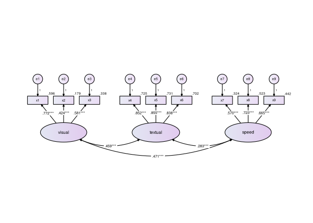

Con `estandarizado = FALSE` se muestran los valores no estandarizados y,
como en AMOS, en lugar de la R² se escribe la varianza de cada variable
exógena y de cada error:

``` r
diagrama_sem(fit, estandarizado = FALSE)
```

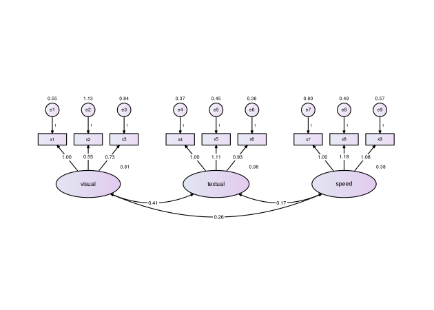

### Correlaciones

``` r
diagrama_sem(fit, correlaciones = FALSE)   # ocultarlas
```

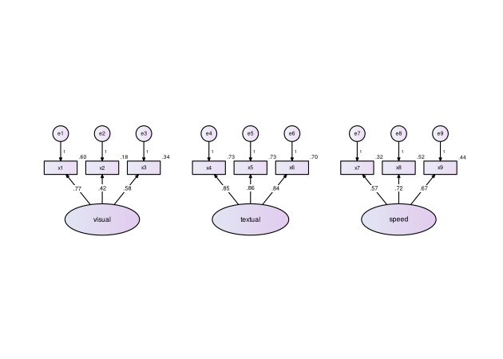

``` r
diagrama_sem(fit, correlaciones = 0.40)    # solo las de |r| >= .40
```

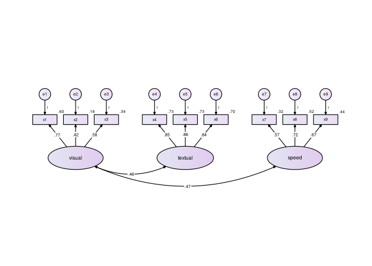

En AFC con 5 o más factores se ocultan automáticamente, porque se cruzan
entre sí sin importar el acomodo. Siguen disponibles en el resultado:

``` r
d <- diagrama_sem(fit, correlaciones = FALSE, dibujar = FALSE)
d$correlaciones_ocultas
#>    variable_1 variable_2     valor            p
#> 10     visual    textual 0.4585093 6.528111e-13
#> 11     visual      speed 0.4705345 1.040015e-10
#> 12    textual      speed 0.2829847 3.832000e-05
```

### Colores

``` r
diagrama_sem(fit, paleta = paleta_sem("verde"))
```

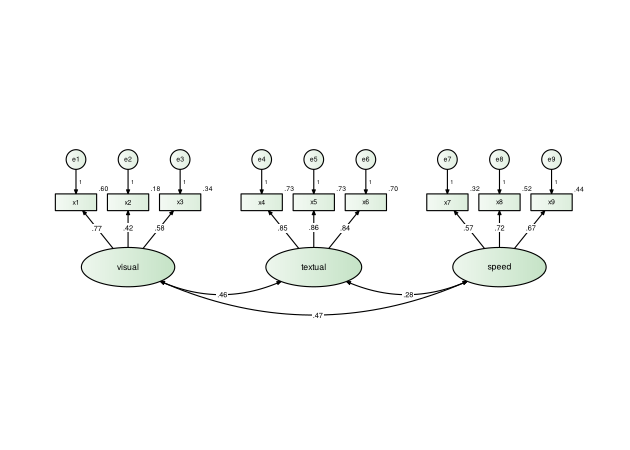

``` r
diagrama_sem(fit, paleta = paleta_sem("blanco"), degradado = FALSE)
```

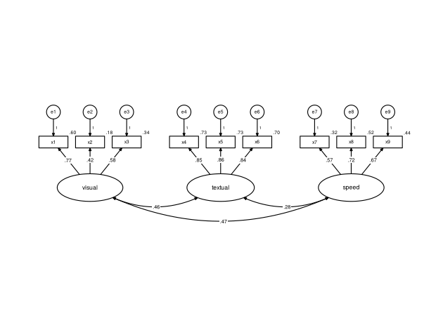

``` r
diagrama_sem(fit, paleta = paleta_sem(latente = c("white", "#FAD3B5"),
                                      observada = "#FFF3EA"))
```

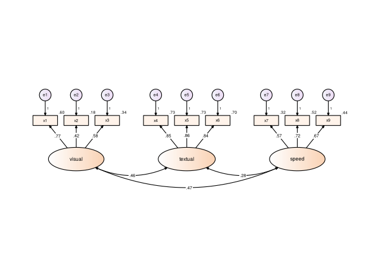

Paletas incluidas: `"lila"` (por omisión), `"azul"`, `"verde"`,
`"gris"`, `"durazno"` y `"blanco"`.

### Ajustes a mano

Hacia dónde van los ítems de un constructo:

``` r
diagrama_sem(fit, lados = c(speed = "abajo"))
```


Mover un elemento (un constructo se mueve con sus ítems y errores). La
unidad equivale aproximadamente al ancho de un ítem:

``` r
diagrama_sem(fit, mover = list(speed = c(0, -1)))
```

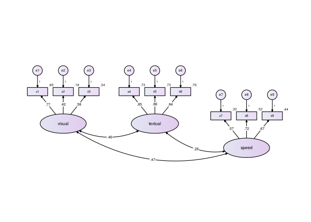

## Guardar el diagrama

``` r
diagrama_sem(fit, archivo = "figura1.png")    # imagen para Word o PowerPoint
diagrama_sem(fit, archivo = "figura1.pdf")    # PDF vectorial (nítido a cualquier tamaño)
```

Si no se indican medidas, se calculan solas según el tamaño del
diagrama. También se aceptan `.tiff`, `.eps`, `.svg` y `.jpg`. Para
guardar un diagrama que ya dibujaste, usa `guardar_diagrama()`:

``` r
d <- diagrama_sem(fit, estilo = "revista")
guardar_diagrama(d, "figura1.pdf", ancho = "pagina")
```

## Figuras para una revista

Las revistas piden que el texto de la figura mida **al menos 8 pt ya
impresa** (APA pide de 8 a 14 pt, sin serifa) y que la figura se
entregue al ancho con que se publicará. Por eso, para un artículo:

``` r
diagrama_sem(fit, estilo = "revista", archivo = "figura1.pdf", ancho = "pagina")
```

Al indicar `ancho`, el paquete informa el tamaño real del texto:

    Figura de 174 x 62 mm; texto de los ítems y valores: 8.4 pt.

Si queda por debajo de 8 pt, aparece un aviso con sugerencias.

**`ancho`**

- `"pagina"`: 174 mm, a lo ancho de la página. Es la opción adecuada
  para casi cualquier modelo.
- `"columna"`: 85 mm, una columna en revistas de dos columnas. Solo
  alcanza para modelos muy pequeños (un factor con pocos ítems, una
  trayectoria simple).
- Un número: el ancho en pulgadas.

**Formato**

| Formato | Cuándo usarlo                                                                                                                    |
|---------|----------------------------------------------------------------------------------------------------------------------------------|
| `.pdf`  | La mejor opción en general: vectorial, con las fuentes incluidas. La aceptan Elsevier, Springer, Taylor & Francis, Wiley y SAGE. |
| `.eps`  | Cuando la revista pide EPS (vectorial).                                                                                          |
| `.tiff` | Cuando la revista pide imagen (por ejemplo PLOS). Se guarda a 600 ppp con compresión LZW.                                        |
| `.png`  | Para Word, PowerPoint o la tesis (300 ppp).                                                                                      |

**Formato APA del resto de la figura.** En APA el número de la figura
(en negritas) y su título (en cursiva) van **arriba y fuera de la
imagen**, y las notas debajo; escríbelos en Word, no con `titulo =`. Por
ejemplo:

> **Figura 1**  
> *Modelo de medición de tres factores*  
> \[diagrama\]  
> *Nota.* Cargas estandarizadas. Los números junto a cada ítem son las
> R². Las cargas de los errores se fijaron en 1. *N* = 301.

Siempre revisa las instrucciones para autores de la revista elegida:
algunas piden otro ancho, otro formato o la figura en un archivo aparte.

## Preguntas frecuentes

**Mi omega o mi AVE no coinciden con los de `semTools`.** Hay varias
fórmulas. `tabla_confiabilidad()` calcula ω igual que
`semTools::compRelSEM()`. `tabla_validez()` usa las fórmulas clásicas de
Fornell y Larcker con las cargas estandarizadas (las de Hair et al.),
que dan valores un poco distintos; con
`tabla_validez(fit, metodo = "semtools")` obtienes los de `compRelSEM()`
y `AVE()`. Reporta cuál usaste.

**El análisis paralelo no coincide con `fa.parallel()`.** Usa el mismo
método de extracción (`tabla_factorabilidad(datos, fm = "ml")` equivale
a `fa.parallel(datos, fm = "ml")`). Como usa datos aleatorios, los
autovalores aleatorios cambian un poco en cada corrida; el número de
factores casi nunca.

**Una tabla dice que el modelo es multigrupo.** Las tablas de cargas,
validez, confiabilidad, etc. describen un solo grupo. Para comparar
grupos usa `tabla_invarianza()`; para las tablas de un grupo, estima el
modelo solo con los datos de ese grupo.

**`cfa()` o `sem()` dicen que no encuentran una variable.** Un nombre
del modelo no coincide con el de la columna (R distingue mayúsculas y
minúsculas). Corre `revisar_datos(datos, modelo)`: te dice cuál es y te
sugiere el nombre correcto.

**No sé leer mi archivo de Excel o SPSS.** Usa
`leer_datos("archivo.xlsx")` o `leer_datos()` sin nada para elegirlo en
una ventana. Si dice que no encuentra el archivo, revisa tu carpeta de
trabajo con `getwd()`.

**El diagrama sale muy pequeño o el texto muy chico.** Guárdalo con
`guardar_diagrama()`; en la ventana de RStudio el tamaño depende del
panel. Para un artículo usa `estilo = "revista"` y `ancho = "pagina"`
(véase [Figuras para una revista](#figuras-para-una-revista)).

**¿Qué estilo uso?** Para clases y tareas, el que prefieras. Para un
artículo, `"revista"`; `"color"` si la revista publica en color o para
una presentación.

**Una flecha pasa por donde no quiero.** Prueba otro `acomodo`, cambia
el lado de los ítems con `lados` o desplaza el constructo con `mover`.

**El modelo es multigrupo.** Se dibuja un grupo a la vez con
`grupo = 1`, `grupo = 2`, etc.

**Aparece el aviso “El modelo no convergió”.** Revisa el modelo en
`lavaan`; el diagrama se dibuja, pero sus valores no son confiables.

**`fa()` marca un error sobre `GPArotation`.** Instala el paquete con
`install.packages("GPArotation")`; `psych` lo necesita para las
rotaciones oblicuas.

**El archivo `.docx` o `.rtf` se abre en otro programa.** Haz clic
derecho → *Abrir con* → *Microsoft Word*.

**Las tablas salieron en inglés (o en español) y no quería.** El idioma
se elige con `idioma_sem("es")` o `idioma_sem("en")` y dura toda la
sesión de R; al reiniciar R vuelve al español.

**`tabla_moderacion()` o `tabla_efectos()` tardan.** Calculan intervalos
con miles de remuestreos bootstrap; es normal que tarden de segundos a
un par de minutos. Para probar puedes usar `bootstrap = 500` y, para el
artículo, el valor por omisión.

**Aparece el aviso “Caso Heywood” en `tabla_bifactor()`.** El modelo
tiene una varianza de error negativa, algo común en modelos bifactor
cuando un factor específico casi no tiene varianza propia. Los índices
no son confiables: revisa ese factor (por ejemplo, prueba un modelo sin
él o uno de segundo orden).

**¿Qué tabla uso para mi tarea o artículo?** La tabla del inicio de la
sección [Tablas en formato APA](#tablas-en-formato-apa) las ordena por
etapa del análisis; la sección [Análisis de trayectorias y SEM paso a
paso](#análisis-de-trayectorias-y-sem-paso-a-paso) muestra el orden
habitual.
