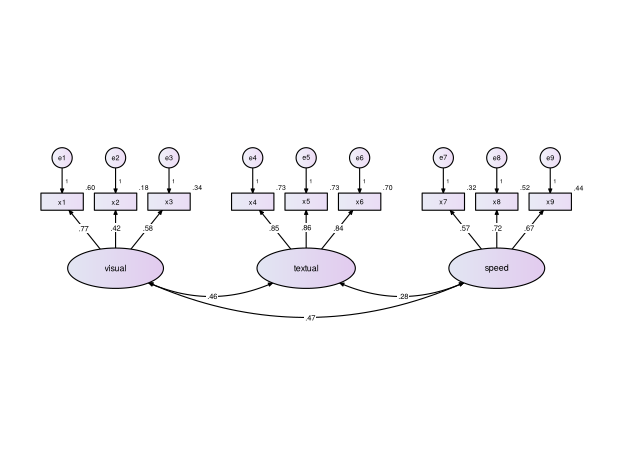
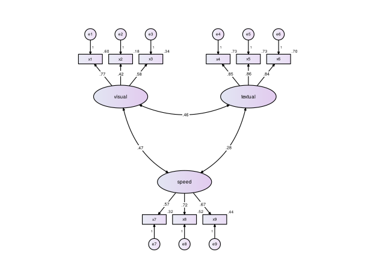
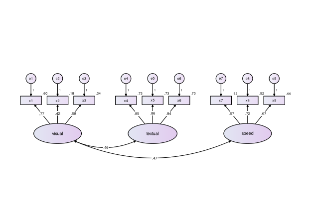
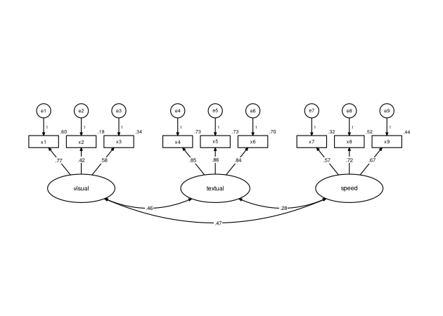
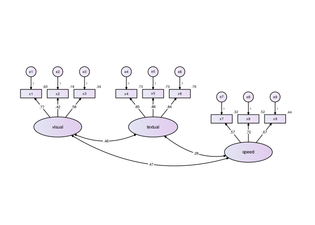

Guía de uso de diagramaSEM
================

`diagramaSEM` dibuja el diagrama de trayectorias de un modelo estimado
con `lavaan`, con la convención gráfica clásica de los programas de
ecuaciones estructurales. Esta guía muestra cómo usarlo, paso a paso.

## Contenido

1.  [El primer diagrama](#el-primer-diagrama)
2.  [Con tus propios datos](#con-tus-propios-datos)
3.  [Acomodo automático](#acomodo-automático)
4.  [Segundo orden](#segundo-orden)
5.  [Análisis de trayectorias](#análisis-de-trayectorias)
6.  [Modelo de ecuaciones
    estructurales](#modelo-de-ecuaciones-estructurales)
7.  [Personalizar el diagrama](#personalizar-el-diagrama)
8.  [Guardar el diagrama](#guardar-el-diagrama)
9.  [Preguntas frecuentes](#preguntas-frecuentes)

## Instalación

Solo la primera vez, con conexión a internet:

``` r
install.packages("remotes")
remotes::install_github("jeshuamv/diagramaSEM")
```

En cada sesión de R se cargan los dos paquetes:

``` r
library(lavaan)
library(diagramaSEM)
```

## El primer diagrama

Basta con estimar el modelo en `lavaan` y pasárselo a `diagrama_sem()`.

``` r
modelo <- "visual  =~ x1 + x2 + x3
           textual =~ x4 + x5 + x6
           speed   =~ x7 + x8 + x9"
fit <- cfa(modelo, data = HolzingerSwineford1939)
diagrama_sem(fit)
```



Qué se ve en el diagrama:

- **Rectángulos**: las variables observadas (ítems).
- **Óvalos**: los constructos (variables latentes).
- **Círculos `e1`, `e2`, …**: los errores, con su peso fijo en 1.
- **Números sobre las flechas**: cargas factoriales estandarizadas.
- **Número junto a cada ítem**: su R², la proporción de varianza que
  explica el constructo.
- **Flechas curvas de doble punta**: correlaciones entre constructos.

## Con tus propios datos

El procedimiento es siempre el mismo: leer los datos, escribir el
modelo, estimarlo con `lavaan` y pasárselo a `diagrama_sem()`.

``` r
datos <- read.csv("mis_datos.csv")      # o read_excel(), read_sav(), etc.

modelo <- "
  Factor1 =~ item1 + item2 + item3
  Factor2 =~ item4 + item5 + item6
"
fit <- cfa(modelo, data = datos)        # sem() para trayectorias o SEM

diagrama_sem(fit)
```

Los nombres de los ítems en el modelo deben ser exactamente los nombres
de las columnas de tus datos. Si `cfa()` o `sem()` marcan un error, el
problema está en el modelo o en los datos, no en `diagramaSEM`;
corrígelo primero en `lavaan`.

## Acomodo automático

`diagrama_sem()` detecta el tipo de modelo y elige el acomodo. Al
imprimir el resultado se ve qué decidió:

``` r
d <- diagrama_sem(fit, dibujar = FALSE)
d
#> Diagrama de diagramaSEM
#>   Tipo de modelo: análisis factorial confirmatorio 
#>   Acomodo:        fila 
#>   Constructos:    3  | Variables observadas: 9  | Errores: 9 
#>   Solución:       estandarizada 
#> Usa plot() para dibujarlo o guardar_diagrama() para guardarlo.
```

Los acomodos disponibles son:

| Acomodo          | Descripción                             | Se usa automáticamente en                                  |
|------------------|-----------------------------------------|------------------------------------------------------------|
| `"fila"`         | Constructos en fila, ítems arriba       | AFC y segundo orden con hasta 3 factores                   |
| `"dos_filas"`    | Dos filas, ítems hacia afuera           | AFC y segundo orden con 4+ factores, o con cargas cruzadas |
| `"arbol"`        | Factor general arriba, ítems abajo      | (a elección)                                               |
| `"bifactor"`     | General arriba, específicos abajo       | Modelos bifactor                                           |
| `"izq_der"`      | Niveles causales de izquierda a derecha | Trayectorias y SEM                                         |
| `"arriba_abajo"` | Niveles causales de arriba hacia abajo  | MIMIC y trayectorias con 4+ exógenas                       |

Para elegir otro:

``` r
diagrama_sem(fit, acomodo = "dos_filas")
```



## Segundo orden

``` r
fit2 <- cfa(paste(modelo, "\n Mental =~ visual + textual + speed"),
            data = HolzingerSwineford1939)
diagrama_sem(fit2)
```


Los constructos de primer orden llevan su propio error (perturbación) y
su R², que indica cuánto de su varianza explica el factor general.

## Análisis de trayectorias

``` r
set.seed(1)
datos <- data.frame(X1 = rnorm(300), X2 = rnorm(300), X3 = rnorm(300))
datos$M1 <- .4 * datos$X1 + .3 * datos$X2 + rnorm(300)
datos$M2 <- .3 * datos$X2 + .4 * datos$X3 + rnorm(300)
datos$Y  <- .4 * datos$M1 + .4 * datos$M2 + .1 * datos$X1 + rnorm(300)

fit3 <- sem("M1 ~ X1 + X2
             M2 ~ X2 + X3
             Y  ~ M1 + M2 + X1", data = datos)
diagrama_sem(fit3)
```


Las variables se ordenan por nivel causal: las que solo explican, a la
izquierda; las mediadoras, al centro; los resultados, a la derecha. Un
efecto que “salta” un nivel (aquí X1 → Y) se curva para no pasar por
encima de otras cajas.

## Modelo de ecuaciones estructurales

``` r
fit4 <- sem("ind60 =~ x1 + x2 + x3
             dem60 =~ y1 + y2 + y3 + y4
             dem65 =~ y5 + y6 + y7 + y8
             dem60 ~ ind60
             dem65 ~ ind60 + dem60
             y1 ~~ y5
             y2 ~~ y4 + y6
             y3 ~~ y7
             y4 ~~ y8
             y6 ~~ y8", data = PoliticalDemocracy)
diagrama_sem(fit4)
```


Cada constructo coloca sus ítems donde menos estorban a las flechas
entre constructos. Las covarianzas entre errores se dibujan como arcos
entre los círculos de error.

## Personalizar el diagrama

### Nombres

``` r
diagrama_sem(fit, etiquetas = c(visual = "Visual", textual = "Verbal",
                                speed = "Velocidad", x1 = "Ítem 1"))
```


Use `"\n"` dentro de un nombre para partirlo en dos renglones.

### Significancia, decimales y solución no estandarizada

``` r
diagrama_sem(fit, estrellas = TRUE, decimales = 3)
```


Con `estandarizado = FALSE` se muestran los valores no estandarizados (y
no se muestra R²):

``` r
diagrama_sem(fit, estandarizado = FALSE)
```


### Correlaciones

``` r
diagrama_sem(fit, correlaciones = FALSE)   # ocultarlas
```


``` r
diagrama_sem(fit, correlaciones = 0.40)    # solo las de |r| >= .40
```



En AFC con 5 o más factores se ocultan automáticamente, porque se cruzan
entre sí sin importar el acomodo. Siguen disponibles en el resultado:

``` r
d <- diagrama_sem(fit, correlaciones = FALSE, dibujar = FALSE)
d$correlaciones_ocultas
#>    variable_1 variable_2     valor            p
#> 10     visual    textual 0.4585093 6.528111e-13
#> 11     visual      speed 0.4705345 1.040015e-10
#> 12    textual      speed 0.2829847 3.832000e-05
```

### Colores

``` r
diagrama_sem(fit, paleta = paleta_sem("verde"))
```


``` r
diagrama_sem(fit, paleta = paleta_sem("blanco"), degradado = FALSE)
```



``` r
diagrama_sem(fit, paleta = paleta_sem(latente = c("white", "#FAD3B5"),
                                      observada = "#FFF3EA"))
```


Paletas incluidas: `"lila"` (por omisión), `"azul"`, `"verde"`,
`"gris"`, `"durazno"` y `"blanco"`.

### Ajustes a mano

Hacia dónde van los ítems de un constructo:

``` r
diagrama_sem(fit, lados = c(speed = "abajo"))
```


Mover un elemento (un constructo se mueve con sus ítems y errores). La
unidad equivale aproximadamente al ancho de un ítem:

``` r
diagrama_sem(fit, mover = list(speed = c(0, -1)))
```



## Guardar el diagrama

``` r
diagrama_sem(fit, archivo = "figura1.png")    # PNG a 300 ppp
diagrama_sem(fit, archivo = "figura1.pdf")    # PDF vectorial
diagrama_sem(fit, archivo = "figura1.svg")    # SVG (editable)

d <- diagrama_sem(fit, dibujar = FALSE)
guardar_diagrama(d, "figura1.tiff", ancho = 7)  # medidas en pulgadas
```

Si no se indican medidas, se calculan solas para que el texto quede
legible. Para publicaciones se recomienda PDF o PNG/TIFF a 300 ppp.

## Preguntas frecuentes

**El diagrama sale muy pequeño o el texto muy chico.** Guárdelo con
`guardar_diagrama()`; en la ventana de RStudio el tamaño depende del
panel. Para modelos grandes indique `ancho` y `alto`.

**Una flecha pasa por donde no quiero.** Pruebe otro `acomodo`, cambie
el lado de los ítems con `lados` o desplace el constructo con `mover`.

**El modelo es multigrupo.** Se dibuja un grupo a la vez con
`grupo = 1`, `grupo = 2`, etc.

**Aparece el aviso “El modelo no convergió”.** Revise el modelo en
`lavaan`; el diagrama se dibuja, pero sus valores no son confiables.
